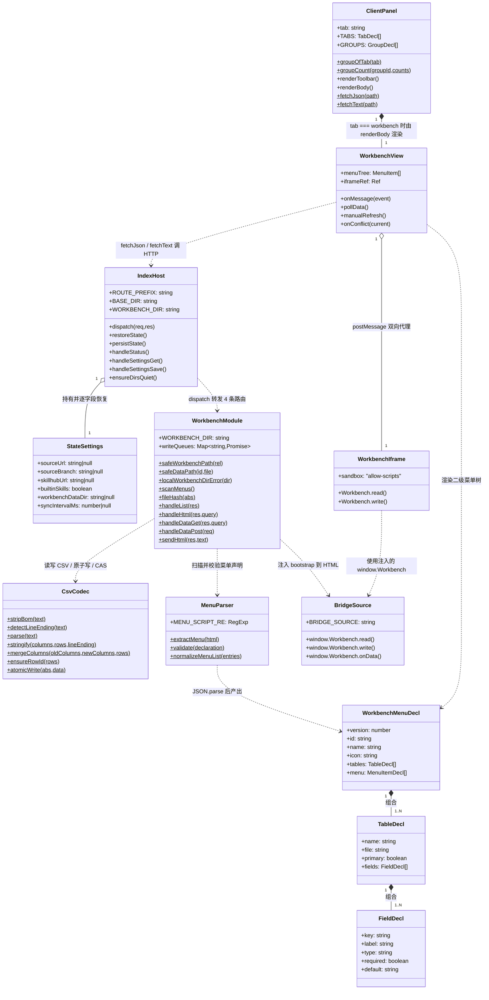
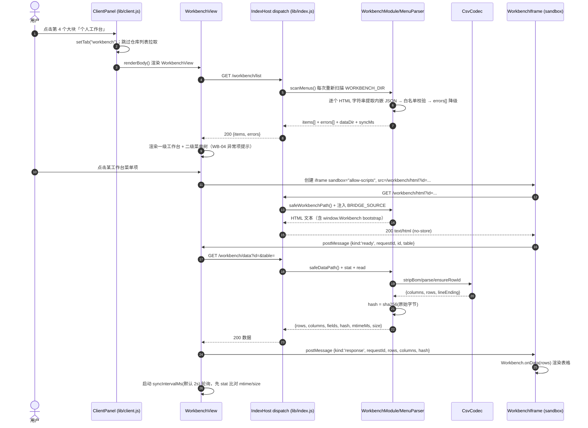
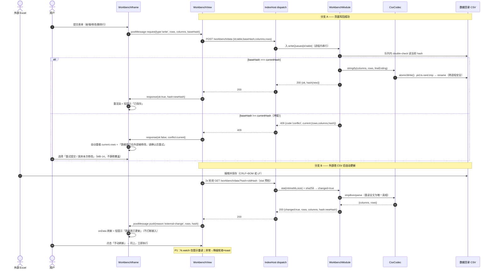
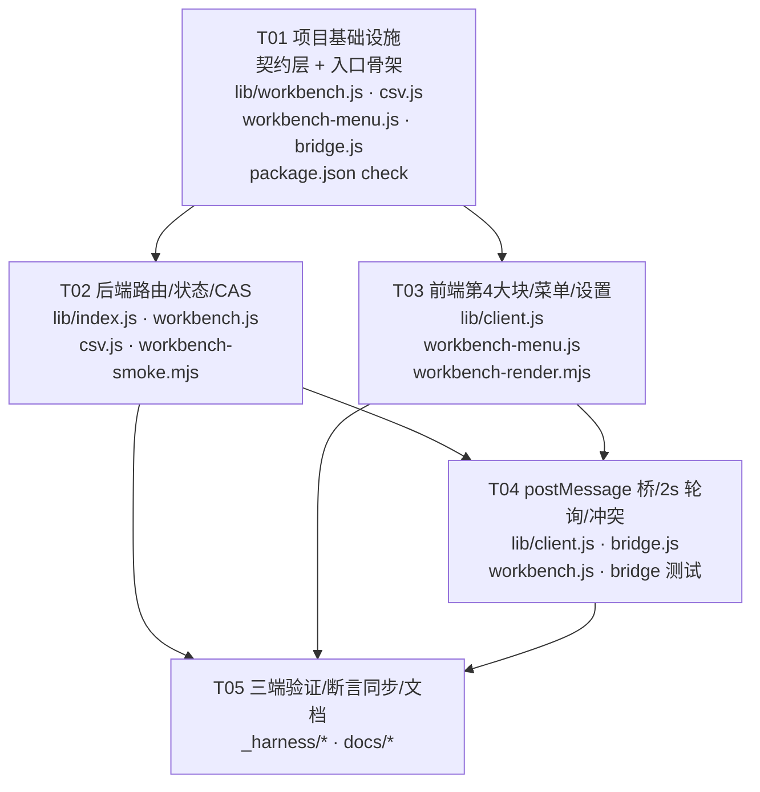

# 个人工作台 · 系统设计与任务分解（定稿）

> **文档类型**：正式系统设计（SOP 设计阶段产物），是 Engineer 实现的唯一依据。**状态：已定稿，无待确认项。**
> **输入**：`docs/workbench-prd.md`（WB-01~WB-22 / US-1~US-6 / §5 UI / §7 Out of Scope）+ 只读代码预研（行号见下）。
> **产品口径已定**：菜单声明内嵌 HTML JSON；用户任务搭配菜单（A+C）列 P1；HTML 目录与数据目录分离；轮询 2s 可配 + 手动刷新；`fs.watch` 仅 P1 加速；乐观并发 CAS；纯本地单机；扩展走「AI 重新生成 HTML」；Win/Linux/macOS 三端；只做数据驱动工作台、既有四 Tab 行为不回退。
> **定稿修订记录**：主理人裁决 D1 = **(b) Panel 内新增第 4 个大块**、D2 = **允许同步更新结构计数类硬断言 + 另建新用例**、Q1 = **HTML 内嵌 JSON 声明 + 字符串切片/正则提取 + `JSON.parse` + 白名单校验**；M1~M4 全部采纳；M4① 定为**插件不提供 HTML 写接口**；Q7（PRD v1.1 新增）即 D1，**已定 (b)，不再二选一**。两个设置字段定名为 `workbenchDataDir` + `syncIntervalMs`。
> **约束**：本次只产出本文档，未改动任何代码 / 配置 / 测试文件。

---

# Part A · 系统设计

## 1. 实现方案与框架选型

### 1.1 技术难点与取舍

| # | 难点 | 方案 | 依据 |
| --- | --- | --- | --- |
| 1 | 返回 HTML 而非 JSON | 新增 `sendHtml()`，`Content-Type: text/html; charset=utf-8` + `Cache-Control: no-store`；**不复用** `send()`（`lib/index.js:237-240` 只发 JSON）也不复用 `sendImage()`（`:277-297`，`IMAGE_MIME` `:180-188` 不含 `.html`） | 预研 §1 |
| 2 | 路径越界 | 新写 `safeWorkbenchPath()` / `safeDataPath()`，照抄 `safeRepoPath()` `:2762-2779` 的 `path.resolve` + `root + path.sep` 前缀 + `fs.realpathSync` 二次校验；**两个不同 root** | 主理人 M1 |
| 3 | HTML 与插件路由同源导致脚本越权 | `iframe sandbox="allow-scripts"`（**不给 `allow-same-origin`**）+ **postMessage 桥**；父组件只代理工作台数据接口 | 本设计 §3.4 |
| 4 | 零依赖 CSV | 自写状态机解析/序列化 `lib/csv.js`（引号、逗号、字段内换行、`""`、BOM、CRLF/LF、按字段名对齐列的合并写） | 主理人 M4② |
| 5 | 双向同步一致性 | `sha256(原始字节)` CAS + 2s `fs.statSync` 预检 + 重读全文为唯一真相 + tmp→rename 原子写 + 单进程内串行化 | PRD §3.3 / WB-14 / 主理人 M3 |
| 6 | 宿主 CSP 不可证 | 三级回退（外链桥脚本 → srcdoc → 父组件只读表格）+ 三端实机验证项 | 本设计 §5 |

**不引入任何新东西的理由**：PRD §0 `:17` 明确「不新增 npm 依赖、不引入前端框架与构建链」；`package.json:16-22` `files:["lib"]` + `:23-28` `exports` 只暴露 `./client`，`lib/client.js:1-5` 是 `window.__ModuleLoader__` 单文件。新增前端文件要改 exports 与加载器，回归面大，故前端逻辑全部内聚在 `lib/client.js`。后端沿用 Node 内置 `fs / path / crypto / os / url`，`lib/index.js:21` 已用 `execFile`，无需新增依赖。

### 1.2 架构模式

**分层（后端 host 半 / 前端 client 半，沿用现有结构）**：

```
lib/client.js  Panel(第4大块 workbench) → WorkbenchView → 二级菜单 + iframe(父桥) ──postMessage──> iframe(注入桥)
     │ fetchJson / fetchText                                          │
     ▼                                                              ▼
lib/index.js  dispatch ──> lib/workbench.js (4 个 handler) ──> lib/csv.js / lib/workbench-menu.js
                                   │
                                   ▼
                    $DSH_HOME/.../workbench/*.html   +   用户数据目录/<id>/*.csv
```

- **后端**：`lib/index.js` 只做「常量、状态字段、设置接口、dispatch 路由转发」，业务逻辑全在新建的 `lib/workbench.js` / `lib/csv.js` / `lib/workbench-menu.js`（低耦合，可单测）。
- **前端**：`Panel` 内新增**第 4 个大块**及其二级菜单（§1.3），工作台视图自绘，既有四 Tab 行为不回退。
- **契约驱动**：菜单声明 JSON（§3.2）+ postMessage 协议（§3.4）+ CAS 接口（§3.3）三份契约先行，前后端可并行实现。

### 1.3 关键选型（D1 已定 = (b)）：Panel 内新增第 4 个大块 + 大块内二级菜单

**术语统一**：现状 `client.js:77-82` `TABS` = **4 个**，`GROUPS` `:85-89` = **3 个大块**（expert / skill / connector）；`_harness/render.mjs:440` 断言的是**大块数 3**。工作台新增的是 **1 个大块（3 → 4）+ 该大块内二级菜单**，共用现有唯一侧栏图标，**不新增 `slots.register`、不动 `main` keyed 槽**。

| 改动点（`lib/client.js`） | 做法 |
| --- | --- |
| `TABS` `:77-82` | 追加 `{ id:"workbench", label:"个人工作台", countKey:"workbench", placeholder:"搜索工作台" }` |
| `GROUPS` `:85-89` | 追加 `{ id:"workbench", label:"个人工作台", icon:"workbench", children:["workbench"] }` |
| `groupOfTab()` `:96-101` | **无需改**：新 group 的 `children` 含 `"workbench"`，自动返回 `"workbench"`，不再兜底 `"expert"` |
| `groupCount()` `:107-110` | **无需改**：按 `countKey` 读 `counts.workbench`；后端 `handleStatus()` `lib/index.js:3017` 新增 `counts.workbench`（工作台数，未配置数据目录时为 0） |
| 大块 Tab 行 `:5240-5251` | `GROUPS.map` 自动多渲染 1 个 `dshe-tab` + 1 个 `dshe-tab-badge` |
| 二级菜单树 | 在 `:5253`（expert 子分组）、`:5270`（skill 子分组）分支之后，新增 `groupOfTab(tab) === "workbench"` 分支：渲染「一级工作台 → 二级菜单项」树，数据来自 `GET /workbench/list` |
| 列表拉取 `:4085` | 加 `if (tab === "workbench") return`，跳过 `listPath()` `:658` 的仓库列表请求（工作台数据走 `/workbench/list`，不复用 `data[tab]`） |
| 工具栏 `renderToolbar()` `:5023` | 加 `if (tab === "workbench") return h(WorkbenchToolbar, {...})`：标题、手动刷新、最后同步时间、当前数据目录（点击跳设置） |
| 主内容区 `renderBody()` `:5102` | 在 `status === null` 检查之后、其它 `tab === ...` 分支之前加 `if (tab === "workbench") return h(WorkbenchView, {...})` |
| 工作台视图宽度 | `WorkbenchView` 用 `display:flex`：左侧二级菜单固定宽（≈220px）+ 右侧 iframe `flex:1; min-width:0; width:100%`。主内容区容器与现有四 Tab 共用，**满足 PRD §5「HTML 展示区需足够宽度、不得挤成窄列表」的产品底线** |
| 断言 | `render.mjs:430`（badge `'0,0,0'` → `'0,0,0,0'`）、`:440`（3 → 4）**按 D2 同步更新**；`:349`（2 插槽）、`:353-355`（main key / 侧栏 order 12 / 固定 label）**保持不变** |

**为什么选 (b) 而不是 (a)**：`sidebar.panellist` 是 list 槽，动态增删条目要 `register`/disposer 生命周期配合（`client.js:7245` `ctx.effect` 是范例），且要给 `main` keyed 槽配第二个 `key`——**宿主是否允许插件注册第二个 `main` 面板无法从本仓库代码证明**（`README.md:18` 只说明 `main` 是 keyed 槽、`sidebar.panellist` 是 list 槽），属运行时推断；(b) 完全不碰这两处。PRD §5「侧栏右侧主区域承载 HTML」在 (b) 下同样成立（Panel 主区域放 iframe）；PRD §7.9「不回退既有行为」不构成选 (a) 的理由。**`:349` / `:353` 不用改，正是选 (b) 的实测收益。**

> Q7 已定 (b)，本节不留二选一表述；PRD v1.1 的 Q7 即 D1，主理人已要求 PM 改为「已定」。

### 1.4 跨平台落地

| 项 | 结论 | 依据 |
| --- | --- | --- |
| HTML 目录 | `WORKBENCH_DIR = path.join(BASE_DIR, 'workbench')`，`BASE_DIR` `lib/index.js:120`；由 `DSH_HOME` `:114-117` 派生（`process.env.DSH_HOME` 可覆盖，**不硬编码 `~/.dsh`**）；**只放 HTML，绝不产生 CSV** | `PLUGIN_ROOT` `:71` 是发布包只读（注释 `:64-70`） |
| 数据目录 | `state.settings.workbenchDataDir`，用户选定、持久化，CSV 在 `<数据目录>/<工作台 id>/<表名>.csv` | 主理人 M1 / M2 |
| 目录选择 | **P0 用「手输绝对路径 + 后端 `parseLocalSource()` `:734-751` 校验 + 可读写探测」**，不以 `webkitdirectory` 为权威路径来源 | `FolderImportDialog` `client.js:2489` / `:2724` 上传的是**文件内容**而非路径，Chromium 外还有降级注释 `:2478` |
| 目录校验 | 新写 `localWorkbenchDirError(dir)`：存在、`fs.accessSync(R_OK\|W_OK)`、可创建 `<id>/` 子目录、拒绝相对路径/控制字符；**不复用 `localDataRootError()` `:623-629`**（硬编码 `experts/\|skills/\|connectors/`） | 预研 §4 |
| 含中文/空格路径 | `parseLocalSource()` `:734-751` 三端通用（POSIX 绝对 / Windows 盘符 / UNC / `~` / `file://` + `path.resolve`）；前端 `encodeURIComponent` 传参 | WB-05 / WB-15 |
| Win CRLF + UTF-8 BOM | `lib/csv.js` 剥 `\uFEFF`、识别并沿用首次创建的换行风格 | WB-16；`readTextSafe()` `:382-387` **不剥 BOM** |
| macOS 与 `builtinPlatform()` | `lib/index.js:77-79` 把 darwin 归 `builtin/linux`（全库唯一 `process.platform`）。**工作台代码不读 `builtin/`，故对本功能零影响；本期不改 `builtinPlatform()`、不新增 `builtin/darwin/`** —— 若新增平台目录会触发 `scripts/check-package.mjs:131-173` 的平台遍历/计数断言，需另立任务 | 主理人指定正面回答 |
| `fs.watch`（P1） | 仅作「提示重读」，正确性始终由**重读 CSV 全文**保证；监听异常/事件丢失 → 自动降级 2s 轮询 + toast「已切换为定时检查」；网络盘/同步盘下仍走轮询 | PRD §3.3 `:98-101` / WB-13 / WB-17 |

---

## 2. 文件清单

> **新建英文目录/文件约定**：运行时数据在 `BASE_DIR/workbench/`（英文子目录，不直接放工作空间根）；代码全部放已有英文目录 `lib/` 下的**英文文件**；测试放 `_harness/` 下的英文 `.mjs`。`package.json:17` `files:["lib"]` 自动覆盖新 `lib/*.js`；**`exports` `:23-28` 不动**；**`cordis.patch.yml` 不动**（无新宿主服务/插槽）。

### 2.1 新建

| 相对路径 | 类型 | 职责 |
| --- | --- | --- |
| `lib/workbench.js` | 后端模块 | `WORKBENCH_DIR`、`safeWorkbenchPath()` / `safeDataPath()`、`localWorkbenchDirError()`、菜单目录扫描、`fileHash()`、写队列、`bootstrap` 注入、4 个路由 handler、`sendHtml()` |
| `lib/csv.js` | 后端模块 | `parse()` / `stringify()` / **`mergeColumns()`（按字段名对齐列的合并写，新列留空、已有行全保留）** / `atomicWrite()` / `detectLineEnding()` / `stripBom()` / `ensureRowId()` |
| `lib/workbench-menu.js` | 后端模块 | 菜单声明 JSON schema（§3.2）、`extractMenu()` 安全提取、白名单校验、WB-04 降级 `normalizeMenuList()` |
| `lib/workbench-bridge.js` | 后端模块 | `BRIDGE_SOURCE` 字符串常量（注入 iframe 的 bootstrap 脚本）+ 外链桥脚本路由响应体 |
| `docs/workbench-design.md` | 文档 | 本设计（**本次唯一落盘产物**） |
| `_harness/workbench-smoke.mjs` | 测试 | 新路由 404 / `../` 穿越 / MIME / CSV 往返 / CAS 409 / 菜单非法降级 |
| `_harness/workbench-render.mjs` | 测试 | 4 个大块 Tab / 工作台二级菜单树 / iframe sandbox 属性 / 设置分区 / 展示区宽度 |
| `_harness/workbench-settings.mjs` | 测试 | 两设置字段的持久化、不传保持原值、传空串清除、非法值 400 |
| `$DSH_HOME/dsh-buddy-expert-hub/workbench/` | 运行时目录 | 由 `ensureDirsQuiet()` `:873-879` 创建；**只放 HTML（含内嵌菜单声明）** |

### 2.2 修改

| 相对路径 | 改动位置 | 改动内容 |
| --- | --- | --- |
| `lib/index.js` | `:120` 附近 / `:873` | 加 `WORKBENCH_DIR`；`ensureDirsQuiet()` 建 HTML 目录 |
| `lib/index.js` | `:206` / `:218` | `state.settings` 加 **`workbenchDataDir: null`、`syncIntervalMs: null`** + JSDoc 类型 |
| `lib/index.js` | `:925-942` 后 | `restoreState()` 逐字段白名单**必须显式新增两个校验分支**（漏加 → 重启丢失） |
| `lib/index.js` | `:3017` `handleStatus()` | `counts` 加 `workbench`（供大块 badge） |
| `lib/index.js` | `:3116-3144` / `:3159` | `handleSettingsGet()` 加返回字段；`handleSettingsSave()` 加两字段「**可选、不传保持原值、传空串清除**」解析；**保持 `:3172-3232` 现有校验顺序与 `sourceUrl` 必填不变** |
| `lib/index.js` | `:8420` 附近 / `:8690` 404 前 | `dispatch()` 加 4 条路由分支（§3.3）；**不提供任何 HTML 写接口** |
| `lib/index.js` | `:977` | `persistState()` **不用改**（整体序列化 `state.settings`） |
| `lib/client.js` | `:77-82` / `:85-89` | `TABS` / `GROUPS` 各加 1 项（§1.3） |
| `lib/client.js` | `:604` 附近 | 新增 `fetchText()`（`fetchJson()` `:604-606` 只 `.json()`） |
| `lib/client.js` | `:3333` `SettingsDialog` | 新增「个人工作台」分区：数据目录、可读写状态、`syncIntervalMs`（默认 2s）、打开 HTML 目录；**保持 `:3493` `fetch(API + "/settings", {` 与 `:3508`「已保存，下次同步生效」字符串不变** |
| `lib/client.js` | `:4085` / `:5023` / `:5102` / `:5240-5270` | 跳过仓库列表拉取、工作台工具栏、`WorkbenchView` 分支、二级菜单树分支（§1.3） |
| `lib/client.js` | `:6887` 轮询模板 | 2s 轮询父桥 + 立即对账事件 + cleanup |
| `package.json` | `:29-32` | `check` 脚本追加 4 个 `node --check`；`files` / `exports` **不改** |
| `docs/user-guide.md`、`README.md` | — | 工作台设置、菜单声明格式、双向同步口径、三端路径差异 |
| `_harness/render.mjs` | `:430` / `:440` | **按 D2 同步**：badge → `'0,0,0,0'`、大块数 3 → 4；`:349` / `:353-355` **保持不变** |
| `_harness/smoke42.mjs` / `smoke44.mjs` / `smoke45.mjs` | 见 §9 | 逐条核对结论：**无需修改**；仅另建 `workbench-settings.mjs` 新用例 |

**不改**：`lib/frontmatter.js`、`lib/connector-*.js`、`lib/client.js` 的既有四 Tab **渲染逻辑**（只新增 `tab === "workbench"` 分支与 `GROUPS`/`TABS` 数据项）、`cordis.patch.yml`、`package.json` 的 `exports`、`builtin/` 任何目录。

---

## 3. 数据结构与接口

### 3.1 状态字段（`state.settings`，`lib/index.js:218`）

| 字段 | 类型 | 默认 | 校验 | 说明 |
| --- | --- | --- | --- | --- |
| `workbenchDataDir` | `string\|null` | `null` | `parseLocalSource()` `:734` → `kind==='local'` → `localWorkbenchDirError()`；非法 400 | 用户选定的 CSV 数据目录（绝对路径）。空串 = 清除 |
| `syncIntervalMs` | `number\|null` | `null`（回落 2000） | 整数 `500..60000`；非法 400 | 轮询间隔，PRD `:140` 默认 2s 可配 |

**两个字段必须同时改**：`state` 初始值 `:218`、JSDoc `:206`、`restoreState()` `:925-942` 后新增分支、**`handleSettingsGet()` `:3120-3143`、`handleSettingsSave()` `:3172` 起**、`SettingsDialog` `client.js:3333`。`persistState()` `:977` 无需改。

### 3.2 菜单声明 JSON schema（Q1 已定：HTML 内嵌）

**载体**（AI 生成的 HTML 内）：`<script type="application/json" id="workbench-menu">{ ... }</script>`（单文件自包含，不用旁置 `.menu.json`）。

| 字段 | 类型 | 必填 | 约束 |
| --- | --- | --- | --- |
| `version` | number | ✅ | 必须 `1` |
| `id` | string | ✅ | `^[a-z0-9][a-z0-9-]{0,63}$`，作为数据目录子目录名，**禁止 `/`、`\`、`..`** |
| `name` | string | ✅ | ≤ 80 字 |
| `icon` | string | ❌ | ≤ 40，映射现有 `Icon` 集（`client.js:1588` 起） |
| `tables[]` | array | ✅ | 1..N；**P0 只消费 `primary===true` 的一张（无则取 `[0]`）**，结构预留多表（WB-10 P1） |
| `tables[].name` | string | ✅ | `^[a-z0-9_]{1,64}$` |
| `tables[].file` | string | ✅ | `^[A-Za-z0-9._-]+\.csv$`，**不允许路径分隔符与 `..`** |
| `tables[].primary` | boolean | ❌ | 默认 `false` |
| `tables[].fields[]` | array | ✅ | 每项 `{key,label,type,required,default,options?}` |
| `fields[].key` | string | ✅ | `^[a-z0-9_]{1,64}$`，**必须含 `_id`**（稳定行标识，PRD `:88`） |
| `fields[].type` | enum | ✅ | `string\|number\|date\|boolean\|enum`；`enum` 需 `options: string[]` |
| `fields[].label` | string | ✅ | 展示名 ≤ 80 |
| `fields[].required` | boolean | ❌ | 默认 `false` |
| `fields[].default` | string | ❌ | 值格式遵 PRD `:87` |
| `menu[]` | array | ✅ | 1..N 菜单项 |
| `menu[].id` | string | ✅ | `^[a-z0-9-]{1,64}$` |
| `menu[].label` | string | ✅ | ≤ 80 |
| `menu[].view` | string | ❌ | 页面内定位（`#anchor`），父组件加载 iframe 后透传 |
| `menu[].prompt` | string | ❌ | **P1（Q2 A+C）**，可选提示词；P0 忽略 |
| `syncMs` | number | ❌ | **P1**，覆盖全局 `syncIntervalMs` |

**示例**（读书记录）：

```json
{
  "version": 1,
  "id": "reading-log",
  "name": "读书记录",
  "icon": "book",
  "tables": [{
    "name": "books", "file": "books.csv", "primary": true,
    "fields": [
      { "key": "_id", "label": "ID", "type": "string", "required": true },
      { "key": "title", "label": "书名", "type": "string", "required": true },
      { "key": "score", "label": "评分", "type": "number" },
      { "key": "finished_at", "label": "读完日期", "type": "date" }
    ]
  }],
  "menu": [
    { "id": "overview", "label": "总览", "view": "#overview" },
    { "id": "add", "label": "添加记录", "view": "#add-form", "prompt": "帮我记一条读书记录" },
    { "id": "stats", "label": "年度统计", "view": "#stats" }
  ]
}
```

**安全解析（绝不执行 HTML）**：
1. `readTextSafe()` `lib/index.js:382` 读 HTML（≤ 2MB 上限）。
2. `lib/workbench-menu.js` 用**零依赖字符串切片 / 只读正则**提取指定 `<script type="application/json" id="workbench-menu">` 块文本 → `JSON.parse` → **白名单字段校验**。**不 `eval`、不 `new Function`、不加载 DOM 解析器、不执行 HTML**。
3. 生成侧约定：JSON 内若出现 `</script>` 字面量，AI 生成时必须写成 `\u003c/script\u003e`；截断 → `JSON.parse` 失败 → 走降级。
4. **WB-04 降级**：单个 HTML 缺失/非法 → 记入 `errors[]`，**其余工作台照常返回**；前端给明确提示 +「跳过 / 以默认项展示」可操作下一步，不白屏。
5. 菜单目录扫描：`GET /workbench/list` **每次重新 `fs.readdirSync(WORKBENCH_DIR)`** → 满足 WB-03「增删 HTML 后菜单随之增减」，**P0 无需文件监听**。

> 不用 `lib/frontmatter.js:82` 的 `parseFrontmatter()`（YAML frontmatter 解析，`unquote()` `:27-35`），不适用于 JSON script 块。**#12 预研 §6 那条建议作废。**

### 3.3 HTTP 接口（挂在 `ROUTE_PREFIX` `lib/index.js:102` 下，自动继承 `localRequestGuard()` `:8308-8328` / dispatch `:8354`）

统一响应 `{ok,...}` / `{ok:false,error,code?}`；`send()` `:237` 发 JSON；HTML 用 `sendHtml()`。**共 4 条只读/数据路由，不提供任何 HTML 写接口。**

#### `GET /workbench/list`

| 项 | 内容 |
| --- | --- |
| 请求 | 无参数 |
| 响应 | `{ ok:true, htmlDir, dataDir: string\|null, syncMs: number, items:[{id,name,icon,tables,menu,file,hash}], errors:[{file,reason}] }` |
| 说明 | `dataDir === null` → 空态「先在设置里选择本地数据目录」；`errors[]` 供 WB-04。**每次调用重新扫描 HTML 目录**：AI 生成 / 删除 HTML 落盘后，用户点「刷新列表」即生效，**无需重启宿主进程**（主理人 M4①）；P1 才需要 watch |

#### `GET /workbench/html?id=<id>`

| 项 | 内容 |
| --- | --- |
| 请求 | `id` 匹配菜单 schema 的 `id` 正则 |
| 处理 | `safeWorkbenchPath(id + '.html')`（**HTML root 专属**）→ 读取 → 在 `</head>` 前（无 head 则 `<body>` 开头）**注入 `BRIDGE_SOURCE`** → `sendHtml()` |
| 响应 | `200 text/html; charset=utf-8; Cache-Control: no-store`；非法 id / 缺失 → 404 JSON |
| 安全 | 注入的是插件自己的桥脚本字符串，不执行用户 HTML；HTML 内 `<script>` 由 iframe sandbox 约束（§3.4） |

#### `GET /workbench/data?id=<id>&table=<name>&hash=<可选>`

| 字段 | 类型 | 说明 |
| --- | --- | --- |
| `ok`, `id`, `table` | — | 回显 |
| `columns` | string[] | 表头顺序（来自菜单 `fields[].key`，缺文件时按声明生成） |
| `fields` | object[] | 字段定义，供父组件/桥透传 |
| `rows` | object[] | 行对象（`key → string`），保证 `_id` |
| `hash` | string | **磁盘原始字节 `sha256` hex**；文件不存在时 `''` |
| `mtimeMs`, `size` | number | `fs.statSync`，供 2s 轮询**先比对再决定是否读全文**（避免大表空读） |
| `lineEnding` | `'CRLF'\|'LF'` | 写回沿用 |
| `changed` | boolean | 请求带 `hash` 时：与当前 hash 不同为 `true`（可只回元数据，不带 `rows`） |

#### `POST /workbench/data`（CAS）

| 方向 | 字段 | 说明 |
| --- | --- | --- |
| 请求 | `{ id, table, baseHash, columns, rows }` | `baseHash` = 页面上次读到的 `hash`；`columns` 为写回表头顺序（WB-19 新列由此进入） |
| 成功 200 | `{ ok:true, hash, mtimeMs, size, rows }` | 新 hash |
| 冲突 409 | `{ ok:false, code:'conflict', error:'数据表已在外部被修改，已重新加载，请确认后重试', current:{ rows, columns, hash, mtimeMs, size } }` | **拒绝写入、不静默覆盖**（WB-14 / Q4） |
| 其它 400 | `{ ok:false, code:'invalid-menu'\|'invalid-path'\|'encoding'\|'columns-mismatch', error }` | WB-20 |

**写入流程（并发双保险）**：

```
1. 校验 id/table/file 白名单 → safeDataPath() 得 abs
2. 进入「进程内写队列」writeQueues[id:table]（Promise 链，净新增）
3. 队列内再次读当前磁盘 currentHash（double-check，防跨进程在排队期间改写）
4. baseHash !== currentHash → 409 + current
5. 一致 → csv.stringify(columns, rows, lineEnding) → atomicWrite()
6. 返回新 hash
```

- **单进程内串行**：`Map<string, Promise>` 保证同一 Node 进程内同一表不交错写；不同表可并行。
- **跨进程**：多个 dsh 窗口/进程可能同时指向同一数据目录，靠 tmp→rename 原子写（照抄 `lib/index.js:8086-8096`）+ 写前 double-check；后写者 `baseHash` 已变 → 409。**不假设只有一个写者**。
- **不做通用分布式锁**（主理人 M3）。`lib/` 全库无文件锁（`grep withFileLock` 零命中），宿主 `dsh-plugin-manager` 的 manifest 写锁不是本插件可复用点。
- `atomicWrite()`：临时名 `${file}.${pid}.${Date.now()}.${randomBytes(4)}.tmp`（三端安全），`flag:'wx'` → `fs.renameSync` → `catch` 清理。`crypto` 为 Node 内置。

### 3.4 postMessage 桥协议（最高优先级）

**问题**：`sandbox="allow-scripts"` 且**不给 `allow-same-origin`** → iframe 是 opaque origin，`fetch('/dsh-buddy-expert-hub/...')` 被 CORS/同源判定阻断；但正因如此，iframe 脚本**无法调用** `/import/folder`（`:8510`）、`/library/import`（`:8518`）、`/connectors/create` 等全部写接口，也无法读 parent DOM / cookie。

| 角色 | 职责 |
| --- | --- |
| 后端 `sendHtml()` | 注入 `BRIDGE_SOURCE`（`lib/workbench-bridge.js`），定义 `window.Workbench`（`read / write / onData / onConflict / ready`） |
| iframe 内 AI 生成的 HTML | **只调用 `window.Workbench.*`**，不写 fetch、不写桥实现；插件不要求 AI 懂协议 |
| 父组件 `WorkbenchView`（`lib/client.js`） | 创建 `iframe`（`sandbox="allow-scripts"`、`src=API+'/workbench/html?id='+id`），监听 `message`，白名单代理 `/workbench/data`，回传结果 |

**消息格式**（全部带 magic `__wb: 1`）：

| 方向 | kind | 载荷 |
| --- | --- | --- |
| iframe → parent | `ready` | `{ __wb:1, kind:'ready', requestId, id, table }` |
| iframe → parent | `request` | `{ __wb:1, kind:'request', requestId, type:'read'\|'write', id, table, rows?, columns?, baseHash? }` |
| parent → iframe | `response` | `{ __wb:1, kind:'response', requestId, ok, rows?, columns?, hash?, mtimeMs?, error?, conflict? }` |
| parent → iframe | `push` | `{ __wb:1, kind:'push', id, table, rows, columns, hash, reason:'external-change'\|'manual-refresh' }` |
| parent → iframe | `view` | `{ __wb:1, kind:'view', menuId, view }`（点击二级菜单定位） |

**父组件校验**：`event.source === iframeRef.current.contentWindow` + `__wb===1` + `kind` 白名单 + `id/table` 属于当前工作台；未知消息忽略。回信用 `postMessage(msg, '*')`（opaque origin 下只能 `'*'`；不含敏感数据且 iframe 已 sandbox 隔离）。**iframe 侧**：`requestId = crypto.randomUUID()`、`Map<requestId,{resolve,reject,timer}>`、**5s 超时**给可读错误；`read()` 返回 `{rows,columns,hash}`，`write()` 内部带 `baseHash`；收到 `push` → `onData` 刷新；收到 `conflict` → `onConflict`（自动重载 + 提示）。

**父组件只代理 `/workbench/data` GET/POST**，桥协议里不存在任意路由调用能力 —— 这是「不给 allow-same-origin」之外第二道边界。

**bootstrap 三种落地**（对应 §5 CSP 回退）：① 首选后端内联注入；② CSP 禁内联脚本 → `GET /workbench/bridge.js` 外链桥脚本（`application/javascript`）；③ iframe 整体被禁 → 见 §5。

### 3.5 类图（Mermaid classDiagram）



---

## 4. 程序调用流程（Mermaid sequenceDiagram）

### 4.1 打开工作台并首次加载数据



### 4.2 页面写回 + 外部改 CSV 后的自动更新与冲突分支



---

## 5. Anything UNCLEAR（仅运行时不可证项，无待拍板项）

### 5.1 已裁决决策清单（Engineer 直接执行，不再询问）

| 编号 | 决策 |
| --- | --- |
| **D1 / Q7** | **选 (b)**：`Panel` 内新增第 4 个大块 + 大块内二级菜单；不新增 `slots.register`、不动 `main` keyed 槽；`:349` / `:353-355` 保持不变 |
| **D2** | 允许同步更新结构计数类硬断言（`render.mjs:430` / `:440`）+ 另建新用例；PRD §8 `:233`「不改动现有断言」作废 |
| **Q1 / D3** | HTML 内嵌 JSON 菜单声明；零依赖字符串切片/正则 + `JSON.parse` + 白名单；**不用 `parseFrontmatter`（YAML，`:82`）**；WB-04 单文件降级 |
| **M1** | HTML 目录（固定，`BASE_DIR/workbench`）与 CSV 目录（`workbenchDataDir`，按 `<id>/<表名>.csv`）分离，两个 `safe*Path()` root |
| **M2** | `syncIntervalMs` 默认 2s 可配；`workbenchDataDir` + `syncIntervalMs` 两字段都要在 `restoreState()` `:925-942` 显式加校验；先 `stat` 预检再读全文 |
| **M3** | CAS 简化版：快照 hash 比对 + tmp→rename 原子写 + 单进程内串行化；不做通用分布式锁 |
| **M4①** | **插件不提供 HTML 写接口**。HTML 由 dsh agent 直接落盘到 `WORKBENCH_DIR`（AI 工作流职责，WB-18）；插件只扫描 / 校验 / 读取 / 返回 `text/html`。**生效方式：agent 落盘后用户点「刷新列表」即可，无需重启宿主进程**（`GET /workbench/list` 每次重扫目录）。理由：多开一个写接口会扩大同源脚本攻击面；P1 才需要 watch |
| **M4②** | `lib/csv.js` 支持**按字段名对齐列的合并写**（新列留空、已有行全保留，WB-19），不是整表覆盖 |
| **Q2 / Q4 / Q5 / Q6** | 按 PRD 推荐默认：A+C（P1）、乐观并发 CAS、纯本地单机、「在线存储」= 数据外置 CSV 非云端 |

### 5.2 运行时不可证项（需三端实机验证 + 回退路径）

| # | 项 | 推荐默认 | 回退路径 |
| --- | --- | --- | --- |
| U1 | 宿主 CSP 是否允许 iframe `src` 到插件路由 / 内联 bootstrap / `srcdoc` | 后端 `sendHtml` 内联注入 `BRIDGE_SOURCE` | ① 禁内联脚本 → `GET /workbench/bridge.js` 外链桥脚本；② iframe 整体被禁 → **父组件只读表格视图**（沿用 `h("div",{className:"dshe-readme"})` `client.js:3122` 风格或自绘表格），仍可读写 CSV 但失去自定义 HTML 布局；③ `srcdoc` 中间态同样受 CSP 约束 |
| U2 | `fs.watch` 三端 / 网络盘 / 同步盘行为 | P0 完全不依赖；P1 仅加速 | 监听异常 → 2s 轮询 + toast「已切换为定时检查」 |
| U3 | `webkitdirectory` 在 Chromium 外降级 | P0 不用于路径选择，仅作「浏览后回填提示文案」辅助 | 手输路径 + 后端 `parseLocalSource()` 校验为权威 |

**必须三端实机验证才能定案**：iframe sandbox + postMessage 可达性、宿主 CSP `script-src`/`frame-src`、`srcdoc`、注入脚本执行、Win 盘符+中文+空格路径、CRLF+BOM 读写、`fs.watch` 三端、网络盘/同步盘轮询、`webkitdirectory` 降级、**宿主是否允许插件注册第二个 `main` 面板**（D1 选 (b) 后不需要，故不阻塞）。本项目代码无法证明宿主 CSP 行为（`send()` `:238` 与 `sendImage()` `:291-295` 均未设置 CSP 头）。

---

# Part B · 任务分解

## 6. Required Packages

**无**（零 npm 依赖，PRD §0 `:17`）。仅用 Node 内置 `fs / path / crypto / os / url / zlib` 与浏览器内置 `crypto.randomUUID()` / `postMessage` / `iframe sandbox`。不新增构建链、不新增前端框架、不改 `package.json` 的 `dependencies` 与 `exports`。

## 7. Task List（按依赖顺序，P0 为本期）

> 零依赖增量项目没有「依赖声明/构建配置」，故 **T01 = 常量与契约层 + 发布清单校验**（等价于基础设施任务），全部新建英文文件集中在 `lib/`。任务数 ≤5，每个 ≥3 文件。

| Task ID | Task Name | Source Files（★新建 / △修改） | Dependencies | Priority | 完成判据 |
| --- | --- | --- | --- | --- | --- |
| **T01** | **项目基础设施：契约层与入口骨架** | ★`lib/workbench.js`（`WORKBENCH_DIR`/`safeWorkbenchPath`/`safeDataPath`/`localWorkbenchDirError`/`fileHash`/写队列骨架/4 handler 空壳/`sendHtml`）<br>★`lib/csv.js`（`parse/stringify/mergeColumns/ensureRowId/atomicWrite`，含 BOM/CRLF/引号状态机）<br>★`lib/workbench-menu.js`（§3.2 schema、`extractMenu` 字符串切片+`JSON.parse`、白名单、WB-04 降级）<br>★`lib/workbench-bridge.js`（`BRIDGE_SOURCE` + 协议常量）<br>△`package.json:29-32`（`check` 追加 4 个 `node --check`；`files`/`exports` 不动） | 无 | **P0** | 4 模块 `node --check` 通过；CSV 引号/逗号/字段内换行/BOM/CRLF 往返字节一致；**`mergeColumns` 按字段名对齐列后新列留空、已有行全保留（WB-19）**；`extractMenu` 对非法 HTML 返回 `errors[]` 不抛异常、**不执行 HTML**；`npm run check` 通过 |
| **T02** | **后端路由、状态与 CAS 写入** | △`lib/index.js`（`:120`/`:873`/`:206,218` 两字段/`:925-942` 后 restoreState 两分支/`:3017` counts.workbench/`:3116,3159` 设置接口/`:8420` 附近 dispatch 4 路由/`:8690` 404 前）<br>△`lib/workbench.js`（list 每次重扫、html 注入 bootstrap、data GET/POST、CAS 队列+double-check、409；**不提供 HTML 写接口**）<br>△`lib/csv.js`（原子写/列对齐/编码错误码）<br>★`_harness/workbench-smoke.mjs` | T01 | **P0** | `GET /workbench/list` 每次重扫且单个非法 HTML 不影响其它；agent 落盘新 HTML 后**刷新列表即出现、无需重启**；`/workbench/html` 拦截 `../` 与非法 id 且返回 `text/html; no-store`；POST 同 hash 成功返回新 hash、旧 hash 409+`current`；两个并发写不互覆盖；两设置字段重启后仍在；**`handleSettingsSave()` `:3172-3232` 现有校验顺序不变** |
| **T03** | **前端第 4 大块、二级菜单与设置分区** | △`lib/client.js`（`:77-82` `TABS` / `:85-89` `GROUPS` 各加 1 项、`:604` `fetchText()`、`:4085` 跳过仓库拉取、`:5023` 工作台工具栏、`:5102` `WorkbenchView` 分支、`:5240-5270` 二级菜单树、`:3333` 设置分区）<br>△`lib/workbench-menu.js`（前端菜单归一化纯函数）<br>★`_harness/workbench-render.mjs` | T01（契约解耦，可并行 mock） | **P0** | 既有四 Tab 渲染逻辑零回退；**`render.mjs:430` 同步为 `'0,0,0,0'`、`:440` 同步为 4；`:349`/`:353-355` 保持不变**；新大块用 `dshe-tab`/`dshe-tab-badge`；`WorkbenchView` 右侧 iframe `flex:1; min-width:0` 满足 PRD §5 宽度底线；设置分区显示路径/可读写/同步间隔；`:3493`/`:3508` 字符串不变 |
| **T04** | **postMessage 桥、2s 轮询与冲突 UI** | △`lib/client.js`（父桥白名单/代理/回传、`:6887` 2s 轮询模板 + 立即对账 + cleanup、手动刷新、冲突提示）<br>△`lib/workbench-bridge.js`（iframe 侧 `window.Workbench.*`、`requestId`、5s 超时、`push`/`conflict` 回调）<br>△`lib/workbench.js`（注入 bootstrap；U1 回退的 `/workbench/bridge.js` 外链路由）<br>★`_harness/workbench-bridge.mjs` | T02, T03 | **P0** | iframe `sandbox="allow-scripts"` 且**不含 `allow-same-origin`**；iframe 无法直调任何插件写接口（仅经桥白名单）；`ready/request/response/push/view` 五类消息符合 §3.4；5s 超时可读错误；**先 stat 预检再读全文**；外部改 CSV 后 ≤2s 内页面更新不丢行；409 自动重载 + 重试/放弃 |
| **T05** | **三端验证、断言同步与文档** | △`_harness/render.mjs`（`:430`/`:440` 按 D2 同步；逐条核对 §9 结论）<br>★`_harness/workbench-settings.mjs`（两字段持久化/不传保持/空串清除/非法值 400）<br>★`_harness/workbench-smoke.mjs`（三端 fixture）<br>△`docs/user-guide.md`、`README.md` | T02, T03, T04 | **P0** | Win/Linux/macOS 各跑一次「选目录 → 写 → 外部改 → 自动更新」；CRLF+BOM 不错列；非 UTF-8 明确报错；`smoke44.mjs` / `smoke45.mjs` **逐条核对无回归**（§9）；`npm run check` + 全部 harness 通过；文档覆盖设置、菜单声明、桥协议、agent 落盘生效方式 |

**P1 / P2 增量（P0 验收后另派，不占本期 5 任务）**：WB-07 用户任务搭配菜单（A+C）、WB-10 多表消费、WB-13/17 `fs.watch` 加速与降级、WB-21 本地版本备份、WB-22 非 UTF-8 探测转码。菜单 schema 已预留 `menu[].prompt` 与 `tables[]`，P0 无需返工承接。**HTML 写接口不做**（M4① 已定）。

## 8. Shared Knowledge（跨文件约定，Engineer 必读）

| 约定 | 内容 |
| --- | --- |
| API 前缀 | `/dsh-buddy-expert-hub/...`（`ROUTE_PREFIX` `lib/index.js:102`，前端 `API` `client.js:22`）；HTML 内绝对路径必须带前缀 |
| 响应格式 | `{ok:true,...}` / `{ok:false,error,code?}`；`send()` `:237` 只发 JSON；HTML 走 `sendHtml()` |
| 同源门禁 | `localRequestGuard()` `:8308-8328` 是 dispatch `:8354` 全局前置，新路由自动继承；**不要重复实现** |
| 路径 root | `WORKBENCH_DIR = path.join(BASE_DIR,'workbench')` 只放 HTML；CSV 在 `state.settings.workbenchDataDir/<id>/<file>`；`safeWorkbenchPath` / `safeDataPath` **两个不同 root** + `realpathSync` 二次校验 |
| 菜单 magic | 内嵌 `<script type="application/json" id="workbench-menu">`；JSON 中 `</script>` 写成 `\u003c/script\u003e`；**只读字符串提取 + `JSON.parse` + 白名单，绝不执行 HTML** |
| 桥 magic | 所有 postMessage 带 `__wb: 1`；父组件校验 `event.source` + `kind` 白名单；`requestId` 用 `crypto.randomUUID()`；超时 5000ms；回信 `targetOrigin:'*'` |
| 版本标识 | `hash = sha256(磁盘原始字节)` hex；`mtimeMs`/`size` 仅作轮询预检；CAS 以 hash 为准 |
| 写入 | `writeQueues[id:table]` 进程内串行 + 队列内 double-check + tmp→rename 原子写（`:8086-8096` 模板）；**不假设只有一个写者**；**不做通用分布式锁，也不引用任何「现有文件锁」**（`grep withFileLock lib/` 零命中，宿主 `dsh-plugin-manager` 的锁不是本插件可复用点） |
| CSV | UTF-8 only，剥 `\uFEFF`，沿用首次创建的 `lineEnding`，按 `columns` 顺序，`_id` 稳定行标识，含 `,`/`"`/`\n`/`\r` 时引号包裹 + `""` 转义；`mergeColumns` 按字段名对齐、新列留空 |
| 设置字段语义 | `workbenchDataDir` / `syncIntervalMs` **可选、不传保持原值、传空串清除**；`handleSettingsSave()` `:3172-3232` 的 `sourceUrl` 必填与**现有校验顺序**保持不变；`restoreState()` `:925-942` 逐字段白名单必须显式加两个分支 |
| iframe 安全 | `sandbox="allow-scripts"`，**禁止 `allow-same-origin`**；桥只代理 `/workbench/data` GET/POST |
| HTML 边界 | **插件不提供 HTML 写接口**；agent 直接落盘 `WORKBENCH_DIR`，`GET /workbench/list` 每次重扫，刷新列表即生效、无需重启进程 |
| 前端单文件 | `lib/client.js` 是 `window.__ModuleLoader__` 单文件（`package.json:25` exports 只有 `./client`）；**不新增前端文件、不改 exports** |
| 断言纪律 | 新增**第 4 个大块**（`TABS`/`GROUPS` 各 +1），**不新增 `slots.register`、不动 `main` keyed 槽**；`render.mjs:430`/`:440` 按 D2 同步，`:349`/`:353-355` 保持不变 |
| 发布清单 | 新 `lib/*.js` 自动被 `files:["lib"]` 覆盖（`check-package.mjs:106-108`）；`check` 脚本追加 `node --check`；`cordis.patch.yml` 不改 |

## 9. 现有 `_harness` 断言影响与同步范围（逐条核对）

| 文件:行 | 断言 | 结论 | 处理 |
| --- | --- | --- | --- |
| `render.mjs:349` | `ctx.slots.registrations.length === 2` | ❌ **不打破** | D1 选 (b)，不新增 `slots.register`（选 (b) 的实测收益） |
| `render.mjs:353-355` | main `key` / 侧栏 `id/order=12` / 固定 label | ❌ **不打破** | 不动 `apply()` `client.js:7448-7469`（选 (b) 的实测收益） |
| `render.mjs:430` | `dshe-tab-badge` 合计 `'0,0,0'` | ✅ **同步** | 大块 3 → 4，`counts.workbench=0` 时期望 `'0,0,0,0'` |
| `render.mjs:440` | `dshe-tab` 节点数 `=== 3` | ✅ **同步** | 改为 `=== 4` |
| `render.mjs:1057-1058` | `fetch(API + "/settings", {` /「已保存，下次同步生效」/ `"/settings/reset"` | ⚠️ 核对 | **`client.js:3493` / `:3508` 字符串保持原样**，只在 `SettingsDialog` 追加分区与可选字段 |
| `render.mjs:1064` | `sourceKind` 四处字符串 | ❌ 不打破 | 不改 `handleSettingsGet/Save` 里 `parseSource(...)` 表达式 |
| `render.mjs:1109` | `dshe-settings-switch` / `role:"switch"` DOM | ⚠️ 核对 | 追加分区时不改动内置技能开关节点 |
| `smoke42.mjs:84-85` | `S4 分支写入 state.json`：`readState().settings.sourceBranch === 'dev'`，第 3 参 `JSON.stringify(readState().settings)` | ❌ **不打破（实证纠正）** | `check` 签名是 `check(label, ok, detail)`（`smoke42.mjs:61`）；`JSON.stringify(...)` 只是**失败时的诊断 detail**，不是断言条件。`state.settings` 加 2 字段不影响 `S4`。详见下方逐条核对 |
| `smoke42.mjs:70-153` 其余 S1~S20 | 全部对 `sourceBranch` / `indexSwitchPending` / `sourceKind` 等**具体字段**断言 | ❌ 不打破 | 逐条核对：无整体结构/快照断言 |
| `smoke44.mjs:59-118` | A1-A5 / B1-B2 / C1-C3 / S1-S2 | ❌ **不打破** | 逐条核对：A/B/C 测 http(s)/git@ 协议、分支、错误文案，`parseSource()` `:763-777` 与其 http 正则均不改；S1/S2 是 `INDEX_CODE.indexOf(...)` 源码字符串断言，不动这些字符串即通过 |
| `smoke45.mjs:60-154` | P1-P3 / A1-A10 / B1-B4 / C1-C5 / D1-D2 / S1-S4 | ❌ **不打破** | 逐条核对：现有 POST 体只带 `sourceUrl` + 凭据字段，新字段「可选、不传保持原值」；S1-S4 断言 `getSourceAuth()` / `handleSettingsProbe` / `showAuthFields` 等字符串，均不动 |
| 新增用例 | — | — | `_harness/workbench-settings.mjs`：两字段持久化、不传保持原值、传空串清除、非法值 400 |
| `qa29.mjs:446-474`、`smoke.mjs:113-117`、`smoke41.mjs:266-271` | `/icon` `/asset` MIME 与 `../` 穿越 404 | ❌ 不打破 | **照抄为新路由的安全回归模板**（`workbench-smoke.mjs`） |
| `scripts/check-package.mjs:106-116` | `lib/*.js` 必须被 `files` 覆盖 | ❌ 不打破 | `files:["lib"]` 自动覆盖；`npm run check` 追加 `node --check` |
| `scripts/check-package.mjs:131-173` | 遍历 `builtin/<platform>` | ❌ 不打破 | 本期不新增 `builtin/darwin/`、不改 `builtinPlatform()`（§1.4） |

**逐条核对结论（Team-lead 要求「别笼统写可能受影响」）**：只要 Engineer 严守「两个新字段可选、不传保持原值、传空串清除」且**不调整 `handleSettingsSave()` `:3172-3232` 现有校验顺序**，`smoke42.mjs` / `smoke44.mjs` / `smoke45.mjs` **无一条断言失效**，无需修改这三个文件；唯一必须同步的是 `render.mjs:430` 与 `:440` 两个结构计数断言（D2 已授权）。PRD §8 `:233`「不改动现有断言」的协作建议已由主理人作废，Engineer 不必二选一。

## 10. Task Dependency Graph（Mermaid）



> T02 与 T03 仅依赖 T01，可并行（通过 §3.2/§3.3/§3.4 三份契约解耦）；T04 汇合前后端；T05 收口验证。

---

**交付声明**：本次仅创建 / 定稿 `docs/workbench-design.md`，未修改 `lib/`、`package.json`、`scripts/`、`_harness/` 或任何代码 / 配置 / 测试文件。所有 `文件:行号` 按当前工作区实测；宿主 CSP、`srcdoc`、`fs.watch` 三端行为、`webkitdirectory` 降级、宿主是否允许第二个 `main` 面板均标注为「需三端实机验证」并给出回退路径。**本文档已定稿，无待确认项。**
