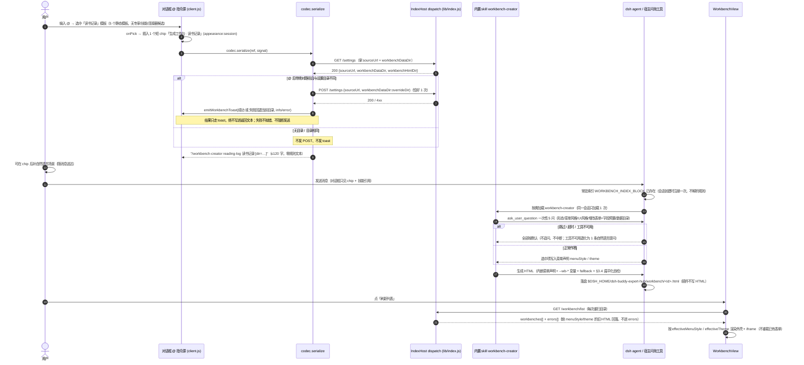
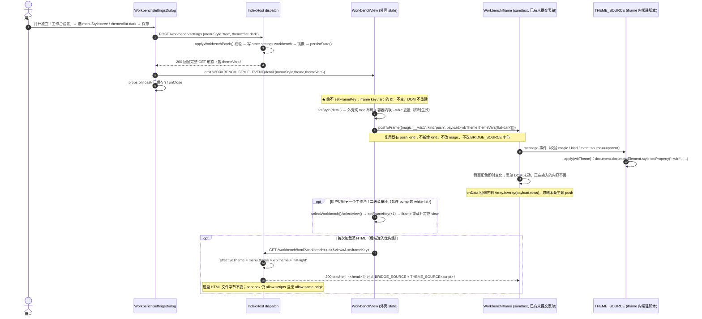
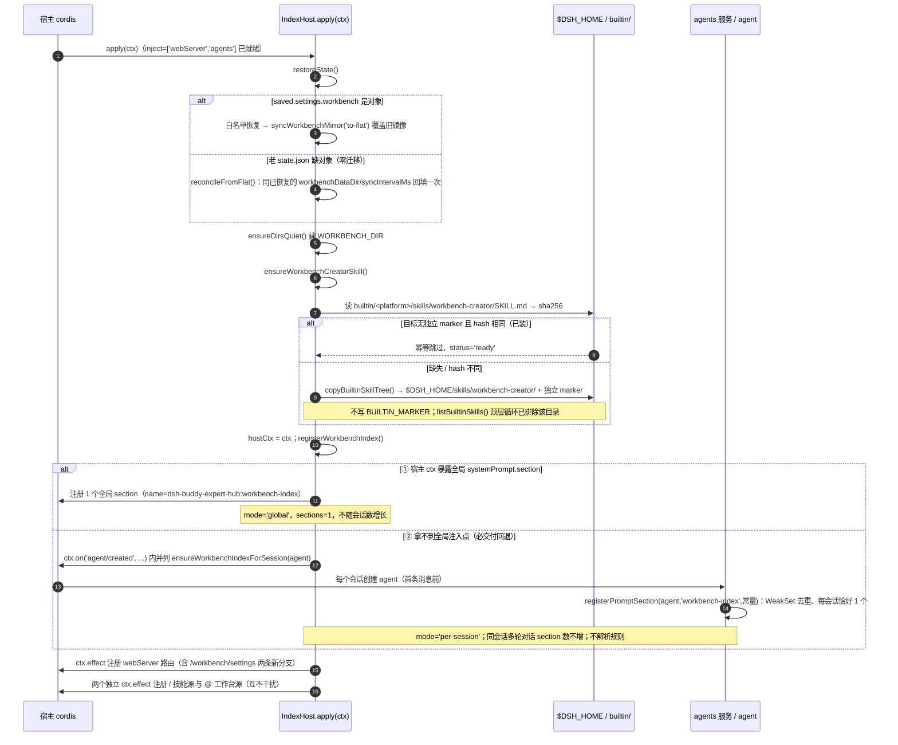
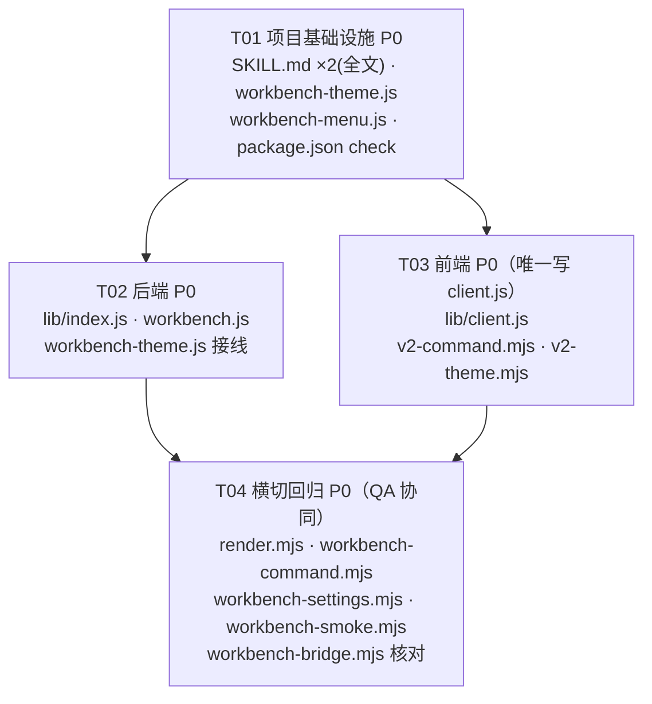

# 个人工作台 v2 · 增量系统设计与任务分解（定稿）

> **文档类型**：正式增量系统设计（SOP 设计阶段产物），是 Engineer 实现本期 v2 的唯一依据。**状态：已定稿，无待确认项**；PRD 的 6 个设计问题（Q-A…Q-F）与主理人追加的 6 个技术点全部给出裁决，Engineer 直接执行、不再询问。
> **输入**：`docs/workbench-v2-prd.md`（本轮唯一产品口径，203 行）+ `docs/workbench-design.md`（v1 定稿，实现层契约以其为准）+ `README.md`「个人工作台」章节（`:556-705`）+ 本轮代码实证（行号均为当前工作区实测）。
> **基线**：v1 全绿 882 PASS / 0 FAIL。本轮为增量，**不推翻 v1、不做迁移、不重述 v1 已交付能力**。
> **本阶段交付约束**：只新建本文件 `docs/workbench-v2-design.md`；不改任何代码 / 其它文档 / `package.json` / `_harness/`；不跑测试；不 git commit；所有文件保持 **LF** 行尾；中文输出。
> **口径优先级**：本文 > v2 PRD（产品口径）> v1 设计（实现层契约）> README（用户说明）。冲突时以本文裁决为准。

---

# Part A · 系统设计

## 0. 决策清单（已定稿，无待确认项）

### 0.1 PRD 六个设计问题的裁决（Q-A…Q-F）

| 编号 | 裁决（已定稿） | 落地点 |
| --- | --- | --- |
| **Q-A** | **精简索引 + 所有会话常驻**。`WORKBENCH_INDEX_BLOCK` 为编译期常量，≤200 字 / ≤8 行，独立命名 `dsh-buddy-expert-hub:workbench-index`；只含「有能力 / 规则在 skill / `@` 触发 / 其它对话忽略」四要素；**不含** schema、CSV/HTML 路径、`window.Workbench`、409、刷新列表。选「所有会话」不预判意图、不解析用户消息；硬约束「不每次生成解析规则」由「常量文本 + 按需加载 skill」满足 | §1.3、§3.6、§1.6 |
| **Q-B** | **短 chip + ≤120 字技能引用**。`onPick.insert` 的 `appearance:"session"` / `label` 短 chip 沿用 v1 不动；`codec.serialize` 由「一大段中文提示语」改为 `/workbench-creator <id> <中文名> [dir=<绝对路径>]`；**规则文本绝不出现在对话框**。chip 后用户补的自然语言场景随消息送达；`@` 后带绝对路径仍解析、发送前仍 `POST /settings` 同步目录，**同步结果改 toast**；失败回退当前设置目录且不阻断发送 | §1.9、§3.7、§4.1 |
| **Q-C** | **UI + 接口 + 存储三层分离 + 存量零迁移**。新建独立「工作台设置」弹窗（`WorkbenchView.onOpenSettings` 直达）；专家 `SettingsDialog` 移除工作台分区；新增 `GET/POST /workbench/settings`；新增 `state.settings.workbench` 对象为新字段权威；旧扁平字段 `workbenchDataDir` / `syncIntervalMs` **保留为镜像、不删、不写迁移脚本**，冷启动回填一次，`restoreState()` 白名单显式加分支，`/settings` 旧行为不回退 | §1.8、§3.1、§3.3、§3.4 |
| **Q-D** | **常驻 = 索引 / `@` = 参数 / skill = 正文（唯一权威）**。规则正文只在 `builtin/<platform>/skills/workbench-creator/SKILL.md` 一份；宿主按需加载，一次会话多次创建只加载一次。**前置条件默认**：`builtinSkills` 总开关默认 false，由插件**幂等单独常驻安装 `workbench-creator` 这一个 skill**（不受总开关关闭清理）；宿主不允许则回退「独立设置一键启用 + `@` 中文引导」，**绝不把规则正文塞回对话框** | §1.3、§1.7、§3.6 |
| **Q-E** | 菜单 `tabs`(默认)/`tree`/`breadcrumb`/`sidebar`；UI `flat-light`(默认)/`flat-dark`/`soft`/`compact`。全局默认在独立设置；单个 HTML 菜单声明用**可选** `menuStyle` / `theme` 覆盖；优先级 **单页 > 全局 > 内置默认**；旧 HTML 缺字段回落且不进 `errors[]`；`validateMenu` 白名单忽略未知值 | §1.4、§3.2、§3.5 |
| **Q-F** | skill 内用宿主 `ask_user_question` **一次性问 5 个问题**（形态用途 / 菜单风格 / UI 风格 / 增改表单+字段预置 / 数据目录），最多 1 轮、不追问；跳过 / 超时 / 工具不可用一律按默认推进、不中断；工具不可用退化为一条自然语言一次性提问。§3.4 的 10 条可测扁平化规范写进 skill 作为生成 HTML 自检清单 | §3.6（skill 正文骨架）、§0.2 T4 |

> 需求池 WV2-01…13 为 **P0 本期必须交付**（WV2-13 为横切回归）；WV2-14 / 15 为 P1、WV2-16 为 P2，按 §7.3 备注延后，不占本期 4 个任务。

### 0.2 主理人追加 6 个技术点的裁决（T1…T6）

| # | 技术点 | **裁决（已定稿）** | 详解 |
| --- | --- | --- | --- |
| **T1** | 主题跨 opaque-origin iframe | **否决「父组件注入 CSS 变量」（PRD §3.2 / U4 的写法做不到）。改为后端 `/workbench/html` 注入**：复用现有「`<head>` 后注入 `<script>`」机制，追加一段 `<script>${THEME_SOURCE}</script>`（**不用 `<style>` 标签**，规避 CSP `style-src` 禁内联样式），脚本内 `document.documentElement.style.setProperty('--wb-*', …)`。全局 theme 从 `state.settings.workbench.theme` 读、单页覆盖从该 HTML 已归一化的 `menu.theme` 读（`findWorkbench()` 结果）；优先级 单页 > 全局 > 内置默认。**切换不重载 iframe**：父组件复用既有 `kind:'push'` 消息、在 `payload` 追加可选 `wbTheme` 字段，`THEME_SOURCE` 监听并重新应用 —— 不新增 `kind`、不改 magic、不改 `BRIDGE_SOURCE` 一个字节、不改 HTML 文件字节 | §1.4、§3.5、§3.8 |
| **T2** | 切风格/主题不能重载 iframe | **状态划分**：`frameKey` 只服务「 iframe 需要真正重新加载」的操作；新增独立 `style` state（`menuStyle` / `theme` / `themeVars`）只驱动外壳 `className` + CSS 变量 + 一条 push 消息，**绝不 `setFrameKey`**。允许 bump：切工作台 `activeId`、切二级菜单 `view`（v1 行为，定位锚点）、数据目录变更、手动刷新列表。禁止 bump：保存独立设置、`POST /workbench/settings` 成功、`WORKBENCH_STYLE_EVENT`、toast、轮询 push、主题/风格切换 | §1.5、§4.2 |
| **T3** | U1 全局常驻注入点 | **主选①（全局）**：`apply(ctx)` 阶段用 `hostService('agents')` 软取服务并探测宿主 `ctx` 上的全局 `systemPrompt.section` 注入点，成功则注册 1 个全局 section。**回退②（每会话首条消息前注入一次，必交付）**：`apply()` 里**已实证存在** `ctx.on('agent/created', ({ agent }) => …)`（`lib/index.js:8849-8856`，v1 用于 `flushPendingAttaches`），在该钩子内对每个 agent 调 `registerPromptSection(agent, 'workbench-index', WORKBENCH_INDEX_BLOCK)`，用 `WeakSet<agent>` 去重。因 `export const inject = ['webServer','agents']`（`:8812`），**apply 时 agents 服务已由 cordis 注入就绪**，但「宿主 ctx 是否暴露全局 systemPrompt scope」无实证 → 工程师**必须实现②**（可验收 P0），① 写成同一函数里的 `if (探测成功)` 分支，不单独阻塞。可验证判据见 §1.6 | §1.6、§4.3 |
| **T4** | skill 幂等常驻安装 | **新增** `WORKBENCH_CREATOR_DIR='workbench-creator'`、`WORKBENCH_CREATOR_MARKER='.wb-creator-skill.json'`、`ensureWorkbenchCreatorSkill()`、`creatorSkillStatus()`；**复用** `copyBuiltinSkillTree()`（`:4097`）/ `isFile` / `isDir` / `builtinSkillsRoot()`（`:4167`）。**关键**：① 必须在 `listBuiltinSkills()` 顶层扫描循环（`:4379-4405`）跳过 `workbench-creator`，否则会被 `installAllBuiltinSkills()`（`:4488`）装成带 `BUILTIN_MARKER` 的普通内置技能、被 `removeBuiltinSkills()`（`:4575`）在关闭总开关时删掉；② 单独安装时**不写 `BUILTIN_MARKER`**，只写独立 marker → `hiddenSkillDirs()`（`:4457`）不认它、`removeBuiltinSkills()` 不删它、宿主原生扫描 `$DSH_HOME/skills/workbench-creator/SKILL.md` 正常加载；③ 落点 `apply()` 内 `ensureDirsQuiet()` 之后（`:8822`）调一次，重启幂等；④ 新 skill 放**顶层** `builtin/windows/skills/workbench-creator/` 与 `builtin/linux/skills/workbench-creator/`，不放 `builtin-plugins/*/skills/`（后者受 `lib/index.js:4201-4257` 的 9 条自包含筛选规则约束，且 `pluginSkillReason` 会把含「插件 / `core/` / `scripts/…`」字样的正文排除） | §1.7、§2.1 |
| **T5** | 配置分层镜像一致性 | **写入权威 = `state.settings.workbench`；运行期数据面读取 = 旧扁平字段**（`/workbench/list`、`/workbench/data`、`GET /settings` 全部零改动）。新增收口函数 `applyWorkbenchPatch(patch, origin)` / `syncWorkbenchMirror('to-flat')` / `reconcileFromFlat()`：**任何写入路径**（`POST /workbench/settings`、`POST /settings`、`@` 目录同步、`restoreState()` 回填）都经收口函数，写完立即双向镜像，保证两个来源恒等。`restoreState()` 在现有 `:955-964` 两分支**之后**新增 `workbench` 对象分支（有则白名单恢复并覆盖镜像；无则「冷启动回填一次」用已恢复旧值建对象），最后统一 `syncWorkbenchMirror('to-flat')`。`/settings` 只在 `:3326-3329` 写入后加一行镜像调用，校验顺序、必填 `sourceUrl`、回显字段全部不回退 | §1.8、§3.1、§3.3、§3.4 |
| **T6** | `buildWorkbenchPrompt` 何去何从 | **删除，不保留死代码**。由 `buildWorkbenchSkillRef(tpl, overrideDir)`（≤120 字）取代；连带删除只服务于提示语的 `buildWorkbenchMenuJson()`、`joinWorkbenchPath()`、`escapeHint`、`dirNote` 全部分支；保留 `sanitizeWorkbenchDir()` / `parseWorkbenchRef()` / `parseLocalSource()` 相关参数处理。`codec.serialize` 新链路：GET `/settings` → （目录不同时）**仍恰好 1 次** `POST /settings`（body 只 `sourceUrl + workbenchDataDir`）→ POST settle 后 `emitWorkbenchToast()` → 返回短技能引用。**toast 触发不依赖发送时机**：用模块级 `toastSink` 注册制（`App` / `WorkbenchPanel` 挂载时把 `setToast` 注册进来），`serialize` 的 Promise settle 时主动调 `emitWorkbenchToast()`；无 sink 才回退 `window` CustomEvent，再无则静默跳过、不影响发送 | §1.9、§3.7、§4.1 |

### 0.3 运行时不可证项（单列，均给默认 + 回退，不留待拍板项）

| 编号 | 项 | 推荐默认 | 回退路径 |
| --- | --- | --- | --- |
| **U1** | 宿主 `ctx` 是否暴露「所有会话共享」的全局 systemPrompt 注入点 | 路径①全局注册（`mode='global'`） | 路径② `agent/created` 每会话注入一次（`mode='per-session'`），**必交付**；两者都满足「不每次生成解析规则」 |
| **U2** | 宿主 `ask_user_question` 工具的确切名称与入参 | 按宿主实机为准（本仓库无该字符串） | 工具不可用 → 一条自然语言一次性提问；跳过 / 超时按默认、不中断、不追问 |
| **U3** | 宿主是否允许插件在总开关之外常驻安装单个 skill | `ensureWorkbenchCreatorSkill()` 幂等单独安装 + 独立设置显示「已就绪」 | 不允许 → 独立设置「一键启用」（`POST /workbench/settings` 带 `action:'enable-creator'`）+ `@` 中文引导，**绝不回塞规则文本** |
| **U4** | CSP 是否禁内联样式 / 内联脚本 | 主路径用**内联 `<script>` 设 CSS 变量**（不受 `style-src` 限制，且与 v1 `BRIDGE_SOURCE` 注入同机制、已实证可执行） | 连内联脚本也禁、或 QA 判定 `push` 载荷扩展不合口径 → URL 参数 `?theme=<theme>`（仅首次加载，切主题不重载故不改 URL）+ HTML 内自带 `--wb-*` fallback；外壳主题仍即时生效；**不新增第六类桥消息、不改产品口径、不回塞规则文本** |
| **U5** | 既有 `_harness` 源码串断言 | 配置分离必然打破工作台字段相关断言 → **QA 阶段同步**（§9 逐条给出改法） | 不做兼容镜像 → 老 `state.json` 冷启动丢配置，不可接受 |

---

## 1. 实现方案与框架选型

### 1.1 技术难点与取舍

沿用 v1：Node.js `lib/index.js` + 单文件前端 `lib/client.js`（`window.__ModuleLoader__`、`React.createElement`、`useState/useEffect/useRef/useCallback`）；**零 npm 依赖、零构建链、浏览器端不引入 node 内置模块**。本轮新增难点与方案：

| # | 难点 | 方案 | 依据 / 实证 |
| --- | --- | --- | --- |
| 1 | 规则「只存一份」且对话框零规则文本 | 编译期常量索引（≤200 字）+ 内置 skill 正文（唯一权威）+ `@` 只产参数；`buildWorkbenchPrompt` 整链删除 | Q-A/Q-B/Q-D；`client.js:7867` 现产大段正文 |
| 2 | `builtinSkills` 总开关默认 false 时 skill 不可用 | 幂等单独常驻安装 + 顶层扫描排除 + 独立 marker，不进全量安装/清理集合 | Q-D；`index.js:4488/:4575/:4457` |
| 3 | 主题跨 opaque-origin iframe（父组件无法注入 CSS） | **后端 `/workbench/html` 注入 `<script>`**（服务端读 theme 渲染变量表）；切换靠既有 `push` 消息带可选 `wbTheme` | T1；`workbench.js:150-162` 已有 `<head>` 注入机制；`client.js:4346` `sandbox="allow-scripts"` 且无 `allow-same-origin` |
| 4 | 切主题「即时生效」与「不重载 iframe、不丢表单」矛盾 | 主题脚本常驻 iframe 内，切主题只发一条 `push` 更新变量；`frameKey` 严格白名单 | T2；`client.js:4240-4255/:4341` |
| 5 | 配置三层分离但旧字段零迁移、旧断言不回退 | 新对象权威写入 + 运行期读旧扁平字段 + 收口镜像函数 + `restoreState()` 冷启动回填 | T5；`index.js:955-964/:3176-3181/:3281-3304/:3326-3329` |
| 6 | 全局常驻注入点不可证 | 双路径自适应：① 全局 scope 软探测（可选）；② `agent/created` 钩子每会话一次（**必交付**） | T3；`index.js:8812 inject`、`8849-8856 ctx.on('agent/created')` 已实证 |
| 7 | `@` 静默后 toast 无触发时机（`codec.serialize` 不持有组件） | 模块级 `toastSink` 注册制 + `serialize` 内 POST Promise settle 主动 emit | T6；`client.js:7921` `emitWorkbenchOpen()` 已是「指令源不持有组件实例 → window 事件解耦」的先例 |
| 8 | 菜单声明新增字段必须向后兼容 | `validateMenu()` 白名单**显式把 `menuStyle`/`theme` 加进返回对象**（该函数是「白名单式归一化」，未列入的字段会被丢弃），未知值/缺字段回落、不进 `errors[]` | Q-E；`workbench-menu.js:82-92` return 的对象只含 6 个已知字段 |

> **不引入任何新东西的理由**：`package.json:16-22` `files:["lib","builtin/**/skills/**",…]` 已覆盖本轮所有新增文件（新 `lib/workbench-theme.js` 由 `"lib"` 覆盖、两个 `SKILL.md` 由 `"builtin/**/skills/**"` 覆盖）；`exports`（`:23-28`）不动；`cordis.patch.yml` 不动；`lib/client.js` 保持单文件。唯一新增 npm 脚本改动是 `package.json:31` `check` 追加一条 `node --check lib/workbench-theme.js`。

### 1.2 架构模式与分层

```
lib/client.js（单文件）
  App / WorkbenchPanel ── onOpenSettings ──> WorkbenchSettingsDialog（★新函数，同文件内）
        │                                      │ GET/POST /workbench/settings
        │                                      └─ emit WORKBENCH_STYLE_EVENT（不 bump frameKey）
        ├─ WorkbenchView（△）
        │    ├─ style state（menuStyle/theme/themeVars）→ 外壳 4 种布局 + --wb-* 变量
        │    ├─ frameKey（白名单 bump）→ iframe key/src 的 &t=
        │    └─ postToFrame({magic:'__wb:1',kind:'push',payload:{wbTheme}})  ← 切主题即时生效
        ├─ codec.serialize（△短技能引用）+ emitWorkbenchToast（★）── POST /settings（目录同步）
        └─ iframe sandbox="allow-scripts" ── __wb:1 桥（字节不变）── 父组件代理 /workbench/data
                     ▲
                     │ GET /workbench/html?workbench=&view=&t=
lib/index.js  dispatch ──> lib/workbench.js handleWorkbenchHtml（△注入 BRIDGE + THEME_SOURCE）
        │                     └─ effectiveTheme = menu.theme > state.settings.workbench.theme > flat-light
        ├─ GET/POST /workbench/settings（★）── state.settings.workbench（权威）──镜像──> 旧扁平字段
        ├─ ensureWorkbenchCreatorSkill()（★，apply 启动时一次）→ $DSH_HOME/skills/workbench-creator/
        ├─ registerWorkbenchIndex()（★）→ ① 全局 scope / ② agent/created 每会话一个 section
        └─ WORKBENCH_INDEX_BLOCK（常量，≤200 字）

builtin/<platform>/skills/workbench-creator/SKILL.md（★两平台）
        └─ 规则唯一权威正文：创建步骤 / schema / 桥 API / CAS+409 / 刷新列表 / 一次性问询 / §3.4 扁平化规范
```

- **契约驱动**：`state.settings.workbench` schema（§3.1）、`/workbench/settings`（§3.3/§3.4）、菜单声明新字段（§3.2）、`--wb-*` 变量表（§3.5）、技能引用格式（§3.7）五份契约先行；T02（后端）与 T03（前端）可据此并行。
- **单一权威**：主题变量表只在 `lib/workbench-theme.js` 一份，服务端渲染进 `THEME_SOURCE` 与 `GET /workbench/settings.themeVars`，前端不硬编码第二份。
- **零桥协议改动**：`BRIDGE_SOURCE`（`lib/workbench-bridge.js:9-68`）、`BRIDGE_MAGIC='__wb:1'`、五类消息（`ready`/`read`/`write` / `response`/`push`/`conflict` 语义集合）**字节级不变**；主题切换复用既有 `push` kind，仅在其 `payload` 追加**可选** `wbTheme`（载荷兼容扩展，非协议变更）。

### 1.3 三者职责与规则唯一权威

| 角色 | 内容 | 长度 | 是否含规则正文 | 加载时机 |
| --- | --- | --- | --- | --- |
| **常驻索引** `WORKBENCH_INDEX_BLOCK` | 能力发现 + 路由（规则在 skill / `@` 触发 / 自护栏） | ≤200 字 / ≤8 行 | ❌ 零细节 | 所有会话常驻，注册一次 |
| **`@` 指令** `codec.serialize` | 短 chip（结构化参数）+ `/workbench-creator <id> <名> [dir=…]` | ≤120 字 | ❌ 零细节 | 用户选中模板时 |
| **内置 skill** `workbench-creator` | 创建步骤、注意点、菜单声明 schema、CSV/HTML 落盘、桥 API、CAS+409、刷新列表、5 问询、§3.4 扁平化 10 条规范 | 无限制 | ✅ **唯一副本** | 宿主按需加载；同一会话多次创建只加载一次 |

**常驻索引正文（编译期常量，工程师逐字使用，勿拼装运行时数据）**：

```text
【个人工作台 · 能力索引】
本扩展提供「个人工作台」：HTML 页面 + 外置 CSV 数据表。
完整规则只在内置技能 workbench-creator 中；创建或修改工作台时加载，同一会话只加载一次。
用户输入 @ 选择工作台模板即触发创建；@ 只传参数，不展示规则文本。
护栏：仅当用户要求创建/修改工作台或输入 @ 工作台指令时执行；其它对话完全忽略本区块。
```

- v2 验收按 WV2-01 的 ≤200 字判据精简为 184 字 / 5 行；旧逐字稿 242 字与表格判据冲突，已废弃。
- 满足 WV2-01：区块内搜不到 `workbench-menu`、`window.Workbench`、`.csv`、`409`、`刷新列表`。
- 「不每次生成都解析规则」：索引是**常量字符串**，宿主不解析用户消息；规则按需由宿主加载 skill，一次会话一次。
- `/` 技能源 `skillSource`（`trigger:"/"`、`name:"dsh-buddy-expert-hub-skills"`）与 `registerSkillSource()` **完全不动**；`@` 序列化产出的文本以 `/` 开头，但只在 `codec.serialize` 返回值里出现，不调用 `/` 源的任何注册 / 候选函数，不触发 `/` 源。两源仍各自独立 `ctx.effect`（`client.js:8376-8377`）。

### 1.4 主题跨 opaque-origin iframe 落地（T1 详解）

**为什么否决 PRD §3.2 / U4 的「父组件注入」**：`client.js:4346` iframe 是 `sandbox="allow-scripts"` 且**不给 `allow-same-origin`**，opaque origin 下父组件**读不到 iframe 的 `contentDocument`**，无法注入 `<style>` 或设 CSS 变量；也不允许新增桥消息（硬约束）。

**方案：后端注入 + 既有 push 消息更新**

1. **首次加载**：`handleWorkbenchHtml(res, params, wbSettings)` 在现有 `<head>` 注入 `BRIDGE_SOURCE` 之后，**追加** `<script>${THEME_SOURCE}</script>`（两者同为内联脚本注入，v1 的 `BRIDGE_SOURCE` 内联已被实证可执行）。
2. `THEME_SOURCE` 由 `renderThemeSource(effectiveTheme)` 服务端渲染，内含按生效 theme 展开的 `--wb-*` 变量 JSON，加载时执行 `document.documentElement.style.setProperty(k, v)` —— **不用 `<style>` 标签**，因此不受 CSP `style-src 'self'` 禁内联样式影响（U4 的 `?theme=` 仅作为「连内联脚本也禁」的极端回退）。
3. **优先级**（服务端 `handleWorkbenchHtml` 内计算，前端外壳用同一函数口径）：
   ```
   effectiveTheme = normalizeTheme(menu.theme)          // 单页覆盖，来自已归一化的 findWorkbench()
                 || normalizeTheme(wbSettings.theme)    // 全局默认，来自 state.settings.workbench.theme
                 || 'flat-light'                        // 内置默认
   effectiveMenuStyle = 同理（menu.menuStyle > wbSettings.menuStyle > 'tabs'）
   ```
   `normalizeTheme()` / `normalizeMenuStyle()` 对未知值、空值、非字符串一律返回 `''`（交由上层回落），**绝不抛错、绝不进 `errors[]`**。
4. **切换不重载 iframe**：父组件 `WorkbenchView` 收到 `WORKBENCH_STYLE_EVENT` 后，用 `postToFrame()` 发一条既有 `push` 消息：
   ```js
   { magic: '__wb:1', kind: 'push', payload: { wbTheme: themeVars[effectiveTheme] } }
   ```
   `THEME_SOURCE` 内常驻的 `message` 监听器校验 `magic/kind/event.source === window.parent`，见到 `payload.wbTheme` 就重新 `setProperty` → **即时生效、DOM 不变、表单不丢**。
5. **零协议改动论证**：未新增 `kind`；`magic` 仍 `'__wb:1'`；`BRIDGE_SOURCE` 文件一个字节不改；`payload` 本就是父组件构造的自由对象，追加可选字段属载荷兼容扩展。`BRIDGE_SOURCE` 收到 `push` 会把整个 `payload` 交给 `onData` 回调，因此 **skill 生成 HTML 的规范要求 `onData(fn)` 回调先判 `Array.isArray(payload && payload.rows)`，否则忽略**（见 §3.6 自检清单），避免把主题更新误当数据刷新。
6. **HTML 文件字节不变**：注入只发生在 HTTP 响应文本上，磁盘 `WORKBENCH_DIR/<id>.html` 一个字节不改；`sandbox`、`__wb:1` 五类消息、CSV/hash/CAS 全部不动。
7. **HTML 内只用 `--wb-*` + 自带 fallback**：skill 生成的页面写 `var(--wb-bg, #F7F8FA)` 等，脱离插件独立打开（无注入脚本）时 fallback 生效；旧 v1 HTML 未消费 `--wb-*`，沿用自身样式，不影响。

**CSP 极端回退（U4）**：若宿主连内联脚本都禁（v1 桥内联已工作，实为低概率），`THEME_SOURCE` 退化为「iframe URL 追加 `&theme=<theme>`、HTML 内脚本读 `location.search` 后应用变量」；因切主题不重载 iframe，URL 参数只在**首次加载**有效，后续切换时 iframe 内沿用自身 fallback、外壳主题仍即时生效。此回退**不新增第六类桥消息、不改 `__wb:1`**；若 QA 判定「`push` 载荷追加可选 `wbTheme`」不合口径，同样按本回退执行（iframe 内沿用自身 fallback、外壳主题仍即时生效），不改产品口径、不回塞规则文本。

### 1.5 `frameKey` 状态划分（T2）

`lib/client.js:4029` `const [frameKey, setFrameKey] = useState(0)`；`:4247`/`:4254` 是现有两处 bump；`:4262` `frameSrc` 带 `&t=frameKey`；`:4341` iframe `key`。**新增 `style` state 与 `frameKey` 完全解耦**：

| state | 内容 | 变化后的动作 | 是否 bump `frameKey` |
| --- | --- | --- | --- |
| `frameKey` | number | iframe `key` / `src` 的 `&t=` 变化 → 真正重新加载 | — |
| `style` | `{ menuStyle, theme, themeVars, syncMs }` | 外壳 `className`/内联 `--wb-*` 重渲染 + 一条 `push` 主题消息 | ❌ **绝不** |
| `activeId` / `activeViewId` | 当前工作台 / 二级菜单 | 定位 `view` | ✅ 允许（v1 行为） |
| `list` / `dataDir` | 刷新列表 / 数据目录 | 重新拉列表、必要时空态 | ✅ 允许（数据目录变更时） |

- **允许 bump 白名单**：`selectWorkbench()`（`:4240-4248`）、`selectView()`（`:4251-4255`）、手动刷新列表、数据目录变更。
- **禁止 bump 清单**（工程师重点自检）：保存独立设置、`POST /workbench/settings` 成功回调、`WORKBENCH_STYLE_EVENT` 监听、`emitWorkbenchToast()`、2s 轮询 `push`、`onConflict`、菜单风格切换、UI 风格切换。
- 4 种菜单风格共用同一份 `workbenches[]` / `menu[]` 数据源，只换**外壳 DOM 结构**（`tabs` 沿用 v1 / `tree` 可折叠缩进 / `breadcrumb` 顶部路径+回退 / `sidebar` 左窄栏右全宽 iframe），点击菜单项仍 `selectView()` 定位 `view`；切换风格本身不 bump。
- 外壳主题：`className={"dshe-wb dshe-wb-theme-" + theme}` + 容器 `style` 展开 `--wb-*`，CSS 数组（`:586` 起 `.dshe-wb-*`）改用 `var(--wb-*, fallback)`。

### 1.6 U1 全局常驻注入点（T3，双路径 + 可验证判据）

**实证前提**：`lib/index.js:8812` `export const inject = ['webServer','agents']` → cordis 在 `apply(ctx)` 前注入依赖，**`agents` 服务在 apply 时已就绪**；`:8827` `hostCtx = ctx`；`:8849-8856` **已存在** `ctx.on('agent/created', ({ agent }) => { void flushPendingAttaches(agent); void flushPendingConnectors(agent); … })` —— 这是「每会话创建 agent」的全局钩子，v1 已实证可用。`registerPromptSection(agent, expertId, block)`（`:6204`）需要的是 **per-agent `agent.ctx`**（`agent.ctx.inject(['systemPrompt'], …)`），而**宿主 `ctx` 是否暴露全局 `systemPrompt.section` 无任何代码实证**。

**统一实现 `registerWorkbenchIndex()`（新增，返回 `mode`）**：

```text
① 主选（全局）：soft-probe hostCtx 上的全局 systemPrompt 注入点
   - 依次探测 hostCtx.systemPrompt?.section / hostCtx.inject(['systemPrompt'], fn) 挂在宿主 ctx 的形态
   - 命中则 scope.systemPrompt.section({ name:'dsh-buddy-expert-hub:workbench-index',
       order: getSectionOrder('DEPLOYMENT_PERSONA_PREFIX')+1, text: () => WORKBENCH_INDEX_BLOCK })
   - 全局注册标志 workbenchIndexMode='global'；只注册一次（模块级 boolean），返回
   - 失败 / 抛错 / 无该 API → 静默落入 ②，绝不抛错、绝不污染 attach

② 回退（必交付，per-session）：在 apply() 的 ctx.on('agent/created', ({agent}) => …) 内
   - ensureWorkbenchIndexForSession(agent)：WeakSet<agent> 去重
   - registerPromptSection(agent, 'workbench-index', WORKBENCH_INDEX_BLOCK)
   - 每个 agent 恰好 1 个 section；agent 销毁由宿主 fiber 自动 unwind，清 WeakSet
   - workbenchIndexMode='per-session'
```

- 两条路径的 `block` 都是**同一个编译期常量**，注册动作都发生在「会话创建 / 插件启动」时，**不在每次生成工作台时解析规则**。
- 若 `hostCtx`/`agents` 缺失（服务不可用），`registerPromptSection` 返回 `null`（`:6206`），`mode='off'`，插件不崩、`/` 与 `@` 触发源不受影响。
- **可验证判据**（`GET /workbench.settings` 响应里新增 `workbenchIndex: { mode, sections, name }` 供 harness 断言）：
  | 判据 | ① 全局 | ② per-session |
  | --- | --- | --- |
  | `mode` | `'global'` | `'per-session'` |
  | section 数量 | 恒为 **1**，不随会话数增长 | `= 已创建会话数`，每个会话恰好 1 |
  | 命名 | `dsh-buddy-expert-hub:workbench-index` | 同左 |
  | 去重 | 模块级 boolean，重复 `apply` 不重复注册 | `WeakSet<agent>`；同一会话第 2/3 轮对话 section 数**不增** |
  | 文本 | 等于 `WORKBENCH_INDEX_BLOCK`，≤200 字、不含规则关键词 | 同左 |
- 探测代码必须 `try/catch` 包裹、不得依赖 `hostCtx` 之外的任何宿主私有字段；② 与 v1 的 `flushPendingAttaches` 并列写在同一个 `ctx.on` 回调里，**不新增 `ctx.on` 监听、不改 `inject` 数组、不动 `main` keyed 槽、不新增 `slots.register`**。

### 1.7 skill 幂等常驻安装（T4）

**新常量**（`lib/index.js`）：`WORKBENCH_CREATOR_DIR = 'workbench-creator'`、`WORKBENCH_CREATOR_MARKER = '.wb-creator-skill.json'`。

**新函数 `ensureWorkbenchCreatorSkill()`**（新增，复用 `copyBuiltinSkillTree()` `:4097`）：

```text
1. src = path.join(builtinSkillsRoot(), WORKBENCH_CREATOR_DIR)；无 SKILL.md → 返回 {ok:false,status:'missing'}
2. dest = path.join(SKILLS_INSTALL_DIR, WORKBENCH_CREATOR_DIR)
3. dest 已存在且**没有**独立 marker（用户自己的同名技能）→ 不覆盖，返回 {ok:true,status:'blocked'}
4. dest 已存在且有独立 marker：
     marker.skillSha256 === sha256(src/SKILL.md) → 幂等跳过，status='ready'
     否则 → fs.rmSync(dest) 后重装（版本升级），status='ready'
5. 否则 → copyBuiltinSkillTree(src, dest)；写 {version:1, skillSha256, installedAt} 到 dest/.wb-creator-skill.json
6. 全程 try/catch，失败记 state.warnings[]，**绝不抛错、绝不阻断 apply**
```

**三个必须同时做的隔离点**（漏一个即违背「不受总开关关闭清理」）：

| # | 位置 | 改动 | 原因 |
| --- | --- | --- | --- |
| 1 | `listBuiltinSkills()` 顶层循环 `index.js:4379-4405` | 加 `if (entry.name === WORKBENCH_CREATOR_DIR) continue` | 否则 `installAllBuiltinSkills()`（`:4488`）会把它当普通内置技能装一份并写 `BUILTIN_MARKER`，随后 `removeBuiltinSkills()`（`:4575`）在**关闭总开关时删掉**；也避免 `builtinSkillCount` 文案数字漂移 |
| 2 | 单独安装写**独立 marker** | **不写 `BUILTIN_MARKER`**（`.builtin-skill.json`） | `hiddenSkillDirs()`（`:4457`）只认 `BUILTIN_MARKER`：不写 → 不被隐藏（宿主原生扫描可见可加载）、不被 `countBuiltinInstalled()` 计入、不被 `removeBuiltinSkills()` 删除 |
| 3 | 目标目录 `$DSH_HOME/skills/workbench-creator/` | 顶层 `builtin/<platform>/skills/` 为源 | `check-package.mjs:131-186` 抽样校验「平台技能目录下第一个技能的 SKILL.md 被 `files` 覆盖」，`files` 已含 `builtin/**/skills/**` → 两平台各放一份即自动通过；`lib/index.js:4201-4257` 的 9 条 `pluginSkillReason` 只作用于 `builtin-plugins/*/skills/`，顶层目录不受约束 |

- **落点**：`apply()` 内 `ensureDirsQuiet()`（`:8822`）之后、`hostCtx = ctx`（`:8827`）之前或之后均可（不依赖宿主服务）调用**一次**；重启再跑因 marker + sha256 相同而跳过 → 幂等。同时 `POST /workbench/settings` 的 `action:'enable-creator'` 也调它（U3 一键启用）。
- **「创建能力状态」取值**：新增 `creatorSkillStatus()`，返回 `{ status:'ready'|'stale'|'missing'|'blocked'|'disabled', dir, reason }`，判据 = `dest/SKILL.md` 存在 + 独立 marker 的 `skillSha256` 与随包一致；`disabled` 表示宿主明确拒绝（仅当 `ensureWorkbenchCreatorSkill` 返回权限类错误时置位，供 U3 回退展示「一键启用」）。该状态**运行时派生、不持久化**，由 `GET /workbench/settings` 返回。
- **SKILL.md 正文避坑**：虽顶层目录不经过 `pluginSkillReason`，仍建议正文避免 `mcp__` / `ToolSearch` / `editor_sdk` / `allowed-tools:` 带值 / `../Xxx` / `core|agents|hooks|shared|dist|bin|prebuilds/` / `scripts/xxx` 引用等字样（`lib/index.js:4201-4257`），以防宿主侧类似扫描误判；「插件」二字可用「工作台扩展」替代表述。
- **两平台**：`builtin/windows/skills/workbench-creator/SKILL.md` 与 `builtin/linux/skills/workbench-creator/SKILL.md` **正文保持一致**（`name` 相同、`skillDirNameOf` 得 `workbench-creator`），避免 Windows/Linux 创建规则漂移；macOS 走 `builtinPlatform()` → `linux`，无需第三份。

### 1.8 配置分层与镜像一致性（T5）

**读写权威（避免两个来源漂移）**：

| 数据 | 权威写入源 | 运行期读取源 | 理由 |
| --- | --- | --- | --- |
| `dataDir` / `syncMs` | `state.settings.workbench.dataDir` / `.syncMs` | **旧扁平字段** `state.settings.workbenchDataDir` / `syncIntervalMs` | `/workbench/list`（`index.js:8647`）、`/workbench/data`（`:8665/:8670`）、`GET /settings`（`:3177-3178`）、`handleWorkbenchList`（`workbench.js:136`）、README、既有 harness 全部读旧字段 → **零回归** |
| `menuStyle` / `theme` / `lastPrefs` | `state.settings.workbench.*` | `state.settings.workbench.*` | 只有新对象能表达 |
| `creatorSkill` / `workbenchIndex` | 不持久化 | 运行时派生 | `GET /workbench/settings` 响应里现算 |

**收口函数**（新增于 `lib/index.js`，所有写路径必须经过）：

| 函数 | 职责 |
| --- | --- |
| `applyWorkbenchPatch(patch, origin)` | 校验 + 写 `state.settings.workbench.*` + 立即 `syncWorkbenchMirror('to-flat')` + `persistState()`；`origin` 仅用于日志/诊断 |
| `syncWorkbenchMirror('to-flat')` | `state.settings.workbenchDataDir = wb.dataDir`；`state.settings.syncIntervalMs = wb.syncMs` |
| `reconcileFromFlat()` | 反向：用旧扁平字段回填 `wb.dataDir/syncMs`（冷启动 / `POST /settings` 之后调用） |

**四条写路径**：
1. `POST /workbench/settings` → `applyWorkbenchPatch(payload)`（权威）。
2. `POST /settings`（`:3326-3329`）→ 写完旧扁平字段后**追加一行** `reconcileFromFlat()`；`sourceUrl` 必填、`:3281-3304` 校验顺序、`:3362-3363` 回显**全部不动** → v1 行为零回退。
3. `@` 目录同步（仍走 `POST /settings`，body 只 `sourceUrl + workbenchDataDir`）→ 同上自动镜像。
4. `restoreState()` 冷启动 → 见下。

**`restoreState()` 新增分支**（严格放在现有 `:955-964` 两个工作台分支**之后**，才能拿到已恢复的旧值）：

```text
A) saved.settings.workbench 是对象：
   逐字段白名单恢复
     dataDir  : string → trim；'' → null；非空须 localWorkbenchDirError()==='' 否则 null
     syncMs   : number 且 500..60000 → 原值；否则 2000
     menuStyle: 4 枚举之一 → 原值；否则 'tabs'
     theme    : 4 枚举之一 → 原值；否则 'flat-light'
     lastPrefs: P1，对象白名单；本期缺失即 null
   恢复后 syncWorkbenchMirror('to-flat')（新对象权威，覆盖旧镜像）
B) saved.settings.workbench 缺失 / 非对象（老 state.json）：
   reconcileFromFlat() —— 用已恢复的 workbenchDataDir / syncIntervalMs 回填 wb.dataDir/syncMs，
   其余字段取内置默认。**这就是「冷启动回填一次」**：不写迁移脚本、不删旧字段、
   不主动改写磁盘 state.json（下次 persistState 自然带上新对象）
C) 无论 A/B，末尾再 syncWorkbenchMirror('to-flat') 保证恒等
```

- `state` JSDoc（`:217`）与初值（`:229`）同步加 `workbench: { dataDir:null, syncMs:2000, menuStyle:'tabs', theme:'flat-light', lastPrefs:null }`；`persistState()`（`:977` 整体序列化 `state.settings`）**无需改**。
- `GET /settings`（`:3176-3181`）四个工作台字段语义与顺序不变；不追加、不删除。
- `GET /workbench/settings` 的 `dataDir`/`syncMs` 从**旧扁平字段**读（保证与运行期一致），`menuStyle`/`theme` 从新对象读；响应里同时给 `themeVars` 与 `creatorSkill` / `workbenchIndex` 派生状态。

### 1.9 `@` 静默后 `buildWorkbenchPrompt` 去向（T6）

**删除清单**（`lib/client.js`，**不留死代码**）：

| 删除 | 现位置 | 原因 |
| --- | --- | --- |
| `buildWorkbenchPrompt(tpl, dataDir, htmlDir, dirNote)` | `:7867-7914` | 产大段规则正文，规则已移入 skill |
| `buildWorkbenchMenuJson(tpl)` | `:7897` 调用点 | 菜单声明模板属规则正文，前端不再生成 |
| `joinWorkbenchPath()` / `escapeHint` / `dirNote` 全部分支 | `:7873-7911` / `:8242-8251` | 只服务于提示语 |
| `codec.clipboardText` 中的长说明 | `:8152-8155` | 保持与短 chip 同口径（现已是短文本，核对不改长） |

**保留**：`WORKBENCH_TEMPLATES`（`:7564`，5 个静态模板）、`workbenchCandidates()`、`parseWorkbenchRef()`、`sanitizeWorkbenchDir()`、`emitWorkbenchOpen()`（`:7921`）、`onPick.insert`（`:8141-8149`，短 chip 已满足 WV2-02）、`registerWorkbenchSource()`（`:8326`）、两个独立 `ctx.effect`（`:8376-8377`）。

**新增 `buildWorkbenchSkillRef(tpl, overrideDir)`** → 返回 ≤120 字：

```text
无目录：  /workbench-creator reading-log 读书记录
带目录：  /workbench-creator task-board 任务看板 dir=E:\NewData
```

- 编码了**模板 id**（宿主据此找模板）、**中文名**（可读）、**可选目录**（`dir=<绝对路径>`，来自 `parseWorkbenchRef` 的 `parsed.dir`）。
- **场景不编码进引用**：用户在短 chip 后补的自然语言随消息送达（WV2-03），`serialize` 拿不到也不该伪造。
- 全文搜不到：`workbench-menu`、`<script`、`window.Workbench`、`.csv`、`409`、`刷新列表`、`\u003c`（WV2-02 判据）。

**`codec.serialize` 新链路**（`:8156-8253` 改写，`async` 签名不变）：

```text
1) GET /settings 拿 sourceUrl + workbenchDataDir（保留；读不到 → 跳过目录同步、不抛错）
2) overrideDir 非空且 ≠ settingsDataDir → 仍**恰好 1 次** POST /settings
   body 只 { sourceUrl, workbenchDataDir: overrideDir }（WV2-03 不变）
3) POST Promise settle：
   成功 → emitWorkbenchToast('已把工作台数据目录同步为 <路径>', 'info')
   失败 → emitWorkbenchToast('目录未同步，已沿用当前设置目录；可在「工作台设置」里手动修改', 'error')
   失败一律不抛错、不阻断发送、返回文本不写任何目录说明
4) return buildWorkbenchSkillRef(tpl, overrideDir)
```

**toast 通道（解决「前端拿不到发送时机」）**：

```text
模块级 let workbenchToastSink = null
setWorkbenchToastSink(fn)   // App / WorkbenchPanel 的 useEffect 里注册 setToast，cleanup 置 null
emitWorkbenchToast(text, level)  // 优先调 sink；无 sink 才 dispatch
                                 // WORKBENCH_TOAST_EVENT = "dsh-buddy-expert-hub:workbench-toast"
                                 // 再无 window / CustomEvent 则静默跳过，绝不影响发送
```

- 复用现有 `.dshe-toast` DOM（`client.js:554` CSS、`App` `:5846`、`WorkbenchPanel` `:5893`）与 3.2s 自动消失（`:5867-5871`）。
- **单一出口**：谁后挂载谁注册 sink（当前可见面板），不会弹两份。
- 与 `emitWorkbenchOpen()`（`:7921`）同构：指令源不持有组件实例，用模块级引用 / window 事件解耦。

---

## 2. 文件清单

> ★ = 新建，△ = 修改。所有路径相对 `dsh-buddy-expert-hub/`。行号为当前工作区实测，Engineer 以**函数/字符串锚点**为准（行号会随编辑漂移）。

### 2.1 新建（★）

| 相对路径 | 类型 | 精确内容 |
| --- | --- | --- |
| `docs/workbench-v2-design.md` | 文档 | **本设计（架构阶段唯一落盘产物，本阶段已完成）** |
| `builtin/windows/skills/workbench-creator/SKILL.md` | 内置 skill | frontmatter 6 字段 + 规则唯一权威正文（§3.6） |
| `builtin/linux/skills/workbench-creator/SKILL.md` | 内置 skill | 与 windows 版**正文一致**（macOS 走此目录） |
| `lib/workbench-theme.js` | 后端模块 | `THEME_VARS`（4 theme × 18 变量，§3.5）、`MENU_STYLES` / `THEMES` 枚举、`normalizeTheme()` / `normalizeMenuStyle()`、`renderThemeSource(theme)` → `THEME_SOURCE` 字符串（§3.8）、`themeVarsFor(theme)`、`escapeForScript()` |
| `_harness/workbench-v2-command.mjs` | 测试 | 新断言：`serialize` ≤120 字、以 `/workbench-creator` 开头、含模板 id、不含 7 个规则关键词、POST 仍恰好 1 次且 body 不变、`emitWorkbenchToast` 成功/失败两分支、失败不阻断 |
| `_harness/workbench-v2-theme.mjs` | 测试 | 新断言：`validateMenu` 缺/未知字段回落且不进 `errors[]`、4×4 优先级、`handleWorkbenchHtml` 注入 `<script>` 且 BRIDGE_SOURCE 字节不变、HTML 文件字节不变、`frameKey` 在风格/主题切换时不 bump |

### 2.2 修改（△）

| 相对路径 | 改动锚点 | 精确改动 |
| --- | --- | --- |
| `lib/index.js` | `:88` 附近常量区 | 新增 `WORKBENCH_CREATOR_DIR` / `WORKBENCH_CREATOR_MARKER` / `WORKBENCH_INDEX_BLOCK` / `WORKBENCH_MENU_STYLES` / `WORKBENCH_THEMES` |
| `lib/index.js` | `:217` JSDoc、`:229` `state.settings` 初值 | 加 `workbench: {dataDir:null,syncMs:2000,menuStyle:'tabs',theme:'flat-light',lastPrefs:null}` |
| `lib/index.js` | `:897` `restoreState()`，`:955-964` 之后 | 加 `workbench` 对象白名单分支 + 冷启动回填 + 末尾镜像（§1.8） |
| `lib/index.js` | `:3176-3181` `GET /settings` | **不改**（旧字段语义/顺序零回退） |
| `lib/index.js` | `:3281-3304` `POST /settings` 校验、`:3326-3329` 写入 | 校验顺序 / `sourceUrl` 必填 / `:3362-3363` 回显**不动**；只在 `:3329` 后加一行 `reconcileFromFlat()` |
| `lib/index.js` | 新函数区 | `applyWorkbenchPatch()` / `syncWorkbenchMirror()` / `reconcileFromFlat()` / `handleWorkbenchSettingsGet()` / `handleWorkbenchSettingsSave(req)` |
| `lib/index.js` | `:4366` `listBuiltinSkills()` 顶层循环（`:4379`） | 加 `if (entry.name === WORKBENCH_CREATOR_DIR) continue` |
| `lib/index.js` | 新函数区 | `ensureWorkbenchCreatorSkill()` / `creatorSkillStatus()` / `registerWorkbenchIndex()` / `ensureWorkbenchIndexForSession()`（含 `WeakSet<agent>`、全局探测） |
| `lib/index.js` | `:8819` `apply()` | `ensureDirsQuiet()` 后调 `ensureWorkbenchCreatorSkill()` 一次；`ctx.on('agent/created')`（`:8849-8856`）回调内并列调 `ensureWorkbenchIndexForSession(agent)`；`hostCtx = ctx` 后调 `registerWorkbenchIndex()` 探测全局 |
| `lib/index.js` | `:8645-8676` dispatch | 新增 `/workbench/settings` GET+POST 两条分支（写法与 `:8645` 一致，`localRequestGuard()` 是全局前置不要重复实现）；`/workbench/html` 分支改为 `handleWorkbenchHtml(res, query, state.settings.workbench)` |
| `lib/workbench.js` | `:150-162` `handleWorkbenchHtml` | 签名加第 3 参 `wbSettings`；`findWorkbench()` 结果取 `menu.theme` / `menu.menuStyle`；算 `effectiveTheme`；`<head>` 后**追加** `<script>${renderThemeSource(effectiveTheme)}</script>`（保留原 `bridge` 字符串与注入位置不变） |
| `lib/workbench.js` | `import` 区 | `import { renderThemeSource, normalizeTheme, themeVarsFor } from './workbench-theme.js'` |
| `lib/workbench-menu.js` | `:32-93` `validateMenu()` | 新增 `MENU_STYLE_VALUES` / `THEME_VALUES` 常量；`return { menu: { … } }`（`:82-92`）**显式加** `menuStyle` / `theme` 两个字段，未知值/缺字段回落为 `''`（由上层按全局>默认解析）、**不 push 到 `errors[]`**；其余字段与 `menu[]` 映射（`:73-80`）一律不动 |
| `lib/client.js` | `:554` 附近 CSS、`:586` 起工作台 CSS | 追加 `.dshe-wb-theme-*` / 4 种菜单布局类；现有 `.dshe-wb-*` 颜色/间距改 `var(--wb-*, fallback)` |
| `lib/client.js` | `:3408-3412` state、`:3437-3440` GET 回填、`:3550-3561` doSave、`:3809-3843` 分区 DOM | 专家 `SettingsDialog` **移除**工作台 5 个 state、2 处回填、2 个 POST 字段、整个 `dshe-settings-wb-*` 分区；其余分区（含 `dshe-settings-switch`）不动 |
| `lib/client.js` | `:7554` 事件常量区 | 新增 `WORKBENCH_TOAST_EVENT` / `WORKBENCH_STYLE_EVENT`、模块级 `workbenchToastSink` + `setWorkbenchToastSink()` + `emitWorkbenchToast()` |
| `lib/client.js` | `:7867-7914` 等 | **删除** `buildWorkbenchPrompt` / `buildWorkbenchMenuJson` / `joinWorkbenchPath` / `escapeHint` / `dirNote` 分支；**新增** `buildWorkbenchSkillRef(tpl, overrideDir)` |
| `lib/client.js` | `:8151-8254` `codec.serialize` | 改写为 §1.9 新链路（保留 GET + 恰好 1 次 POST + toast，返回短技能引用） |
| `lib/client.js` | 新组件区 | 新增 `WorkbenchSettingsDialog`（独立弹窗，3 分区，§7 T03）；`WorkbenchView` 内新增 `style` state、`WORKBENCH_STYLE_EVENT` 监听、4 种菜单布局渲染分支、外壳 `--wb-*` 内联变量、切主题 `postToFrame({magic:'__wb:1',kind:'push',payload:{wbTheme}})`；**`setFrameKey` 调用点保持原 2 处不增** |
| `lib/client.js` | `App`（`:4604` 事件监听附近）、`:5862` `WorkbenchPanel` | 两处 `useEffect` 注册 `setWorkbenchToastSink(setToast)` / cleanup；`WorkbenchPanel` 的 `settingsOpen` 弹窗由 `SettingsDialog` 改为 `WorkbenchSettingsDialog`；`onOpenSettings: () => setSettingsOpen(true)` 字符串**保持不变**（`render.mjs:1227` 依赖） |
| `package.json` | `:31` `check` 脚本 | 仅追加 `&& node --check lib/workbench-theme.js`；`files` / `exports` / `dependencies` / 版本**全不动** |
| `_harness/render.mjs` | `:1228-1234` | **QA 阶段同步**（§9），工程师不在本任务改 |
| `_harness/workbench-command.mjs` | `:393-469` 等 W5/W6/W7 组 | **QA 阶段同步**（§9） |
| `_harness/workbench-settings.mjs` | 24 条 | **QA 阶段核对 + 追加新端点用例**（§9） |
| `_harness/workbench-smoke.mjs` | 33 条 | **QA 阶段核对 + 追加主题注入用例**（§9） |

### 2.3 明确不改

- `lib/workbench-bridge.js`（`BRIDGE_SOURCE` / `BRIDGE_MAGIC` **字节级不变**）、`lib/csv.js`、`lib/frontmatter.js`、`lib/connector-*.js`。
- `POST/GET /workbench/data`、`/workbench/list` 的请求/响应字段、`/workbench/bridge.js`、`sendHtml()`、`listWorkbenches()` 的扫描与 `errors[]` 逻辑。
- CSV 契约（表头 / `_id` / UTF-8 BOM / 沿用首次 CRLF-LF / `sha256(原始字节)` / CAS+409+`current` / 按字段名对齐列 / `tmp→rename` / 写队列）、`__wb:1` 五类桥消息、`sandbox="allow-scripts"`（无 `allow-same-origin`）。
- `builtinPlatform()`（`:88`）、`PLUGIN_SKILL_*` 9 条筛选规则（`:4198-4257`）、`main` keyed 槽、`slots.register`、`/` 技能源 `skillSource` / `registerSkillSource()`。
- `docs/workbench-design.md`、`docs/workbench-prd.md`、`README.md`、`docs/user-guide.md`（PRD §7.7，文档同步由后续阶段统一处理）。
- 不新增 / 修改 / 删除任何 HTML 写接口；不新增前端文件；不改 `package.json` 的 `exports` / `files` / 依赖；不改 `cordis.patch.yml`；不写迁移脚本；不删旧 `state.json` 字段；不 git commit。

---

## 3. 数据结构与接口

### 3.1 `state.settings.workbench` schema（`lib/index.js:229`）

| 字段 | 类型 | 默认 | 校验 / 归一化 | 说明 |
| --- | --- | --- | --- | --- |
| `dataDir` | `string\|null` | `null` | `parseLocalSource()` → `localWorkbenchDirError()`；空串=清除；非法→`null` | CSV 数据目录，**权威写入源**；镜像到 `workbenchDataDir` |
| `syncMs` | `number` | `2000` | 整数 `500..60000`；越界 400 | 轮询间隔；镜像到 `syncIntervalMs` |
| `menuStyle` | enum | `'tabs'` | `tabs\|tree\|breadcrumb\|sidebar`；未知 400（设置端点）/ 回落（菜单声明） | 全局菜单风格默认 |
| `theme` | enum | `'flat-light'` | `flat-light\|flat-dark\|soft\|compact`；同上 | 全局 UI 风格默认 |
| `lastPrefs` | `object\|null` | `null` | P1，白名单对象 | WV2-15 偏好记忆，本期只预留字段 |

**镜像字段（保留、不删、不迁移）**：`state.settings.workbenchDataDir`（`string|null`）、`state.settings.syncIntervalMs`（`number`，默认 2000）。

### 3.2 菜单声明新增可选字段（`lib/workbench-menu.js`）

| 字段 | 类型 | 必填 | 取值 | 校验 |
| --- | --- | --- | --- | --- |
| `menuStyle` | string | ❌ | `tabs\|tree\|breadcrumb\|sidebar` | **未知值/缺失 → `''`**（上层按 全局 > `tabs` 解析）；**不进 `errors[]`** |
| `theme` | string | ❌ | `flat-light\|flat-dark\|soft\|compact` | 同上；上层按 全局 > `flat-light` 解析 |

> ⚠️ **最易实现错**：`validateMenu()`（`:82-92`）是**白名单式归一化**——`return { menu: { version, id, name, icon, tables, menu } }`，**未显式列入返回对象的字段会被静默丢弃**。新增两个字段必须写进这个返回对象，否则 `findWorkbench()` 拿不到单页覆盖值，`GET /workbench/list` 的 `workbenches[]` 也不带，优先级「单页 > 全局」直接失效。旧 v1 HTML 缺字段时返回 `''`，由上层回落，不得 `errors.push`。

**优先级（前后端同一口径）**：

```text
effectiveMenuStyle = menu.menuStyle || wb.menuStyle || 'tabs'
effectiveTheme     = menu.theme     || wb.theme     || 'flat-light'
```

### 3.3 `GET /workbench/settings`

| 项 | 内容 |
| --- | --- |
| 方法 / 路由 | `GET /dsh-buddy-expert-hub/workbench/settings`（dispatch 新增分支，自动继承 `localRequestGuard()`） |
| 请求 | 无参数 |
| 200 响应 | 见下表 |
| 405 | 非 GET/POST → `{ok:false,error:'仅支持 GET / POST'}` |

| 响应字段 | 类型 | 说明 |
| --- | --- | --- |
| `ok` | boolean | `true` |
| `dataDir` | string | 从**旧扁平字段**读；未配置为 `''` |
| `dataDirReady` | boolean | `localWorkbenchDirError()===''` |
| `syncMs` | number | 从旧扁平字段读，500..60000，默认 2000 |
| `menuStyle` | enum | 全局默认 |
| `theme` | enum | 全局默认 |
| `htmlDir` | string | `WORKBENCH_DIR`（供「打开 HTML 目录」） |
| `menuStyles` | string[] | `['tabs','tree','breadcrumb','sidebar']` |
| `themes` | string[] | `['flat-light','flat-dark','soft','compact']` |
| `themeVars` | `Record<theme, Record<var,string>>` | **变量表单一来源**（`lib/workbench-theme.js`），父组件切主题时取 `themeVars[theme]` 发 `push.payload.wbTheme` |
| `creatorSkill` | object | `{ status:'ready'\|'stale'\|'missing'\|'blocked'\|'disabled', dir:string, reason:string }`，运行时派生 |
| `workbenchIndex` | object | `{ mode:'global'\|'per-session'\|'off', sections:number, name:string }`，供 U1 断言 |
| `lastPrefs` | object\|null | P1，本期 `null` |

### 3.4 `POST /workbench/settings`

| 项 | 内容 |
| --- | --- |
| 方法 / 路由 | `POST /dsh-buddy-expert-hub/workbench/settings`，`Content-Type: application/json` |
| 请求体 | 全部**可选、不传保持原值**（与 `/settings` 同语义），见下表 |
| 200 响应 | **回显完整 `GET` 形态**（`{ok:true, …§3.3 全部字段}`），前端保存后无需再 GET |
| 400 | `{ok:false, error:'<中文>', code:'<错误码>'}` |

| 请求字段 | 类型 | 默认 / 清除 | 范围校验 | 错误码 |
| --- | --- | --- | --- | --- |
| `dataDir` | string | 不传=保持；`''`=清除为 `null` | 非 string → 400；非空须 `localWorkbenchDirError()===''`（绝对路径、存在、是目录、可写、可建子目录） | `invalid-data-dir` |
| `syncMs` | number \| `''` \| null | 不传=保持；`''`/`null`=回 2000 | 数字须整数 500..60000，越界 / 非有限 → 400 | `invalid-sync-ms` |
| `menuStyle` | enum | 不传=保持 | 必须是 4 枚举之一，否则 400（设置端点严格） | `invalid-enum` |
| `theme` | enum | 不传=保持 | 必须是 4 枚举之一，否则 400 | `invalid-enum` |
| `action` | string | 不传=无动作 | 仅 `'enable-creator'` 合法 → 调 `ensureWorkbenchCreatorSkill()` 并在响应里回显新 `creatorSkill` | `invalid-action` |

> 设置端点**严格 400**、菜单声明**忽略未知值**：两处不同，勿混用。写入一律经 `applyWorkbenchPatch()` → `syncWorkbenchMirror('to-flat')` → `persistState()`。**不依赖 `sourceUrl`**（与 `/settings` 的关键区别），保证 `@` 目录同步与独立设置互不耦合。

### 3.5 `--wb-*` 变量表 × 4 theme 矩阵（`lib/workbench-theme.js` 单一来源）

| 变量 | 含义 | `flat-light`(默认) | `flat-dark` | `soft` | `compact` |
| --- | --- | --- | --- | --- | --- |
| `--wb-bg` | 页面背景 | `#F7F8FA` | `#14161A` | `#F5F6F8` | `#FFFFFF` |
| `--wb-card` | 卡片 / 表面 | `#FFFFFF` | `#1E2127` | `#FFFFFF` | `#FFFFFF` |
| `--wb-text` | 主文字 | `#1F2329` | `#ECEFF4` | `#1F2329` | `#1F2329` |
| `--wb-text-sub` | 次文字 | `#646A73` | `#9AA1AC` | `#6B7280` | `#646A73` |
| `--wb-primary` | 主色 | `#2B5AED` | `#5B82F5` | `#3F6AD8` | `#2B5AED` |
| `--wb-primary-contrast` | 主色上文字 | `#FFFFFF` | `#FFFFFF` | `#FFFFFF` | `#FFFFFF` |
| `--wb-border` | 描边 | `#E5E6EB` | `#2E323A` | `#E8EAF0` | `#E5E6EB` |
| `--wb-radius` | 全局圆角 | `6px` | `6px` | `12px` | `4px` |
| `--wb-shadow` | 阴影（≤1 层） | `0 1px 2px rgba(0,0,0,.06)` | `0 1px 2px rgba(0,0,0,.30)` | `0 1px 2px rgba(0,0,0,.06)` | `none` |
| `--wb-gap` | 间距基数 | `8px` | `8px` | `8px` | `6px` |
| `--wb-gap-lg` | 区块间距 | `24px` | `24px` | `24px` | `16px` |
| `--wb-pad` | 卡片内边距 | `20px` | `20px` | `20px` | `12px` |
| `--wb-control-h` | 控件高度 | `40px` | `40px` | `40px` | `30px` |
| `--wb-font-size` | 基准字号 | `14px` | `14px` | `14px` | `13px` |
| `--wb-line-height` | 行高 | `1.5` | `1.5` | `1.5` | `1.4` |
| `--wb-danger` | 错误 / 冲突 | `#D93026` | `#F26A5F` | `#D93026` | `#D93026` |
| `--wb-focus-ring` | 输入框聚焦 | `0 0 0 2px rgba(43,90,237,.25)` | 同左低饱和版 | 同左 | 同左 |

- `compact` 间距/控件高 -25%（40→30、24→16、8→6、20→12），`soft` 圆角 12px + 低饱和主色，均满足 PRD §3.2 / §3.4。
- **生成 HTML 只消费 `var(--wb-*, <fallback>)`**，fallback 值与 `flat-light` 列一致 → 脱离插件独立打开也好看。
- 外壳（`WorkbenchView`）用同一份 `themeVars` 展开为容器内联 `--wb-*`，CSS 里改 `var()` → 4 主题即时生效。

### 3.6 skill `SKILL.md` frontmatter 与正文骨架

**frontmatter（两平台一致）**：

```yaml
---
name: workbench-creator
description: 创建/修改「个人工作台」HTML + 外置 CSV 数据视图的唯一权威规则。当用户在对话框用 @ 选择工作台模板、或明确要求创建/修改个人工作台时使用；内含创建步骤、菜单声明 schema、桥 API、CAS/409、刷新列表、创建前一次性偏好询问与扁平化 UI 自检清单。
category: workbench
tags: [workbench, html, csv, flat-ui]
user-invocable: true
disable-model-invocation: false
---
```

**正文骨架（必含 8 段，规则正文只此一份）**：

| # | 段 | 内容 |
| --- | --- | --- |
| 1 | 何时使用 / 护栏 | 仅「创建/修改工作台」或 `@` 指令；无关对话不动作；同一会话只加载一次 |
| 2 | **创建前一次性问询（Q-F）** | 用宿主 `ask_user_question` **一次问 5 题**：① 形态用途（记录台账/看板/表单驱动/统计仪表盘）② 菜单风格（跟随全局/tabs/tree/breadcrumb/sidebar）③ UI 风格（跟随全局/flat-light/flat-dark/soft/compact）④ 增改表单（弹窗/行内/顶部常驻/抽屉 + 同轮问「字段是否按模板预置」，默认预置、允许增删）⑤ 数据目录（沿用全局/自定义绝对路径，`@` 已带路径则跳过）。**最多 1 轮、不追问**；跳过/超时/工具不可用 → 全部按默认继续、不中断、不报错；工具不可用退化为一条自然语言一次性提问。选中项写入菜单声明 `menuStyle` / `theme` |
| 3 | 落盘位置 | HTML → `$DSH_HOME/dsh-buddy-expert-hub/workbench/<id>.html`（取自 `GET /settings.workbenchHtmlDir`，取不到用默认）；CSV → `<数据目录>/<id>/<tables[].file>`；两个不同 root；**扩展不提供 HTML 写接口，由 agent 直接落盘**；生成完提示用户点「刷新列表」即生效、无需重启进程 |
| 4 | 菜单声明 schema | 完整字段表（`version/id/name/icon/tables[].file/fields[].{key,label,type,required,default,options}/menu[].{id,label,view,prompt}`）+ **新增可选 `menuStyle` / `theme`**；`_id` 由后端自动补齐；JSON 内 `</script>` 写 `\u003c/script\u003e`；`<script type="application/json" id="workbench-menu">` 载体 |
| 5 | 桥 API | 只用注入的 `window.Workbench.ready()/read({table})/write({table,baseHash,columns,rows})/onData(fn)/onConflict(fn)`；iframe 是 opaque origin，`sandbox="allow-scripts"`，不得自己 fetch；`onData` 回调**须先判 `Array.isArray(payload && payload.rows)`**（忽略主题 push）；5s 超时；`push`/`conflict` 语义 |
| 6 | CAS / 409 / 冲突态 | `hash = sha256(磁盘 CSV 原始字节)`；写回带 `baseHash`；外部改 CSV 自动 push；409 时给**非阻断**顶部横幅「数据表已在外部被修改，已重新加载」+「重试 / 放弃」，不静默覆盖、不打断正在输入的表单 |
| 7 | **扁平化 UI 10 条自检清单（PRD §3.4）** | 配色（单主色+灰阶、禁渐变/拟物/纹理、阴影≤1 层）/ 间距（4px 栅格、卡片 16–24、区块 24、控件 32/40）/ 字号（14px、标题 18/20/24、行高 1.5、字重 400/500/600、中文系统字体栈）/ 控件（圆角 4–8、按钮 主/次/文字 三种、无 3D、1px 描边 + focus ring）/ 表单（单列、标签在上、一行≤2 字段、必填 `* `、就地红字校验不 `alert`、主操作右对齐）/ 空态（图标+一句说明+1 个主操作「添加第一条记录」）/ 冲突态 / 同步态（「已保存」「数据表已更新」轻提示 2s 消失、不弹模态）/ 响应式无障碍（`min-width:0`、表格横向滚动、窄屏单列、`aria-label`、键盘可聚焦、对比度 ≥4.5:1）/ **变量契约**（只消费 `--wb-*` + 自带 fallback） |
| 8 | 完成与自检 | 逐条对照第 7 段自检；确认 `--wb-*` 变量与 fallback；确认菜单声明合法 JSON；提示用户「刷新列表」；不把规则正文回显到对话框 |

> 正文不得出现 `mcp__` / `ToolSearch` / `editor_sdk` / `allowed-tools:` 带值 / `../Xxx` / `core|agents|hooks|shared|dist|bin|prebuilds/` / 目录外的 `scripts/xxx` 引用（§1.7 避坑）。

### 3.7 `codec.serialize` 新输出格式

| 场景 | 返回值（≤120 字） |
| --- | --- |
| 无目录覆盖 | `/workbench-creator reading-log 读书记录` |
| 带绝对路径 | `/workbench-creator task-board 任务看板 dir=E:\NewData` |
| 带中文/空格路径 | `/workbench-creator blank 自定义空白工作台 dir=D:\我的数据\workbench-data` |

- **编码项**：模板 id（宿主识别）、中文名（可读）、可选 `dir=<绝对路径>`（`parseWorkbenchRef` 的 `parsed.dir`，已过滤控制字符 / 换行 / 尖括号 / 反引号 / 竖线并截断长度）。
- **不编码**：场景（用户 chip 后自然语言补充）、规则正文（全在 skill）、目录同步结果（改 toast）。
- **禁止出现**：`workbench-menu`、`<script`、`window.Workbench`、`.csv`、`409`、`刷新列表`、`\u003c`（WV2-02）。
- `onPick.insert.label` 短 chip「生成工作台 · 读书记录」与 `appearance:"session"`、`clipboardText` 保持短文本（`client.js:8141-8155`），对话框可见**恰好 1 个 chip**。

### 3.8 `THEME_SOURCE` 契约（`lib/workbench-theme.js`）

```text
renderThemeSource(theme) → String.raw`(function(){
  var V = <JSON.stringify(THEME_VARS[normalizeTheme(theme)] || THEME_VARS['flat-light'])>;
  function apply(v){ for (var k in v) if (Object.prototype.hasOwnProperty.call(v,k))
                       document.documentElement.style.setProperty(k, v[k]); }
  apply(V);
  window.addEventListener('message', function(e){
    var d = e && e.data;
    if (!d || d.magic !== '__wb:1' || d.kind !== 'push') return;
    if (window.parent !== window && e.source !== window.parent) return;
    if (d.payload && d.payload.wbTheme) apply(d.payload.wbTheme);
  });
})();`
```

- 内嵌 JSON 里的 `<` 由 `escapeForScript()` 转义为 `\u003c`，防止提前闭合 `<script>`（沿用 v1 菜单声明的同一约定）。
- **不引用 `window.Workbench`、不改 `BRIDGE_SOURCE`、不新增消息 kind**；只监听既有 `push`。
- 注入顺序：`bridge`（原 `<script>BRIDGE_SOURCE</script>`）在前，`themeTag` 在后；两者互不影响（各自独立 `message` 监听）。
- `handleWorkbenchHtml` 的 `sendHtml(res, injected)` / `Cache-Control: no-store` / `text/html; charset=utf-8` 全部沿用（`workbench.js:77-85`）。

### 3.9 模块关系图（Mermaid classDiagram）

```mermaid
classDiagram
    class StateSettings {
        +sourceUrl: string|null
        +builtinSkills: boolean
        +workbenchDataDir: string|null
        +syncIntervalMs: number
        +workbench: WorkbenchSettings
    }
    class WorkbenchSettings {
        +dataDir: string|null
        +syncMs: number
        +menuStyle: string
        +theme: string
        +lastPrefs: object|null
    }
    class IndexHost {
        +ROUTE_PREFIX: string
        +WORKBENCH_DIR: string
        +WORKBENCH_INDEX_BLOCK: string
        +hostCtx: any
        +apply(ctx)
        +restoreState()
        +persistState()
        +applyWorkbenchPatch(patch, origin)
        +syncWorkbenchMirror(dir)
        +reconcileFromFlat()
        +handleWorkbenchSettingsGet()
        +handleWorkbenchSettingsSave(req)
        +ensureWorkbenchCreatorSkill()
        +creatorSkillStatus()
        +registerWorkbenchIndex()
        +ensureWorkbenchIndexForSession(agent)
        +registerPromptSection(agent, key, block)
        +dispatch(req, res)
    }
    class WorkbenchModule {
        +handleWorkbenchList(res, query, dataDir, syncMs)
        +handleWorkbenchHtml(res, params, wbSettings)
        +handleWorkbenchDataGet(res, params, dataDir)
        +handleWorkbenchDataPost(req, res, dataDir)
        +findWorkbench(id)
        +sendHtml(res, html)
    }
    class ThemeSource {
        +THEME_VARS: object
        +MENU_STYLES: string[]
        +THEMES: string[]
        +normalizeTheme(v)$
        +normalizeMenuStyle(v)$
        +themeVarsFor(theme)$
        +renderThemeSource(theme)$
    }
    class MenuParser {
        +extractMenu(html)$
        +validateMenu(raw)$
        +MENU_STYLE_VALUES: string[]
        +THEME_VALUES: string[]
    }
    class WorkbenchMenuDecl {
        +version: number
        +id: string
        +name: string
        +menu: MenuItemDecl[]
        +menuStyle: string
        +theme: string
    }
    class BridgeSource {
        +BRIDGE_MAGIC: string
        +BRIDGE_SOURCE: string
    }
    class WorkbenchCreatorSkill {
        +name: string
        +askUserQuestion()
        +flatUiChecklist: string
        +menuSchema: object
        +bridgeApi: object
    }
    class ClientApp {
        +setToast(text)
        +setWorkbenchToastSink(fn)
        +emitWorkbenchToast(text, level)
        +WORKBENCH_STYLE_EVENT: string
        +WORKBENCH_TOAST_EVENT: string
    }
    class WorkbenchSettingsDialog {
        +dataDir: string
        +syncMs: string
        +menuStyle: string
        +theme: string
        +creatorSkill: object
        +doSave()
    }
    class WorkbenchView {
        +frameKey: number
        +style: WorkbenchStyle
        +selectWorkbench(id)
        +selectView(view)
        +postToFrame(msg)
        +onStyleEvent(e)
    }
    class WorkbenchStyle {
        +menuStyle: string
        +theme: string
        +themeVars: Record~string,string~
    }
    class WorkbenchSource {
        +trigger: "@"
        +name: string
        +onPick(arg)
        +codec.serialize(ref, signal)$
        +buildWorkbenchSkillRef(tpl, dir)$
    }
    class WorkbenchIframe {
        +sandbox: string
        +THEME_SOURCE: string
        +BRIDGE_SOURCE: string
    }

    StateSettings "1" *-- "1" WorkbenchSettings : 新对象权威 · 双向镜像
    StateSettings ..> IndexHost : restoreState 白名单恢复
    IndexHost ..> WorkbenchModule : dispatch 转发 5 条只读/设置路由
    IndexHost ..> ThemeSource : 读 themeVars / 渲染注入
    IndexHost ..> WorkbenchCreatorSkill : ensureWorkbenchCreatorSkill 幂等常驻安装
    IndexHost ..> BridgeSource : registerPromptSection 注入常量索引
    WorkbenchModule ..> MenuParser : findWorkbench / listWorkbenches
    WorkbenchModule ..> ThemeSource : handleWorkbenchHtml 注入 THEME_SOURCE
    WorkbenchModule ..> BridgeSource : handleWorkbenchHtml 注入 BRIDGE_SOURCE(不变)
    MenuParser ..> WorkbenchMenuDecl : validateMenu 产出(含 menuStyle/theme)
    ClientApp "1" *-- "1" WorkbenchSettingsDialog : onOpenSettings 直达
    ClientApp "1" *-- "1" WorkbenchView : 主面板 / WorkbenchPanel 薄壳
    WorkbenchSettingsDialog ..> IndexHost : GET/POST /workbench/settings
    WorkbenchSettingsDialog ..> ClientApp : emit WORKBENCH_STYLE_EVENT(不 bump)
    WorkbenchView "1" *-- "1" WorkbenchStyle : 独立 state
    WorkbenchView ..> IndexHost : GET /workbench/list + /workbench/html
    WorkbenchView "1" o-- "1" WorkbenchIframe : postMessage __wb:1 (push.wbTheme)
    WorkbenchSource ..> ClientApp : emitWorkbenchToast / emitWorkbenchOpen
    WorkbenchSource ..> WorkbenchCreatorSkill : serialize 返回技能引用
    WorkbenchSource ..> IndexHost : 目录同步 POST /settings(仍 1 次)
    WorkbenchIframe ..> ThemeSource : 消费 --wb-* 变量 + fallback
    WorkbenchIframe ..> BridgeSource : 消费 window.Workbench(字节不变)
```

---

## 4. 程序调用流程

### 4.1 `@` 静默创建链路（WV2-02/03/04/05/06）



### 4.2 风格 / 主题切换链路（不重载 iframe、不丢表单，WV2-09/10/11）



### 4.3 冷启动：配置回填 / skill 常驻 / 索引注入（U1/U3/U5）



---

## 5. Anything UNCLEAR（仅运行时不可证项，无待拍板项）

| 编号 | 项 | 推荐默认 | 回退路径 | 可验证点 |
| --- | --- | --- | --- | --- |
| **U1** | 宿主 `ctx` 是否有全局 systemPrompt 注入点 | 路径①全局注册 | 路径② `agent/created` 每会话一次（**必交付**）；`GET /workbench/settings.workbenchIndex` 暴露 `mode/sections/name` | section 数量 / 命名 / 去重（§1.6） |
| **U2** | `ask_user_question` 确切名称与入参 | 按宿主实机为准 | 工具不可用 → 1 条自然语言一次性提问；跳过/超时按默认、不中断、不追问 | skill 正文流程静态可查；运行期至多 1 轮 |
| **U3** | 宿主是否允许总开关之外常驻装单个 skill | `ensureWorkbenchCreatorSkill()` + 设置显示「已就绪」 | 「一键启用」`action:'enable-creator'` + `@` 中文引导，**绝不回塞规则文本** | `creatorSkill.status` 四态；总开关关闭后 `$DSH_HOME/skills/workbench-creator/SKILL.md` 仍存在 |
| **U4** | CSP 禁内联样式 / 内联脚本、QA 是否认可 `push` 载荷扩展 | 内联 `<script>` 设 CSS 变量（不受 `style-src` 限制） | CSP 被拦或载荷扩展不被认可 → `?theme=`（仅首次加载）+ HTML 自带 fallback；外壳主题仍即时生效；**不新增第六类桥消息、不改产品口径、不回塞规则文本** | 变量生效 / 脱离插件独立打开时 fallback 生效 |
| **U5** | 既有 `_harness` 源码串断言 | 配置分离必然打破工作台字段相关断言 → **QA 阶段同步** | 不做兼容镜像 → 老 `state.json` 冷启动丢配置，不可接受 | §9 逐条给出改法 |

> 以上 5 项**均不阻塞**；本文所有其它结论已定稿。宿主 CSP / `srcdoc` / 全局 scope / `agent/created` 触发精确时刻 / `ask_user_question` 入参由三端实机验证，但插件侧均已给出不依赖实机结果也能通过 P0 的默认实现。

---

# Part B · 任务分解

## 6. Required Packages

**无**（零 npm 依赖，PRD §6 / v1 §6）。仅用 Node 内置 `fs / path / crypto / os / url` 与浏览器内置 `React.createElement` / `useState/useEffect/useRef/useCallback` / `postMessage` / `CustomEvent` / `crypto.randomUUID()`。不新增构建链、不新增前端框架、不改 `package.json` 的 `dependencies` / `exports` / `files`（只追加一条 `check` 的 `node --check`）。

## 7. Task List（按依赖顺序，≤5 个任务，P0 为本期）

> 零依赖增量项目没有「依赖声明 / 构建配置」，故 **T01 = 项目基础设施（新契约文件 + 内置 skill + 打包清单）**，全部新建文件集中在一个任务。每个任务 ≥3 个相关文件；`lib/client.js` 是单文件，**只由 T03 写入**，其它任务严禁改（§7.2 冲突矩阵）。

### 7.1 任务表

| Task ID | Task Name | Source Files（★新建 / △修改） | Dependencies | Priority | 完成判据 |
| --- | --- | --- | --- | --- | --- |
| **T01** | **项目基础设施：内置 skill 全文 + 主题/菜单新契约 + 打包清单** | ★`builtin/windows/skills/workbench-creator/SKILL.md`<br>★`builtin/linux/skills/workbench-creator/SKILL.md`<br>★`lib/workbench-theme.js`<br>△`lib/workbench-menu.js`<br>△`package.json`（仅 `check` 追加 `node --check lib/workbench-theme.js`）<br>△`docs/workbench-v2-design.md`（本设计，架构阶段已完成，Engineer 只读） | 无 | **P0** | ① 两平台 `SKILL.md` 各存在一份，frontmatter 6 字段齐、正文含 §3.6 的 8 段（5 问询 / 10 条扁平化自检 / schema / 桥 API / CAS+409 / 刷新列表），两版正文一致；② `THEME_VARS` 4 theme × 18 变量完整、`normalizeTheme/MenuStyle` 对未知值返回 `''`、`renderThemeSource()` 产出不含裸 `</script>`；③ `validateMenu()` **显式**把 `menuStyle`/`theme` 写进返回对象，缺字段/未知值回落 `''` 且 `errors[]` 长度不变；④ `npm run check` 通过（`files` 已覆盖新文件与两平台技能，`check-package.mjs:131-186` 抽样通过）；⑤ 新文件 LF、`node --check` 全绿 |
| **T02** | **后端：配置分层 + 专用端点 + skill 常驻 + 索引注入 + 主题注入** | △`lib/index.js`（常量 / `state` / `restoreState` / 4 个收口函数 / `GET-POST /workbench/settings` / `listBuiltinSkills` 排除 / `ensureWorkbenchCreatorSkill` / `creatorSkillStatus` / `registerWorkbenchIndex` / `apply()` 接线 / dispatch 2 新路由 + `/workbench/html` 传参）<br>△`lib/workbench.js`（`handleWorkbenchHtml` 加第 3 参 + 注入 `THEME_SOURCE`；`BRIDGE_SOURCE` 注入保持原样）<br>△`lib/workbench-theme.js`（`renderThemeSource` 接线、`themeVarsFor` 供端点） | T01 | **P0** | ① 老 `state.json`（只有旧扁平字段）冷启动后 `dataDir`/`syncMs` 不丢且 `workbench` 对象与旧字段**恒等**；② `POST /settings` 带旧字段仍生效、`:3281-3304` 校验顺序与 `sourceUrl` 必填不回退、`:3362-3363` 回显不变；③ `GET/POST /workbench/settings` 字段/默认值/范围/错误码符合 §3.3/§3.4，POST 回显完整 GET 形态；④ `builtinSkills` 总开关**关闭**时 `$DSH_HOME/skills/workbench-creator/SKILL.md` 仍存在且不带 `BUILTIN_MARKER`，`creatorSkill.status==='ready'`，重启再跑幂等；**关闭再开启总开关后该 skill 仍可用**（不被 `removeBuiltinSkills()` 删除、不出现「第一次能用、关一次开关就坏」，对应 PRD WV2-06 新增判据）；⑤ `workbenchIndex.mode` 为 `global` 或 `per-session`，section 命名 `dsh-buddy-expert-hub:workbench-index`、数量/去重符合 §1.6，索引文本 ≤200 字且不含规则关键词；⑥ `GET /workbench/html` 响应 `<head>` 后含 BRIDGE + THEME 两段 `<script>`，**磁盘 HTML 字节不变**、`sandbox` 与 `__wb:1` 不变；⑦ 单页 `theme` 覆盖全局时注入变量取单页值 |
| **T03** | **前端单文件：`@` 静默 + 独立设置 + 4×4 风格主题外壳 + frameKey 纪律** | △`lib/client.js`（**唯一写入者**：删除提示语链 / 新 `buildWorkbenchSkillRef` / 改写 `codec.serialize` + toast sink / 新增 `WorkbenchSettingsDialog` / 移除专家 `SettingsDialog` 工作台分区 / `WorkbenchView` 的 `style` state + 4 种菜单布局 + `--wb-*` 外壳 + 事件监听 / CSS 变量化）<br>★`_harness/workbench-v2-command.mjs`<br>★`_harness/workbench-v2-theme.mjs` | T01（契约）；依赖 T02 的**端点存在**，可用 mock 先行，最终由 T04 收口集成 | **P0** | ① `codec.serialize` 返回 ≤120 字、以 `/workbench-creator` 开头、含模板 id、搜不到 7 个规则关键词；chip 恰好 1 个；`@` 仍只有 5 模板、无资源候选；`/` 源注册与行为不变；② `@` 带目录仍恰好 1 次 `POST /settings` 且 body 只 `sourceUrl+workbenchDataDir`，成功/失败走 toast、失败不抛错不阻断、回退当前目录；③ 专家 `SettingsDialog` 内**无任何工作台字段**，独立弹窗含数据目录/同步间隔/菜单风格/UI 风格 4 项 + 打开 HTML 目录 + 创建能力状态，保存后重启仍在；④ 4 种菜单风格 × 4 种 UI 风格可切，单页覆盖优先级 单页>全局>默认，旧 HTML 不进 `errors[]`；⑤ **切风格/主题/保存设置绝不 `setFrameKey`**，iframe 内未提交表单不丢、页面 `--wb-*` 即时更新（后端注入的常驻主题脚本 + 复用既有 `push` 载荷、**不新增桥 kind**，对应 PRD WV2-10）；`setFrameKey` 调用点仍只有原 2 处；⑥ `WORKBENCH_OPEN_EVENT` 与 `onOpenSettings: () => setSettingsOpen(true)` 字符串保持（`render.mjs:1225-1227` 依赖） |
| **T04** | **横切回归：既有断言同步 + 全量验证（P0 收口）** | △`_harness/render.mjs`<br>△`_harness/workbench-command.mjs`<br>△`_harness/workbench-settings.mjs`<br>△`_harness/workbench-smoke.mjs`<br>△`_harness/workbench-bridge.mjs`（核对 66 条，预计无需改）<br>（与团队任务 #4 QA 阶段协同；`npm run check` + 全量 harness） | T02, T03 | **P0** | ① §9 逐条同步完成，882 PASS / 0 FAIL 基线不回退（render 447 / GATE 32 / smoke42 26 / 43 17 / 44 15 / 45 28 / workbench-smoke 33 / workbench-settings 24 / workbench-bridge 66 / workbench-command 80 / qa28 35 / smoke26 79 + 新增两用例）；② `npm run check` PASS；③ CSV / sha256 hash / CAS+409 / `__wb:1` 五类桥消息 / `sandbox="allow-scripts"` 字节级不变；④ 旧 `state.json` 与 v1 示例 HTML 全链路通过；⑤ 所有文件 LF、无 git commit |

### 7.2 文件冲突矩阵（Engineer 必读）

| 文件 | T01 | T02 | T03 | T04 | 说明 |
| --- | --- | --- | --- | --- | --- |
| `lib/client.js` | ❌ | ❌ | ✅ **唯一写入者** | ❌ | 单文件 `window.__ModuleLoader__`，**任何其它任务不得并行写**；T03 一次性完成全部前端改动 |
| `lib/index.js` | ❌ | ✅ 唯一 | ❌ | ❌ | 后端单文件，只在 T02 写 |
| `lib/workbench.js` | ❌ | ✅ | ❌ | ❌ | 只改 `handleWorkbenchHtml` 与 import |
| `lib/workbench-theme.js` | ★ 建 | △ 接线 | 只读引用 | ❌ | T01 先建、T02 后改，**串行**（已由依赖保证） |
| `lib/workbench-menu.js` | △ | ❌ | ❌ | ❌ | 只在 T01 改 `validateMenu` |
| `builtin/*/skills/workbench-creator/SKILL.md` | ★ 全文一次写 | ❌ | ❌ | ❌ | **T01 一次写完整正文**，不留给后续任务补写 |
| `package.json` | △ check | ❌ | ❌ | ❌ | 只追加 1 条 `node --check` |
| `_harness/workbench-v2-*.mjs` | ❌ | ❌ | ★ 新建 | 只运行 | 新用例，不碰既有文件 |
| `_harness/` 既有文件 | ❌ | ❌ | ❌ | ✅ **唯一写入者** | T03 **禁止**改既有断言；T04（QA 协同）统一同步 |

> T02 与 T03 都只依赖 T01 的契约（schema / 端点 / 变量表 / 技能引用格式），**可并行开发**；`lib/client.js` 与 `lib/index.js` 无交集。T04 收口集成与断言同步。

### 7.3 P1 / P2 增量（P0 验收后另派，不占本期 4 个任务）

| 编号 | 需求 | 说明 |
| --- | --- | --- |
| WV2-14（P1） | 设置内 4 种菜单风格 / 4 种 UI 风格纯 CSS 缩略预览 | 复用 `themeVars`，只在 `WorkbenchSettingsDialog` 加预览块 |
| WV2-15（P1） | 偏好记忆 `workbench.lastPrefs` | schema 已预留；第二次创建问询默认值取上次选择 |
| WV2-16（P2） | 自定义主题色 / 圆角 + 按工作台 id 持久化覆盖 | 映射 `--wb-*`；**HTML 文件字节不变**，覆盖存在插件侧 `state` |
| §3.3 第 6 题（P1） | 是否需要统计 / 图表区 | 不阻塞 P0 |

## 8. Shared Knowledge（跨文件约定，Engineer 必读）

| 约定 | 内容 |
| --- | --- |
| API 前缀 | `/dsh-buddy-expert-hub/...`（`ROUTE_PREFIX` `index.js:102` / 前端 `API` `client.js:22`）；HTML 内绝对路径必须带前缀。新增 `/workbench/settings` 两条分支写法与 `:8645` 一致；`localRequestGuard()` 是 dispatch **全局前置**，不要重复实现 |
| 响应格式 | `{ok:true,…}` / `{ok:false,error,code?}`；`send()` 只发 JSON；HTML 走 `sendHtml()`（`text/html; charset=utf-8; no-store`）；`/workbench/bridge.js` 走 `application/javascript` |
| 同源门禁 | `localRequestGuard()` 自动继承；iframe `sandbox="allow-scripts"`，**禁止 `allow-same-origin`**；父桥只代理 `/workbench/data` GET/POST |
| 路径 root | `WORKBENCH_DIR = path.join(DSH_HOME,'dsh-buddy-expert-hub','workbench')` 只放 HTML；CSV 在 `state.settings.workbenchDataDir/<id>/<file>`；`safePath()` 词法 + `realpathSync` 双校验；两个 root 不串用 |
| 菜单 magic | 内嵌 `<script type="application/json" id="workbench-menu">`；JSON 中 `</script>` 写 `\u003c/script\u003e`；**只读字符串提取 + `JSON.parse` + 白名单，绝不执行 HTML**；`validateMenu()` 白名单返回对象必须含 `menuStyle`/`theme` |
| 桥 magic | 所有 postMessage 带 `magic:'__wb:1'`（值 `'__wb:1'`，字段名 `magic`）；五类消息 `ready`/`read`/`write` → `response`/`push`/`conflict` **字节级不变**；父组件校验 `event.source` + `kind` 白名单；`requestId` 5s 超时；回信 `targetOrigin:'*'`；**主题切换复用 `push`，只在 `payload` 追加可选 `wbTheme`，不新增 kind、不改 `BRIDGE_SOURCE`** |
| 版本标识 | `hash = sha256(磁盘 CSV 原始字节)` hex；`mtimeMs`/`size` 仅轮询预检；CAS 以 hash 为准；409 返回 `current` |
| 写入 | `writeQueues[id:table]` 进程内串行 + 队列内 double-check + `tmp→rename` 原子写；不假设只有一个写者、不做分布式锁 |
| CSV | UTF-8 only，剥 `\uFEFF`、沿用首次 `lineEnding`，按 `columns` 顺序，`_id` 稳定行标识，引号 / `""` 转义；`mergeColumns` 按字段名对齐 |
| **配置镜像** | `state.settings.workbench` = 写入权威；运行期数据面读旧扁平字段；**任何写路径必经 `applyWorkbenchPatch` / `reconcileFromFlat` → `syncWorkbenchMirror('to-flat')`**；`/settings` 旧行为零回退；不删旧字段、不写迁移脚本 |
| **主题契约** | 变量表只在 `lib/workbench-theme.js` 一份；外壳与 iframe 共用 `--wb-*`；生成 HTML 只写 `var(--wb-*, fallback)`；优先级 **单页 `menu.theme` > 全局 `wb.theme` > `flat-light`**（`menuStyle` 同理）；切主题**不 bump `frameKey`** |
| **三者职责** | 常驻索引 = 常量（≤200 字，零规则）；`@` = 参数（≤120 字技能引用，零规则）；`workbench-creator` = 规则**唯一权威正文**；规则绝不写第三份、绝不进对话框 |
| **skill 常驻** | `ensureWorkbenchCreatorSkill()` 顶层 `builtin/<platform>/skills/workbench-creator/` → `$DSH_HOME/skills/workbench-creator/`；独立 marker `.wb-creator-skill.json`（**不写 `BUILTIN_MARKER`**）；`listBuiltinSkills()` 顶层循环排除该目录；总开关关闭不清理 |
| 设置字段语义 | 旧 `/settings` 两字段「可选、不传保持原值、传空串清除」不变；新 `/workbench/settings` 同语义且**不依赖 `sourceUrl`**；设置端点未知枚举 400、菜单声明未知值回落 |
| 前端单文件 | `lib/client.js` 是 `window.__ModuleLoader__` 单文件（`exports` 只有 `./client`）；不新增前端文件、不改 exports；指令源不持有组件实例，用模块级 sink / `window` CustomEvent 解耦 |
| HTML 边界 | **不提供 HTML 写接口**；agent 落盘 `WORKBENCH_DIR`，`GET /workbench/list` 每次重扫，刷新列表即生效、无需重启进程；注入只改 HTTP 响应文本，磁盘 HTML 字节不变 |
| 断言纪律 | T03 **不改任何既有 `_harness` 断言**；T04（QA 协同）按 §9 同步；不新增 `slots.register`、不动 `main` keyed 槽、不改 `builtinPlatform()`、不改 `/` 技能源 |
| 发布清单 | 新 `lib/*.js` 由 `files:["lib"]` 覆盖、`check` 追加 `node --check`；两平台 `SKILL.md` 由 `builtin/**/skills/**` 覆盖（`check-package.mjs:131-186`）；`cordis.patch.yml` 不改；不放 `builtin-plugins/*/skills/` |
| 行尾与版本控制 | 所有新增 / 修改文件 **LF**；**不执行 git commit** |

## 9. 现有 `_harness` 断言影响逐条核对（T04 / QA 阶段执行）

| 文件:行 | 断言 | 是否打破 | 处理（给出具体改法） |
| --- | --- | --- | --- |
| `_harness/render.mjs:1228-1234` | 「设置弹窗的个人工作台分区与两个可选字段」：`dshe-settings-wb-dir` / `dshe-settings-wb-sync` / `workbenchDataDir: String(workbenchDataDir` / `syncIntervalMs: workbenchSyncMs` / `wbSyncError` / `dshe-settings-switch` | ✅ **打破（前 4 项）** | 专家 `SettingsDialog` 移除工作台分区后前 4 串消失。**改法**：断言改为检查 `WorkbenchSettingsDialog` 新标识（如 `dshe-wb-settings-dir` / `dshe-wb-settings-sync`）与 `POST /workbench/settings` 请求体；`wbSyncError` 变量名在新弹窗**沿用**（则该项仍通过）；`dshe-settings-switch` 属专家设置内置技能开关，保持不动。`render.mjs:1225-1227`（`复制任务提示` / `刷新列表` / `onOpenSettings: () => setSettingsOpen(true)`）**必须保持不变**，T03 不得改这三串 |
| `_harness/workbench-command.mjs:393-435`（W5.1–W5.11，11 条） | `serialize` 返回 `prompt.length > 200`、含「请使用个人工作台能力帮我制作一个『读书记录』」、Windows CSV/HTML 路径、`workbench-menu` / `window.Workbench` / `_id` / `刷新列表` / `409` / `重试 / 放弃`、菜单声明合法 JSON、`\u003c/script` 转义 | ✅ **全部打破（规则正文移入 skill）** | **整组替换为新口径**：`serialize` 返回值 ≤120 字、以 `/workbench-creator` 开头、含模板 id + 中文名、**不含** `workbench-menu`/`<script`/`window.Workbench`/`.csv`/`409`/`刷新列表`/`\u003c`；`codec.clipboardText` 与 `onPick` 短 chip 同口径；W5.8/W5.9/W5.10（菜单声明 JSON 与转义说明）**删除或迁移到 `SKILL.md` 静态检查用例** |
| `_harness/workbench-command.mjs:435-469`（W5.11 / W6.1–W6.5 / W7.1–W7.2，约 8 条） | 无 override 不发 POST；override 时恰好 1 次 `POST /settings`、body 只 2 键、`Content-Type`、CSV 路径采用 overrideDir、「已自动」闭环说明、目录相同不发 POST、「已自动 / 手动」不误报 | ⚠️ **部分打破** | **保留**：POST 次数 / body 2 键 / `Content-Type` / 目录相同不发 POST / 失败不抛错（这些链路不变）。**删除或改写**：所有断言「提示语里出现 CSV 路径 / 『已自动』/ 目录说明」的条目 → 改为断言 `emitWorkbenchToast` 被调用（成功 info / 失败 error）、返回文本里搜不到目录说明、失败时返回文本仍为短技能引用且不抛错 |
| `_harness/workbench-command.mjs:310-388`（W1.1–W4.5，约 20 条） | 插槽数、main key、sidebar order、`applyStyles`、恰好 2 个触发源、trigger/name/order、codec 独立、5 个静态模板、候选过滤、`onPick` chip / ref / label / clipboardText | ❌ **不打破** | T03 保持 `onPick.insert`、`WORKBENCH_TEMPLATES`、两个独立 `ctx.effect`、`registerWorkbenchSource()` 全部不动；这组断言**一条都不改** |
| `_harness/workbench-command.mjs` 其余（W8/W9 等目录净化、设置读取失败降级组） | 读不到 `/settings` 时不 POST、不抛错、返回可用文本 | ⚠️ **部分打破** | 断言「返回大段提示语」改为「返回 ≤120 字技能引用」；「不 POST / 不抛错」保持 |
| `_harness/workbench-settings.mjs`（24 条） | 两设置字段持久化、不传保持原值、传空串清除、非法值 400；`POST /settings` 带旧字段生效 | ❌ **主体不打破**（旧 `/settings` 零回退） | 逐条核对保持；**追加**新端点用例：`GET /workbench/settings` 全字段、`POST` 4 字段校验 / 400 错误码 / 回显完整 GET 形态、`themeVars` 完整、老 `state.json` 冷启动回填后新旧字段恒等、`creatorSkill.status`、总开关关闭后 skill 仍在 |
| `_harness/workbench-smoke.mjs`（33 条） | 4 路由 404 / `../` 穿越 / MIME / CSV 往返 / CAS 409 / 菜单非法降级 | ❌ **主体不打破** | 逐条核对保持；**追加**：`GET /workbench/html` 响应含 THEME `<script>`、`BRIDGE_SOURCE` 字节不变、磁盘 HTML 字节不变、单页 `theme` 覆盖全局的注入变量、`menuStyle`/`theme` 缺字段/未知值不进 `errors[]` |
| `_harness/workbench-bridge.mjs`（66 条） | `__wb:1` 五类消息、iframe sandbox、5s 超时、push/conflict | ❌ **不打破** | `BRIDGE_SOURCE` 字节级不变；逐条核对保持；可追加一条「`push.payload.wbTheme` 不新增 kind、不破坏 `onData`」的兼容断言 |
| `_harness/smoke42.mjs` / `smoke43.mjs` / `smoke44.mjs` / `smoke45.mjs` / `qa28.mjs` / `smoke26.mjs` / GATE | `sourceUrl` 必填、`sourceBranch` / `sourceKind` / `parseSource()` / `settings` 源码串 / 校验顺序 | ❌ **不打破** | 严守「`POST /settings` 校验顺序不动、回显字段不动、`sourceUrl` 必填不动」；逐条核对无回归（v1 §9 结论仍成立） |
| `scripts/check-package.mjs:102-186` | `lib/*.js` 被 `files` 覆盖、两平台第一个技能 `SKILL.md` 被覆盖、反向禁宿主资源 | ❌ **不打破** | `files` 已覆盖；`check` 脚本追加 `node --check lib/workbench-theme.js`；新 skill 放顶层 `skills/` 而非 `builtin-plugins/` |

**逐条核对总结**：真正需要改写的是 `render.mjs:1228-1234` 一组 + `workbench-command.mjs` 的 W5/W6/W7/W8 目录说明组（约 20 条）；W1–W4 组、全部非工作台 harness、`check-package.mjs` **零改动**。T03 严禁动既有断言文件，全部同步由 T04 与 QA 阶段统一完成。

## 10. Task Dependency Graph（Mermaid）



> T02 与 T03 仅共同依赖 T01 的契约（§3.1–§3.8），**可并行**（`lib/index.js` / `lib/client.js` 无交集）；T04 收口集成与断言同步。`lib/client.js` 只在 T03 写，`lib/workbench-theme.js` 由 T01 建、T02 接线（串行已由 T01→T02 保证）。

---

**交付声明**：架构阶段仅创建 / 定稿 `docs/workbench-v2-design.md`，未修改 `lib/`、`builtin/`、`package.json`、`scripts/`、`_harness/`、`README.md` 或任何代码 / 配置 / 测试文件；未跑测试；未 git commit。按主理人「只新建 `docs/workbench-v2-design.md` 这一个文件」的硬约束，**未另存 `docs/sequence-diagram.mermaid` / `docs/class-diagram.mermaid`**，两张 sequenceDiagram、一张 classDiagram、一张依赖图均已内嵌于本文（§3.9 / §4.1 / §4.2 / §4.3 / §10）。所有 `文件:行号` 按当前工作区实测；宿主全局 systemPrompt 注入点、`ask_user_question` 入参、常驻单 skill 权限、CSP 严格程度、既有断言同步均标注为运行时不可证 / QA 协同项并给出默认与回退。**本文档已定稿，无待确认项，Engineer 可直接照此落代码。**
