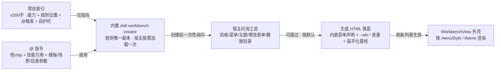

# 个人工作台 v2 · 增量 PRD

> **类型**：简单增量 PRD｜**输入对象**：架构师（直接转任务列表）｜**状态**：6 个设计问题均给出推荐默认，**按默认推进、不阻塞**。
> **范围**：仅本轮 4 条需求，不重述 v1 已交付能力（面板第 4 大块、侧栏入口、`@` 模板源、4 个只读/数据路由、iframe 桥、CSV/CAS 契约）。实现层契约以 `docs/workbench-design.md` 为准；本文只定产品口径与验收判据。
> **基线**：v1 全绿（882 PASS / 0 FAIL）。本轮为增量，**不推翻 v1、不做竞品/市场分析**。

---

## 0. 项目信息

| 项 | 内容 |
| --- | --- |
| Language | 中文（与用户一致） |
| Programming Language | 沿用现有插件：Node.js `lib/index.js` + 单文件前端 `lib/client.js`（`window.__ModuleLoader__`、`React.createElement`，仅 `useState/useEffect/useRef/useCallback`）；**零 npm 依赖、零构建链、浏览器端不引入 node 内置模块**。默认 Vite+React+MUI+Tailwind 模板不适用本插件 |
| Project Name | `dsh_buddy_expert_hub_workbench_v2` |
| 交付物 | 本文档。本阶段**只新建 `docs/workbench-v2-prd.md`**，不改代码/其它文档/`package.json`/`_harness/`，不 git commit |

**原始需求（逐字）**

1. 在使用对话框创建个人工作台的时候，插件工作台（plugin workbench）机制要插入到上下文中，不能每次都在生成工作台的时候进行解析规则，使用@调用工作台的时候，提示词不要展示到对话框里面
2. 工作台的自己的配置要单独出来，不要和之前的专家配置合在一起
3. 创建一个内置skills，让创建工作台的时候可以调用这个skills，将创建方法步骤、注意的点都写在里面，开始创建的时候要进行思考问一下用户喜欢什么样的工作台风格，增改表单如何设置等，UI要美观，扁平化
4. 工作台展示的时候菜单风格要多提供几种，供用户选择，树形菜单，面包屑等，UI整体风格也要多提供一些

---

## 1. 产品目标（3 个正交目标）

| # | 目标 | 可度量判据 |
| --- | --- | --- |
| G1 | **规则只存一份、按需加载** | 生成工作台时宿主不再每次解析/内联规则；对话框零规则文本；同一会话创建多个工作台只加载 1 次 skill |
| G2 | **工作台配置与专家配置解耦** | 独立设置入口 + 独立端点 + 独立存储；旧 `state.json` 零迁移、冷启动不丢配置 |
| G3 | **创建体验可挑选、页面美观扁平** | 创建前 1 轮偏好询问且可跳过；4 种菜单风格 × 4 种 UI 风格可切；生成页面满足 §3.4 扁平化规范自检 |

---

## 2. 用户故事

| 编号 | 场景 |
| --- | --- |
| US-1 | As 想用一句话建工作台的用户, I want 打 `@` 选模板后对话框只显示一个短 chip、看不到任何提示词/规则文本, so that 对话干净，且我还能补一句场景描述或带一个数据目录 |
| US-2 | As 要调整工作台设置的用户, I want 从工作台视图直接打开独立设置（数据目录 / 同步间隔 / 菜单风格 / UI 风格）, so that 不用在专家设置里翻找、改完重启仍生效 |
| US-3 | As 第一次建工作台的用户, I want 开始前被问一次喜欢什么风格、增改表单怎么设, so that 拿到的页面美观扁平、不用返工；不想选就跳过按默认走 |
| US-4 | As 已有多个工作台的用户, I want 在设置里切树形 / 面包屑等菜单风格和整体 UI 风格（也可让某个工作台单独覆盖）, so that 按自己的习惯看数据 |

---

## 3. 六个设计问题 · 推荐默认（全部「按默认推进、不阻塞」）

| 编号 | 歧义点 | 推荐默认 | 若改选的影响 |
| --- | --- | --- | --- |
| **Q-A** | 常驻上下文的**内容边界与时机**：精简索引还是完整规则？所有会话常驻还是仅工作台会话？ | **精简索引 + 所有会话常驻**：一段 ≤200 字 / ≤8 行的 systemPrompt 独立区块，只含 ① 有「个人工作台」能力及一句话用途；② 完整规则在内置 skill `workbench-creator`、何时读；③ `@` 触发方式与「发送时不展示规则」；④ 护栏「仅当用户要求创建/修改工作台或输入 `@` 工作台指令时执行，其它对话完全忽略本区块」。**不含**菜单声明 schema、CSV/HTML 路径、`window.Workbench` API、CAS/409、刷新列表说明。选「所有会话」而非「仅工作台会话」：后者需要预判意图、反而要解析用户消息；避免污染靠「极短 + 自护栏」，不靠动态注入。硬约束「不能每次生成都解析规则」由此满足 | 改完整规则：违背硬约束并污染无关对话；改「仅工作台会话」：需意图预判，回归面明显变大 |
| **Q-B** | `@` 静默后**对话框里呈现什么**：短 chip / 一句技能调用指令 / 完全不插入只加载 skill？ | **短 chip + 一句技能引用**：对话框显示结构化 chip「个人工作台 · 读书记录」（沿用 v1 `appearance:"session"`）；`codec.serialize` 由「一大段中文任务提示语」改为 ≤120 字的宿主技能引用 + 模板参数（如 `/workbench-creator 读书记录`，沿用 v1 技能引用语义）。**规则文本绝不出现在对话框**：菜单声明 JSON、`<script`、`window.Workbench`、CSV/HTML 落盘路径、409、刷新列表说明全部移入 skill。用户仍能表达场景：chip 后继续输入自然语言；数据目录：`@` 后带绝对路径仍解析、发送前仍自动 `POST /settings` 同步，同步结果改 **toast** 提示（不再写进提示语），失败仍回退当前设置目录且不让发送失败 | 改「完全不插入」：用户看不到选了什么、无法补场景；改「无 chip 的纯指令」：丢失结构化参数与可编辑性；任何方案都不得把规则文本塞回对话框 |
| **Q-C** | 配置分层范围：仅 UI 分离，还是接口 + 存储也分离？旧 `state.json` 字段如何兼容？独立设置里有哪些项？ | **UI + 接口 + 存储三层都分离，存量零迁移**：① UI 新建独立「工作台设置」（`WorkbenchView.onOpenSettings` 直达），专家 `SettingsDialog` 移除工作台分区；② 新增 `GET/POST /workbench/settings` 专用端点，`/settings` 保留旧字段读写以不回退 v1 与既有断言；③ 新增 `state.settings.workbench` 对象为新字段权威，旧扁平字段 `workbenchDataDir` / `syncIntervalMs` **保留为镜像、不删除、不写迁移脚本**，冷启动新对象缺失时由旧值回填一次，`restoreState()` 白名单须显式加分支。独立设置项：数据目录、同步间隔（500–60000，默认 2000）、**菜单风格（全局默认）**、**UI 风格（全局默认）**、「打开 HTML 目录」、创建能力状态（见 Q-D） | 改「仅 UI 分离」：用户第 2 条只做一半；改「删旧字段」：老 `state.json` 与 `_harness` 源码串断言断裂 |
| **Q-D** | 常驻上下文 / `@` 指令 / 内置 skill **三者职责**如何划分，避免规则重复三份 | **常驻 = 索引，`@` = 参数，skill = 正文（唯一权威）**：索引只做能力发现 + 路由（≤200 字、零规则细节）；`@` 只采集意图与参数（模板、场景、数据目录覆盖）、产出短 chip + 技能引用（零规则文本）；内置 skill `workbench-creator` 承载创建方法步骤、注意点、菜单声明 schema、CSV/HTML 落盘、桥 API、CAS/409、刷新列表、扁平化 UI 规范、创建前偏好询问——**规则正文只此一份**，宿主按需加载，一次会话多次创建也只加载一次。**前置条件（默认）**：新 skill 随包发布在 `builtin/<platform>/skills/workbench-creator/`；因 `builtinSkills` 总开关默认 false，不能依赖用户手动开启，默认由插件**幂等地单独常驻安装这一个 skill**（不受总开关关闭清理），独立设置显示「已就绪」；若宿主不允许，回退为独立设置「一键启用」+ `@` 时中文引导，**绝不因此把规则正文塞回对话框** | 规则写三份：改一处要同步三处，必然漂移；不做常驻安装：总开关没开时打 `@` 拿不到任何规则，生成的工作台直接坏 |
| **Q-E** | 菜单风格与 UI 主题**清单**、谁来选择 | **菜单风格 4 种（含树形、面包屑）+ UI 风格 4 种（扁平化为主）**；**全局默认在独立设置里选 + 单个 HTML 菜单声明可选覆盖**，优先级 单页 > 全局 > 内置默认；覆盖字段为菜单声明新增**可选**字段 `menuStyle` / `theme`，旧 HTML 缺失即回落、白名单校验兼容、不改 CSV/桥契约。清单见 §3.2 | 只给 2 种：不满足「多提供几种」；只做全局或只做单页：前者无法个性化、后者每次生成都要写声明 |
| **Q-F** | 创建前**偏好询问**问什么、选项与跳过默认；「UI 美观、扁平化」如何落成可执行规范 | skill 开始时用宿主 `ask_user_question` 工具**一次性问 5 个问题**（最多 1 轮、不追问），跳过 / 超时 / 工具不可用一律按默认推进、不阻塞；工具不可用时退化为一条自然语言一次性提问。问题与选项见 §3.3，扁平化规范见 §3.4（写进 skill，生成 HTML 时逐条自检） | 不问就生成：违背用户第 3 条；多轮追问：打断创建；只写「要美观」不给数值规范：架构师与 QA 无法验收 |

> 以上 6 项均**按默认推进、不阻塞**；若主理人改选，只需调整对应 WV2 条目的验收判据，不改其它结论。

### 3.1 三者职责与创建链路（Mermaid）

### 3.2 菜单风格 / UI 风格清单（Q-E）

| 层 | 取值 | 说明 | 默认 |
| --- | --- | --- | --- |
| 菜单风格（插件外壳渲染：一级工作台列表 + 二级 `menu[]`） | `tabs` | 横向标签，v1 现状，零回归 | ✅ 全局默认 |
| | `tree` | **树形菜单**（用户点名）：一级可折叠、二级缩进、选中高亮 | |
| | `breadcrumb` | **面包屑**（用户点名）：顶部路径「工作台 / 菜单项」+ 可点击回退 | |
| | `sidebar` | 侧栏：左侧固定窄栏两级，右侧全宽 iframe | |
| UI 风格（整体，扁平化为主） | `flat-light` | 扁平浅色：无渐变、无拟物阴影、单层浅阴影 | ✅ 全局默认 |
| | `flat-dark` | 扁平深色 | |
| | `soft` | 柔和圆角：低饱和 + 单层浅阴影 | |
| | `compact` | 紧凑高密度：间距/控件高度 -25% | |

- **谁来选择**：全局默认在独立工作台设置（`workbench.menuStyle` / `workbench.theme`）；单个 HTML 菜单声明里用同名字段可选覆盖。推荐「全局为主、单页覆盖为辅」，不新增第二套配置体系。
- **主题落地**：插件外壳与 iframe 页面**共用一组 `--wb-*` CSS 变量**。iframe 是 opaque origin sandbox（`allow-scripts`、无 `allow-same-origin`），父组件读不到 `contentDocument`、也不可改 src 带参数（会重载 iframe 丢表单），故**不能由父组件注入**；默认由**后端 `/workbench/html` 在返回 HTML 的 `<head>` 注入一段常驻主题脚本**，按「单页 `theme` > 全局 `wb.theme` > `flat-light`」设定 `--wb-*`。切主题时父组件复用既有 `push` 消息附带可选 `wbTheme`，iframe 内脚本即时重设变量 → **页面也即时生效，且不重载 iframe、不丢正在编辑的表单**；不新增桥 kind、不改 `__wb:1` / `BRIDGE_SOURCE` 字节、HTML 文件字节不变。HTML 内只用变量且自带 fallback（保证脱离插件独立打开也好看）。
- **向后兼容**：`menuStyle` / `theme` 是菜单声明的**可选**字段，`GET /workbench/list` 白名单校验须忽略未知/缺失值，v1 示例 HTML 不产生 `errors[]`。

### 3.3 创建前偏好询问（Q-F）

| # | 问题 | 选项 | 跳过默认 | 备注 |
| --- | --- | --- | --- | --- |
| 1 | 工作台形态 / 用途 | 记录台账（表格为主） / 看板（卡片分栏） / 表单驱动 / 统计仪表盘 | 记录台账 | 决定字段与页面布局 |
| 2 | 菜单风格 | 跟随全局 / 横向标签 / 树形 / 面包屑 / 侧栏 | 跟随全局 | 选中项写入菜单声明 `menuStyle` |
| 3 | UI 风格 | 跟随全局 / 扁平浅色 / 扁平深色 / 柔和 / 紧凑 | 跟随全局 | 选中项写入菜单声明 `theme` |
| 4 | 增改表单如何设置 | 弹窗表单 / 行内编辑 / 顶部常驻表单 / 抽屉表单 | 弹窗表单 | 同轮另问「字段是否按模板预置」→ 默认预置、允许增删 |
| 5 | 数据目录 | 沿用全局设置 / 自定义绝对路径 | 沿用全局 | `@` 已带路径则跳过此问 |
| 6（P1） | 是否需要统计 / 图表区 | 要 / 不要 | 不要 | 不阻塞 P0 |

**规则**：一次问完、最多 1 轮、不追问；跳过 / 超时 / 工具不可用 → 全部按默认继续创建，不中断、不报错。`ask_user_question` 的确切名称与入参以宿主实机为准（本仓库无该字符串，见 §8 U2）。

### 3.4 扁平化 UI 规范（写进 skill，生成 HTML 时逐条自检）

| 维度 | 可测规范 |
| --- | --- |
| 配色 | 单主色 + 中性灰阶，≤1 个强调色；**禁渐变 / 拟物 / 纹理 / 图片背景**；阴影最多一层 `0 1px 2px rgba(0,0,0,.06)`；示例值 背景 `#F7F8FA` / 卡片 `#FFFFFF` / 主文字 `#1F2329` / 次文字 `#646A73` / 主色 `#2B5AED`（按 `theme` 变量覆盖） |
| 间距 | 4px 基数栅格（4/8/12/16/24/32）；卡片内边距 16–24；区块间距 24；控件高 32 / 40 |
| 字号 | 基准 14px，标题仅 18 / 20 / 24 三级，行高 1.5，字重仅 400 / 500 / 600，中文系统字体栈优先 |
| 控件形态 | 圆角 4–8px 全局统一；按钮仅「主（实心）/ 次（描边）/ 文字」三种；无 3D 凸起、无内阴影；输入框 1px 描边 + focus 主色 ring |
| 表单布局 | 单列优先、标签在上、一行 ≤2 字段；必填 `*` 标注；校验错误就地红字提示、不弹 `alert`；主操作按钮右对齐 |
| 空态 | 图标 + 一句说明 + 一个主操作（「添加第一条记录」），无数据时表格区不白屏 |
| 冲突态 | `window.Workbench.onConflict` → 页面顶部**非阻断**横幅「数据表已在外部被修改，已重新加载」+「重试 / 放弃」，不打断正在输入的表单、**不静默覆盖** |
| 同步态 | 「已保存」「数据表已更新」轻提示，2s 自动消失，不弹模态 |
| 响应式 / 无障碍 | `min-width:0`、表格横向滚动、窄屏单列；`aria-label`、键盘可聚焦、文字对比度 ≥ 4.5:1 |
| 变量契约 | 页面只用 `--wb-*` 变量消费主题，插件按 theme 注入；变量缺失时 HTML 内自带 fallback 值 |

---

## 4. 需求池（WV2-01…16）

> P0 必须本次交付，P1 应交付，P2 可延后。每条验收判据均可测；横切回归单列 WV2-12。

| 编号 | 需求 | 优先级 | 验收判据 |
| --- | --- | --- | --- |
| WV2-01 | 工作台机制常驻上下文精简索引（Q-A） | P0 | 抓取 systemPrompt 区块：文本 ≤200 字、独立命名、含「规则在 skill / `@` 触发 / 其它对话忽略」三要素；区块内**不含** `workbench-menu`、`window.Workbench`、`.csv`、`409`、`刷新列表` 等规则关键词；无关对话不产生任何工作台动作 |
| WV2-02 | `@` 指令静默化（Q-B） | P0 | `codec.serialize` 返回值 ≤120 字且为技能引用 + 模板参数；用户消息里搜不到菜单声明 JSON、`<script`、`window.Workbench`、CSV/HTML 落盘路径、`409`、刷新列表说明；对话框可见 1 个短 chip；`@` 菜单仍只有 5 个模板、无专家/技能/连接器候选；`/` 技能源注册与行为不变 |
| WV2-03 | `@` 场景表达与数据目录覆盖保留（Q-B） | P0 | chip 后可继续输入自然语言并随消息送达；`@读书 D:\我的数据\workbench-data` 仍解析并在发送前自动 `POST /settings` 同步；同步成功 / 失败用 toast 反馈，失败时回退当前设置目录且消息可正常发送、不静默写错位置 |
| WV2-04 | 内置 skill `workbench-creator`（Q-D / Q-F） | P0 | `builtin/windows/skills/workbench-creator/SKILL.md` 与 `builtin/linux/skills/workbench-creator/SKILL.md` 各存在一份（YAML frontmatter 含 `name` / `description` / `category` / `tags` / `user-invocable` / `disable-model-invocation`）；正文含创建步骤、注意点、菜单声明 schema、CSV/HTML 落盘、桥 API、CAS/409、刷新列表、§3.3 询问、§3.4 规范；规则正文只此一份；`files` 覆盖 + `scripts/check-package.mjs` + `npm run check` 通过 |
| WV2-05 | 创建前一次性偏好询问（Q-F） | P0 | 触发创建流程时恰好 1 轮问询、覆盖 §3.3 的 5 个问题；跳过 / 超时按默认生成且无报错；问询工具不可用时退化为一条自然语言一次性提问且不中断；不追问 |
| WV2-06 | 创建时 skill 可用（Q-D 前置条件） | P0 | `builtinSkills` 总开关关闭状态下，打 `@` 仍能生成工作台（skill 已常驻可用）或给出「一键启用」明确引导；**关闭再开启总开关后该 skill 仍可用**（不被内置技能清理逻辑删除，不出现「第一次能用、关一次开关就坏」）；**两种情况都不把规则正文塞回对话框**；独立设置显示创建能力状态 |
| WV2-07 | 独立工作台设置 UI（Q-C） | P0 | 工作台视图「设置」直达独立弹窗；专家 `SettingsDialog` 内不再有任何工作台字段；独立设置含数据目录、同步间隔、菜单风格、UI 风格 4 项 + 打开 HTML 目录 + 创建能力状态；4 项保存后重启仍在 |
| WV2-08 | 配置接口与存储分层 + 向后兼容（Q-C） | P0 | 新增 `GET/POST /workbench/settings` 与 `state.settings.workbench`；带旧扁平字段的老 `state.json` 冷启动后目录 / 间隔不丢；新对象与旧字段镜像一致；`POST /settings` 带旧字段仍生效、现有校验顺序不回退；不删旧字段、不写迁移脚本 |
| WV2-09 | 菜单风格 4 种（Q-E） | P0 | `tabs` / `tree` / `breadcrumb` / `sidebar` 均从同一份 `menu[]` 渲染；点击菜单项仍能定位 `view`；默认 `tabs` 与 v1 观感一致；切换即时生效、不重载 iframe 数据 |
| WV2-10 | UI 风格 4 种 + CSS 变量契约（Q-E） | P0 | `flat-light` / `flat-dark` / `soft` / `compact` 切换后外壳按钮 / 卡片 / 文字色随之变化且 iframe 内页面 `--wb-*` 同步更新（后端注入的常驻主题脚本 + 复用既有 `push` 载荷，不新增桥 kind）；不刷新页面、不重载 iframe、不丢正在编辑的表单；页面脱离插件独立打开时 fallback 生效 |
| WV2-11 | 单 HTML 可选覆盖（Q-E） | P0 | 菜单声明带 `menuStyle` / `theme` 时按覆盖渲染；不带字段的 v1 示例 HTML 按全局渲染且 `GET /workbench/list` 不产生 `errors[]`；优先级 单页 > 全局 > 内置默认 |
| WV2-12 | 扁平化 UI 规范落地（Q-F） | P0 | 新建工作台 HTML 逐条满足 §3.4：无渐变 / 拟物阴影；空态有 1 个主操作；冲突态为非阻断横幅且含「重试 / 放弃」；表单校验就地提示；对比度 ≥4.5:1 |
| WV2-13 | 硬约束与回归（横切） | P0 | `npm run check` + 全量 harness 通过；`@` / `/` 互不干扰且 `@` 不塞资源候选；插件无 HTML 写接口；CSV / `sha256` hash / CAS + 409 / `__wb:1` 桥协议字节级不变；旧 `state.json` 与 v1 示例 HTML 全链路通过；**需同步既有 `_harness` 源码串断言**（配置分离会打破 `dshe-settings-wb-*` 等断言，由 QA 阶段同步，本文不列行号）；所有文件 LF、无 git commit |
| WV2-14 | 设置内风格 / 主题缩略预览 | P1 | 独立设置里 4 种菜单风格与 4 种 UI 风格各有纯 CSS 缩略预览，且与生效样式一致 |
| WV2-15 | 偏好记忆 | P1 | 第二次创建时问询默认值 = 上次选择（存 `workbench.lastPrefs`），仍可改；不影响跳过默认 |
| WV2-16 | 自定义主题色 / 圆角 + 按工作台持久化覆盖 | P2 | 独立设置可改主色与圆角并映射到 `--wb-*`；按工作台 id 在插件侧覆盖风格且重启仍生效，**HTML 文件字节不变** |

---

## 5. UI / 交互设计稿

| 区域 | 设计 |
| --- | --- |
| 对话框 `@` | 输入 `@` → 仍只有「个人工作台」分组的 5 个模板；选中 → 插入短 chip「个人工作台 · 读书记录」；发送后用户消息仅 chip + 一句技能引用；目录同步结果用 toast；用户可在 chip 后补自然语言场景或 `@` 后带绝对路径 |
| 独立「工作台设置」 | 从 `WorkbenchView` 工具栏「设置」直达，**不与专家设置共用弹窗**。分区：① 数据（目录 + 可读写状态 + 同步间隔 + 打开 HTML 目录）；② 外观（菜单风格 4 选 1、UI 风格 4 选 1，P1 带缩略预览）；③ 能力（创建 skill 状态 + 一键启用） |
| 工作台外壳 | 4 种菜单风格共用同一 `menu[]` 数据源；点击菜单项仍发 `view` 定位消息；切风格即时生效、不重载 iframe 数据；顶部工具条沿用 v1（刷新列表 / 最后同步时间 / 数据目录） |
| 主题 | 外壳与 iframe 页面共用 `--wb-*`；由后端 `/workbench/html` 注入的常驻主题脚本设值，切主题时复用既有 `push` 带可选 `wbTheme` 即时重设，**iframe 内页面也即时生效**；不刷新页面、不重载 iframe、不丢正在编辑的表单、不改桥协议 |
| iframe 页面 | 由 skill 生成，满足 §3.4；内嵌菜单声明 + `--wb-*` 变量与 fallback；只用注入的 `window.Workbench` 桥读写；iframe 仍 `sandbox="allow-scripts"` 且不给 `allow-same-origin` |
| 空态 / 错误态 | 沿用 v1（无工作台、数据目录未配置、菜单声明非法降级、409 冲突）；**新增「创建能力未就绪」**一项，给「一键启用」可操作下一步，不静默失败、不白屏 |

---

## 6. 硬约束（不可协商）

| 约束 | 口径 |
| --- | --- |
| 零 npm 依赖 | 不新增任何依赖 / 前端框架 / 构建链 / 前端文件；`lib/client.js` 保持单文件 `window.__ModuleLoader__`，仅用 `useState/useEffect/useRef/useCallback` + `React.createElement`；浏览器端**不引入 `node:path` 等 node 内置模块** |
| `@` 与 `/` 互不干扰 | 两个触发源各自独立 `ctx.effect` 注册，一个失败不影响另一个；`@` 只承载工作台模板，**绝不塞专家 / 专家团 / 技能 / 连接器候选**；`/` 仍是技能指令源；`@` 序列化产出的技能引用文本不影响 `/` 触发源注册 |
| 插件仍不写 HTML | 不新增 / 修改 / 删除 HTML 的路由；HTML 由 dsh agent 落盘到固定目录，落盘后点「刷新列表」即生效，无需重启宿主进程 |
| CSV / hash / CAS 契约不变 | 表头与 `_id`、UTF-8（剥 BOM、沿用首次 CRLF/LF）、`sha256(原始字节)` hash、乐观并发 CAS + 409 + `current`、按字段名对齐列的合并写、`tmp→rename` 原子写、进程内串行队列、`__wb:1` 五类桥消息、`sandbox="allow-scripts"` 一律不改 |
| 向后兼容 | 已有 `state.json`（旧扁平字段）、已生成工作台 HTML（旧菜单声明）、v1 示例 `docs/workbench-example.html` 全部照常工作；菜单声明新增字段必须**可选**、白名单校验忽略未知值；`/settings` 旧行为不回退 |
| 不改宿主 | 不新增 `slots.register`、不动 `main` keyed 槽、不改 `builtinPlatform()`、不改宿主配置与 `/` 技能源 |
| 行尾与版本控制 | 所有新增 / 修改文件保持 **LF** 行尾；**不执行 git commit** |
| 断言同步 | 配置分离会打破既有 `_harness` 源码串断言（工作台字段相关），**需同步既有断言**，不列具体行号；其余断言保持不变 |

---

## 7. 明确不做（Out of Scope）

1. 不新增 HTML 写接口 / 上传编辑 HTML 的界面（HTML 一律 agent 落盘，插件只读）。
2. 不做云端存储、跨设备同步、多用户实时协同、账号 / 权限 / 服务端。
3. 不改 CSV 契约、不改 `window.Workbench` 桥协议、不改 iframe sandbox 安全边界。
4. 不做运行时可视化配置器 / 拖拽建表 / 运行时字段编辑器；扩展仍走「agent 重新生成 HTML」。
5. 不做竞品 / 市场分析，不输出竞争象限图（本轮为简单增量 PRD）。
6. 不迁移 / 删除旧 `state.json` 字段，不改 v1 已生成 HTML 的既有格式（只加可选字段）。
7. 不改 `docs/workbench-design.md`、`docs/workbench-prd.md`、`README.md`、`docs/user-guide.md`（文档同步由后续阶段统一处理）。
8. 不新增 npm 依赖、不新增前端文件、不改 `package.json` 的 `exports`、不改 `cordis.patch.yml`。
9. 本阶段不改任何代码 / 配置 / 测试文件，不跑测试，不 git commit。

---

## 8. 待确认 / 运行时不可证项（不阻塞，均给默认与回退）

| 编号 | 项 | 默认 | 回退 |
| --- | --- | --- | --- |
| U1 | 宿主是否提供「所有会话共享」的 systemPrompt 注入点 | 复用 `registerPromptSection` 思路做全局常驻索引 | v1 只在 attach 专家/连接器时拿到 agent；若拿不到全局注入点 → **每会话首条消息前注入一次索引**（仍不解析规则），并依赖区块自护栏避免污染 |
| U2 | 宿主 `ask_user_question` 工具的确切名称与入参 | 按宿主实机为准（本仓库无该字符串） | 工具不可用 → 一条自然语言一次性提问，跳过即按默认，不中断 |
| U3 | 宿主是否允许插件在 `builtinSkills` 总开关之外常驻安装单个 skill | 幂等单独安装 `workbench-creator` + 独立设置显示状态 | 不允许 → 独立设置「一键启用」+ `@` 中文引导，**绝不回塞规则文本** |
| U4 | 主题 CSS 变量跨 opaque-origin iframe 的注入方式 | 后端 `/workbench/html` 注入常驻主题脚本 + 复用既有 `push` 带可选 `wbTheme` 即时重设 `--wb-*`，HTML 自带 fallback | 注入被 CSP 拦 / QA 判定 `push` 载荷扩展不合口径 → 页面用自身 fallback、外壳主题仍即时生效，不改产品口径、不回塞规则文本 |
| U5 | 既有 `_harness` 源码串断言 | 配置分离会打破工作台字段相关断言，**需同步既有断言**（QA 阶段处理） | 不做兼容镜像 → 旧 `state.json` 冷启动丢配置，不可接受 |

---

## 9. 协作提示

- 需求池按 **「常驻索引 / `@` 静默 + 内置 skill / 配置分层 / 风格主题 / 横切回归」** 六组拆分即可直接转任务列表；P0 为 WV2-01…13。
- 架构师重点先确认 U1 / U2 / U3 三个宿主侧不可证项，其余按默认推进。U1 的回退路径已实证：复用 `ctx.on('agent/created', …)` + `WeakSet<agent>` 去重注入索引；U4 的落地方式以 `docs/workbench-v2-design.md` 定稿为准（**后端注入**，父组件无法注入 opaque-origin iframe）。
- 本轮唯一落盘产物为本文档；所有新增 / 修改文件保持 **LF** 行尾。
