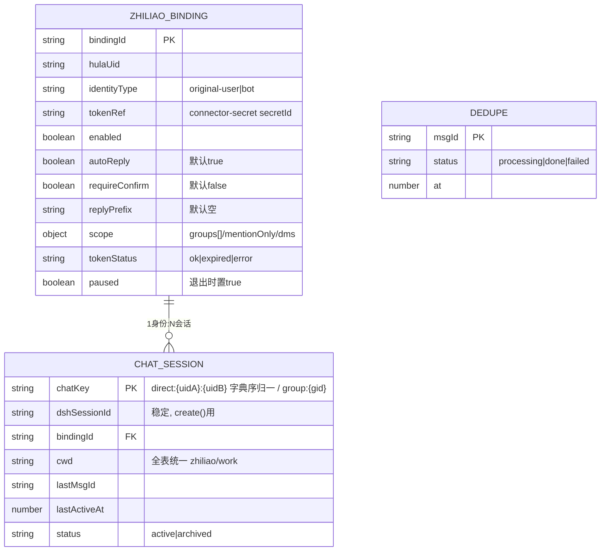

# 智聊（ZhiLiao）方案 v5 · 适配层

> 状态：**v4 阶段 0–3 已完成；v5 新增独立适配层（2026-11-26）**——不再写死 HuLa，任意聊天工具实现固定接口即可接入，权限在适配层
> 更新时间：2026-11-26
> 继续约定：接入新聊天工具只需在 `zhiliao-adapter/config.json` 登记 adapter，**插件侧零改动**
> 本文件是权威方案，改动前先读它。环境/API 证据索引见第 9 节；适配层见第 10 节。

---

## 0. 一句话

dsh-desktop 常驻 + 插件注入 `ctx.sessionController`，HuLa Server Webhook 秒级推送消息给插件，插件用 `create → prompt → follow` 驱动指定 dsh 会话跑一轮并取回回复，再以绑定身份回投；一个 HuLa 身份可绑多个 IM 会话，每个会话（私聊对 / 群）独立上下文。

---

## 1. 用户需求与已确认决策

### 1.1 原始需求
把 dsh 的一个/多个会话与 HuLa IM 的身份关联，用 dsh 会话代替该 IM 用户收发消息，随时处理别人发来的消息（含群聊 @）。

### 1.2 已拍板决策（不可随意推翻）

| # | 决策 | 值 |
|---|---|---|
| 1 | HuLa 部署 | 自建，**可改源码**（fork 维护） |
| 2 | 身份语义 | 一个 HuLa 身份（原用户或 bot）↔ 多个 IM 会话；**每个 IM 会话独立上下文，群算一个会话** |
| 3 | dsh 运行形态 | dsh-desktop 常驻 Web 服务 + 插件注入 `sessionController`；跨平台、零额外进程；1000 人靠池/队列/限流，不选独立 SDK 进程 |
| 4 | 群 @ | `{atList:[uid...]}` 命中绑定 uid 才触发（待真实群消息 JSON 校准） |
| 5 | 代发策略 | `autoReply` / `requireConfirm` / `replyPrefix` 由用户在智聊面板自配 |
| 6 | 并发规模 | 1000 绑定身份；峰值按 200 chatKey / 16 个执行中 turn 规划 |
| 7 | 退出语义 | 用户退出 dsh → AI 不接管（paused + 不补处理） |
| 8 | cwd | 全局固定 `<DSH_HOME>/dsh-buddy-expert-hub/zhiliao/work` |
| 9 | 确认提醒 | `requireConfirm=true` 时双通道提醒（notifySession + 面板待发 badge） |
| 10 | 回收（阶段 3 待选） | 默认 (a) 插件自持 AgentHandle 验证 → (b) 定期重启兜底；(c) 加宿主 `session/dispose`（+1 人日）未选 |

---

## 2. 关键核实结论

### 2.1 宿主 API（已查实，源码路径见第 9 节）
- `ctx.sessionController.create({sessionId, cwd})` — 幂等，允许显式 sessionId。**Host 路径 prompt 不自动创建 session，必须先 create**。
- `ctx.sessionController.prompt({requestId, sessionId, mode:'queue', content}, signal)` → `{accepted:true}`；同 requestId 幂等。
- `ctx.sessionController.follow({address:{kind:'session',sessionId},maxMessages,assistantStream}, signal)` — 流式取 `assistant/message` + `turn/end`；兜底 `page()`。
- `agents.get(id)` 返回裸 Agent，不能直接驱动执行；`session.status=idle|running` 可作并发信号。
- `conversation.input.for(actx)` 有 `submit()` 但需浏览器，主链路不用。

### 2.2 session 持久化（已查实启用）
- `desktop_web.patch.yml:31-33` 装配 `session-persistence-jsonl`，root = `dshHomePath('sessions')` = `~/.dsh/sessions/`（本机已有实际会话目录）。
- `DSH_RUNTIME_SESSION_ROOT` 只用于临时会话，不影响智聊长期会话。
- 结论：闲时释放 live agent 后，`prompt()` 会 `resume()` 从 JSONL 恢复，**上下文不丢**。

### 2.3 dispose 修正（v3 遗漏）
`sessionController` remote 方法全集无 dispose/evict/close，插件经它建的会话拿不到 AgentHandle。故：
- 阶段 0–2 不做主动 dispose（并发闸限 16 turn）
- 阶段 3 (a) 插件自己 `ctx.agents.create()` 持 handle 做闲时 dispose（技术验证点）；(b) 兜底靠 paused + 并发闸 + 每日低峰重启
- (c) 需放宽零宿主改造才可用

---

## 3. 架构

```mermaid
graph LR
  U[IM用户] -->|私聊/群@| HS[HuLa Server<br/>Webhook出站+回投API+paused接口]
  HS -->|HMAC webhook| P[dsh插件 /zhiliao/inbound]
  P --> D[验签+dedupe+@命中+映射表]
  D --> Q[分区串行队列 by chatKey]
  Q --> SC[ctx.sessionController<br/>create→prompt→follow]
  SC --> R[回复采集 assistant/message+turn/end]
  R --> CF{requireConfirm}
  CF -->|true| DR[待发草稿+notifySession提醒]
  CF -->|false| RP[回投器 replyPrefix]
  DR --> RP
  RP --> HS
  P -. tokenRef .-> SEC[connector-secret]
  UI[智聊面板] -. 配置 .-> P
```

---

## 4. 数据模型（两表 + dedupe）

落盘 `$DSH_HOME/dsh-buddy-expert-hub/zhiliao/{bindings,sessions,dedupe}.json`，复用 `restoreState()` + 原子写。



---

## 5. 接口契约

`POST /dsh-buddy-expert-hub/zhiliao/inbound`（本机来源，遵循 localRequestGuard）
```json
{"msgId":"hula-msg-1001","chatKey":"direct:uidA:uidB","sessionId":"zhiliao-...","text":"...","requestId":"hula-msg-1001"}
```
header `x-zhiliao-sign: <HMAC/测试token>`
回包 `{ok:true,msgId,sessionId,reply,turnEnd,dedupe:"first|duplicate"}`，失败 400 `{ok:false,error}`。

幂等：宿主 `requestId=msgId` + 插件 `DEDUPE[msgId]`（processing/done，崩溃遗留 >5min 重置重放）+ create 幂等。

**阶段 2 新增端点（均在本机来源防护之后）**

| 端点 | 方法 | 用途 |
|---|---|---|
| `/zhiliao/bindings` | GET | 绑定列表（`tokenRef` 只回引用，不回明文） |
| `/zhiliao/binding` | POST | 创建/更新绑定；`token` 写 `credentials.enc`，state 只留 `tokenRef` |
| `/zhiliao/binding?id=...` | DELETE | 删除绑定，关联 chat session 标 archived |
| `/zhiliao/pending` | GET | `requireConfirm` 待发草稿列表 |
| `/zhiliao/pending/send` | POST | 发送草稿 `{msgId}` → HuLa Server reply API |
| `/zhiliao/pending/discard` | POST | 丢弃草稿 `{msgId}` |
| `/zhiliao/status` | GET | `{enabled,bindingCount,chatSessionCount,pendingCount,qaMode}` |
| `/zhiliao/settings` | POST | `{webhookSecret,testMode,replyBaseUrl,enabled}`，测试模式兼容阶段 0 固定 token |

验签：默认 `HMAC-SHA256(rawBody, secret)`（secret 取面板配置，缺省 `zhiliao-dev-secret`），`timingSafeEqual` 恒定时间比对；只有面板显式打开 `testMode` 才认阶段 0 的 `zhiliao-test-token`。

绑定解析：`bindingId` 优先；否则私聊用 `from` 匹配 chatKey 另一端，群聊用 `atList` 命中 `hulaUid`/`botUid`；`mentionOnly!==false` 的群必须 @ 命中；`enabled=false` / `paused=true` / 未命中一律 `{ok:true,ignored}` 不跑 agent。

回投：`POST http://<replyBaseUrl>/zhiliao/internal/reply`，header `x-zhiliao-internal-secret`，body `{bindingId,identityType,roomId,text:replyPrefix+reply,replyToMsgId:msgId,requestId:msgId}`；失败标 dedupe failed 由服务端幂等重试。

**阶段 3 并发可靠性**

- `lib/zhiliao-queue.js`：分区串行队列。分区键 = `chatKey`，同 key 严格串行；区内按 payload `seq` 升序（同批同步入队先落位再排序）；全局并发闸 `queue.maxConcurrent`（默认 16）；每 key 上限 `queue.perKeyLimit`（默认 20）、全局上限 `queue.globalLimit`（默认 1000），超限 webhook 返回 **429 `{ok:false,error:'queue-full'}`** 由 HuLa 退避重试。任务 finally 释放槽位，异常不卡队列。注意 `perKeyLimit` 只约束**排队中**，不含在飞，所以「每 key 20」实际是 20 排队 + 1 执行。`close()` 会把残留排队任务交给 `onDiscard` 标 failed（让 HuLa 重试），不会静默丢弃；`drain()` 在关闭且空队列时立即返回。
- `lib/zhiliao.js` 的 `withZhiliaState(baseDir, mutator)` 是**状态写锁 + 进程内缓存**：promise 链保证同一时刻只有一个 mutator 改内存 state；退出后标 dirty，同一 tick 内合并成一次落盘；落盘失败保留 dirty 并告警。所有 `load→改→save` 都走它（turn 的 markDone/markFailed/会话更新、绑定/草稿、队列关闭记账）。**锁内禁止 await 网络/LLM**，只包内存改动；否则 16 并发 turn 会用陈旧快照互相覆盖（真机 20 并发曾丢 18 条账本）。`loadZhiliaState/saveZhiliaState` 旧签名保留。
- `/zhiliao/inbound` 默认改为**入队即 ACK**：`{ok:true,msgId,chatKey,queued:true,position}`；回复仍走独立回投。兼容分支：`testMode===true` 且 payload 带合法 `sessionId`（阶段 0 curl）仍同步返回 `reply/turnEnd/dedupe`。
- 崩溃重放：`apply()` 启动时 `resetStaleProcessing(state, 5min)`；单轮超时沿用 120s `follow` 硬超时，超时 `markFailed` 并释放槽位，不自动重试（HuLa 重试 + requestId 幂等兜底）。
- 退出 paused：`ctx.on('dispose')` 时对所有启用绑定 `POST /zhiliao/internal/binding/paused {paused:true}`，`Promise.allSettled` + 3s 总超时；启动 2s 后反向置 `paused:false` 恢复接管。内部密钥取 `zhiliao.internalSecret`（默认 `zhiliao-internal-dev-secret`）。
- 闲时回收 `lib/zhiliao-recycle.js`：默认关闭（`recycle.enabled=false`，`recycle.idleMinutes=30`）。因 `sessionController` 无 dispose、拿不到 AgentHandle，当前只会记 `recycle-skipped`；只有通过 `ctx.agents.create()` 创建并 `registerHandle()` 的会话才真正 `dispose()`。
- `GET /zhiliao/status` 增加 `queue{activeChatKeys,queued,inflight,maxConcurrent}`、`recycle{enabled,idleMinutes,recycled,recycleSkipped}`、`uptimeMs`。

---

## 6. 阶段 0 MVP（当前进行中）规格

改动：
- `lib/index.js:9601` `inject` 加 `'sessionController'`
- `lib/index.js` dispatch 加 `/zhiliao/inbound` POST 路由
- `lib/index.js` 新增 `handleZhiliaInbound()`、`ensureZhiliaoCwd()`
- `lib/zhiliao.js`（新建）三表 load/save、dedupe、chatKey→sessionId

调用顺序：`create({sessionId,cwd})` → `prompt({requestId:msgId,sessionId,mode:'queue',content})` → `follow()` 取 `assistant/message` + `turn/end`。

curl 测试：
```bash
curl -s -X POST "http://127.0.0.1:<PORT>/dsh-buddy-expert-hub/zhiliao/inbound" \
  -H 'content-type: application/json' -H 'x-zhiliao-sign: <token>' \
  -d '{"msgId":"hula-msg-1001","chatKey":"direct:uidA:uidB","sessionId":"zhiliao-test-001","text":"用一句话介绍你自己","requestId":"hula-msg-1001"}'
```

6 条验收：
1. 新 sessionId 首次 create 后 prompt 不再报 `session/not-found`
2. 同 sessionId 重复 create 幂等，无 `ApiSessionCwdConflict`
3. 指定会话出现这轮问答
4. follow()（或 page 兜底）拿到完整回复文本
5. 重复 msgId 重放 dedupe=duplicate，agent 只跑一次
6. 两个不同 sessionId 上下文隔离

---

## 7. 阶段 1–4 任务卡

| 阶段 | 目标 | 验收 | 仓 | 人日 |
|---|---|---|---|---|
| 1 HuLa Server ✅ | Webhook 出站（HMAC+白名单+3 次退避+死信）、两身份回投 API、binding paused 接口 | 两账号互发验签通过；两身份回投可见；paused 后不推 | HuLa-Server fork | 3–5 |
| 2 映射+面板 ✅ | 两表+dedupe 落 `lib/zhiliao.js`；智聊面板（绑定/策略/Token/待发/日志）；懒 create；群@命中 | 一身份 3 chatKey 得 3 独立上下文；@未命中不触发；Token 不明文 | 插件仓 | 5–7 |
| 3 并发可靠性 ✅ | 分区串行（按 seq，turn/end 释放）、全局闸 16、队列上限（20/1000，超 429）、退出 paused、崩溃重放、闲时回收（见 2.3）、账本写锁、单实例守卫 | 200 chatKey 压测无串线；退出即停；重启上下文不丢；20 并发账本不丢 | 插件仓 | 6–8 |
| 4 千人格度（代码加固 ✅ / 运维项待办） | 真实规模压测、限流调优、Token 过期演练、@ 用真实 JSON 校准、升级回归、**生产加固（见 7.3）** | 代码侧全绿；运维与真实规模项见 7.4 | 双方 | 3–5 |

合计 **18–27 人日**。

### 7.1 阶段 3 签收（2026-11-17，QA 限定回归 16/16 PASS）

被验代码 hash（**以后任何人改动下列文件，阶段 3 的"可交付"结论不自动成立，需重新回归**）。本表由 `sha256sum` + `wc -c` 实测生成；本文档自身不列入（改表即改 hash，永远对不上）：

| 文件 | sha256 前 12 位 | 字节 | 行数 |
|---|---|---|---|
| `lib/index.js` | `80fd3d2a93ad` | 461,371 | 10,901 |
| `lib/zhiliao.js` | `94d2d6eeb9a2` | 31,147 | 775 |
| `lib/zhiliao-queue.js` | `533566812412` | 8,114 | 215 |
| `lib/zhiliao-recycle.js` | `89e49cbbf442` | 5,607 | 145 |
| `lib/client.js` | `f4d4b9b22b58` | 781,442 | 14,220 |
| `package.json` | `069cfae472f3` | 2,213 | 61 |

> `lib/client.js` 确实被阶段 3 改过（账本落盘状态行、multiHost 横幅、`writePaused` 时禁用保存/删除/发送/丢弃 + 503 toast）——回滚或 cherry-pick 时不能按"未改动"处理。

覆盖边界（区分证据来源，勿混为一谈）：
- **QA 真机**：单宿主 / 双宿主（503 写闸、读 200、不落账、运行时抢锁接管）、429 背压、队列上限 1/20/1000、seq 乱序、退出 paused、账本并发完整性（N=10/20、同 chatKey 5 并发、重投幂等）
- **工程师自测（QA 采信机制未复跑）**：三宿主抢锁（A 死→B 放行→C 被 503）
- **仅静态/单测**：`lib/zhiliao-recycle.js`（回收三态 + dispose 抛错边界）、面板 UI（字段绑定与文案，未做浏览器点击）

**未覆盖**：1000 真实用户长期运行、单轮 turn >60s 的队列超时行为、`resetStaleProcessing` 5min 盲窗实际重放、面板 UI 真机点击、HuLa 重启后重复回投、HuLa 先于插件退出的场景。

### 7.2 阶段 4 待办（生产加固，按优先级）

1. **HuLa webhook 退避阻塞线程**（HIGH）：`ZhiliaoWebhookSender.deliver()` 用 `Thread.sleep` 退避，503/429 持续时会占满 webhook 线程池 → 线程饥饿，表现像丢消息。改法：`ScheduledExecutorService` 非阻塞重试 / 503+429 单独短重试上限 + 抖动 + 识别 `Retry-After` / 有界队列 + 明确拒绝策略 + 监控。插件侧可配合在 503 响应加 `Retry-After` 头（约 3 行）。
2. **HuLa 缺 `binding/unregister`**：只有 reply / binding/paused / binding/register，测试绑定会留在 HuLa 内存直到重启；清理脚本无法依赖该接口，需评估是否补。
3. **生产密钥与网络**：换掉默认 `zhiliao-dev-secret` / `zhiliao-internal-dev-secret`；IM 18778 监听 0.0.0.0 需网络 ACL；网关/Nacos 的 `/zhiliao/internal/**` ignore 同步（dev common.yml 已加，Nacos 未同步，网关仍 406）。
4. **规模与限流**：1000 绑定真实压测、并发闸/回收参数定值、模型配额与限流。
5. **Token 过期演练**：提前刷新、失败降级、面板 `tokenStatus` 提示。
6. **群 @ 真实样本校准**：拿到真实群消息 JSON 核对 `atUidList` 解析。
7. **面板 UI 真机点击验证**（阶段 0-3 只做静态核对 + 后端真机）。

其中 **1、2 已由阶段 4 代码加固完成**（见 7.3）；**5 完成检测+自动暂停+面板提示**（不自动刷新 Token）；3、4、6、7 属运维/环境项，留在 7.4。

### 7.3 阶段 4 代码加固签收（2026-11-17）

**插件仓**（QA6 Round 2 限定回归 **108/108 PASS**，bug 清单清空）。当前门禁 hash（实测全值前 12 位）：

| 文件 | sha256 前 12 位 | 说明 |
|---|---|---|
| `lib/index.js` | `02c8e5879d4f` | 阶段 4 多次加固后的最终版（阶段 3 是 `80fd3d2a93ad`） |
| `lib/client.js` | `6c9c29126440` | 阶段 4 加安全告警/过期 Token 提示（阶段 3 是 `f4d4b9b22b58`） |
| `lib/zhiliao.js` | `94d2d6eeb9a2` | 阶段 3 起未动 |
| `lib/zhiliao-queue.js` | `533566812412` | 阶段 3 起未动 |
| `lib/zhiliao-recycle.js` | `89e49cbbf442` | 阶段 3 起未动 |
| `package.json` | `069cfae472f3` | 未动 |

覆盖：默认密钥告警 / 密钥优先级 state>env>默认 / GET+POST settings 均不回明文 / Token 401/403/200+body 失效判定与自动暂停 / 重填恢复且手动停用不误恢复 / 500 不误伤 / 503+Retry-After=5 五写闸 / 同步兼容 / 429 / 20 并发账本 / requireConfirm / 单实例守卫。

**HuLa Server 仓**（QA5 独立验证，源码 bug 0）：`ZhiliaoWebhookSender` 非阻塞调度（`ScheduledThreadPoolExecutor` + Semaphore 有界，无 `Thread.sleep`）、Retry-After 识别与 30s 封顶、死信并发安全；新增 `POST /binding/unregister`（幂等、鉴权、审计）。编译 BUILD SUCCESS 24 模块。700+ 请求 harness：20 条提交 17ms、重试恰好 4 次、80/80 HMAC 匹配、无重复投递、饱和 100 条全部一次死信无泄漏。完整 daemon 真机 BLOCKED（基础设施未起），但真实 Controller + 内嵌 Tomcat 的真实 HTTP 验证通过。

**Cookie-Cutter 决策记录**：多实例 503 的 `Retry-After` 保持 **5**——HuLa `maxRetries=3` 共 4 次尝试，1s 的总窗口仅 3 秒，运维关掉多余宿主来不及，积压会误进死信（死信无自动重放）；5s 给 15 秒窗口。非阻塞改造已解决线程饥饿，不再靠缩短退避救线程。

### 7.4 仍未完成（需要环境或用户决策，不属代码缺陷）

1. **生产密钥与网络**（上线前必须）：换掉默认 `zhiliao-dev-secret` / `zhiliao-internal-dev-secret`（面板或 `DSH_ZHILIAO_*` 环境变量）；IM 18778 监听 0.0.0.0 加网络 ACL；网关/Nacos 同步 `/zhiliao/internal/**` ignore（dev common.yml 已加但 Nacos 未同步，网关实测仍 406，插件目前只能直连 IM 端口）。
2. **真实规模压测与调参**：1000 绑定真实环境压测，并发闸 16 / 闲时回收参数按模型配额定值；服务端非阻塞调度池参数（`scheduledPoolSize=2` / `queueCapacity=500`）压测校准。
3. ~~群 @ 真实样本校准~~ **✅ 2026-11-17 完成（真机，未改码）**：用有效登录 token 经网关发 5 条真实群消息，坐实 `im_message.extra.atUidList` 为驼峰键 + JSON 数字数组、webhook 出站 `atList` 为字符串数组（Long→String，只放命中绑定 uid 的项）、`chatKey:group:1` 与真实 im_room 一致、`resolveBinding` 命中 PASS（生产写入路径会归一 hulaUid 为字符串，无类型坑）、@所有人因服务端无 uid=0 不会产生。观察项：`scope.groups[]` 存了但未用于群过滤（改它会触及冻结的 `zhiliao.js`，需另行评估）。
4. **面板 UI 真机点击**：阶段 0-4 全部只做静态字段核对 + `node --check`，需要用浏览器/CDP 真点一次状态卡、绑定保存、待发发送。
5. ~~真实 HuLa 端到端补验~~ **✅ 2026-11-17 完成（最终 hash，全真机）**：18778 Java 服务 + MySQL 192.168.50.50 + 真 magpie LLM。真机证据：HMAC inbound→异步 ACK→真 LLM reply→`[ZHILIAO_AUDIT]` 日志 + `im_message` 落库（id 228834704255488 / 228835769608704）+ requireConfirm 草稿真发；绑定两端已清理。
6. **Token 语义 → 用户已选 B 方案，B1 已完成并验收**：
   - 真机证实阶段 4 的 401/403 来自 HuLa **共享密钥** `x-zhiliao-internal-secret`，不是用户 Token；用户Token 在旧回投路径从未使用。用户拍板 **B**：回投改用用户 Token 调官方 API 以原用户身份发消息 + 自动刷新。
   - **B1 MVP ✅（2026-11-17，QA7 新 hash 真机 E2E 三路径全 PASS，bug 0）**：`POST <网关>/im/chat/msg` + Header **`Token: <uuid>`**（无 Bearer），成功 msgId 在 **`data.message.id`**（兼容 `data.msgId`），错误是 HTTP 200 + `R.fail(code,msg)`（失效码 401/403/406/40001/40009）。有 token 的 original-user 走官方 API；bot/无 token 回落 internal reply；错 token 406 → token-expired 告警+草稿保留+无重试无落库。**active-timeout 实测远大于 1h**（64 分钟未活动 token 仍 200），排除 refresh 风暴。B1 hash：`index.js 24eae11ec8ed` / `client.js 59cd51a3cad1`，冻结三文件未动。
   - **B2/B4（未做）**：refresh 链路与服务端加固。⚠️ 官方 `RefreshTokenGranter.refresh()` 有致命副作用——一次性删 refreshToken + **全局删该用户所有 refreshToken** + kickout，会把真人 HuLa 客户端抹掉/踢下线。最小服务端改动 M1（按 device/clientId 限定删除）/ M2（跳过同 clientId 踢出）/ M4（refresh 结果补 uuid/expiration）+ Nacos ignore 同步；插件侧按 uid promise 单飞防并发刷新。面板需加 refreshToken 框，存储复用 `zhiliao.<id>.refreshToken` + `.tokenExpiresAt`（不碰冻结的 zhiliao.js 字段白名单）。
7. **真实 LLM 长 turn**：本机缺模型凭证，阶段 3/4 部分验证用 stub turn；单轮 >60s 的队列超时行为未覆盖。
8. **崩溃恢复盲窗**：SIGKILL/断电丢排队与在飞消息，靠 5min stale reset + HuLa 按 msgId 重试，最坏 5 分钟盲窗；`zhiliao-recycle.js` 只有单测，无真机。

### 7.5 绑定测试改用 account + internalBase 分流（2026-11-17，真机全 PASS）

**背景**：uid 用户看不到，用户只认 account（用户名/群账号）。绑定测试目标由 uid 改为 account，支持用户与群，群可 @ 指定账号。

**契约**
- `GET <internalBase>/zhiliao/internal/user/by-account?account=` → `data:{ok, uid, account, name, error}`；`not-found` 为 **HTTP200 + `data.ok=false`**（不是 404）
- `GET <internalBase>/zhiliao/internal/group/by-account?account=` → `data:{ok, roomId, account, name, error}`
- 用户命中 → 用 uid 查与小管家的单聊 roomId 发消息；群命中 → 直接用 roomId 发群消息；都不中 → `target-not-found`(400)
- 群 @：`body.atUidList` 必须是 **JSON 数字数组**（`List<Long>`）；只写文本 `@xxx` 不产生结构化 @
- 已知 account：`bot` → uid=1（HuLa小管家，注册时自动建好友）；`hula-ds240401` → roomId=1（HuLa官方频道）；`17149576795` → uid=228629435015680（冷血）

**internalBase 分流（部署必需）**：实测 18760 网关对 `/zhiliao/internal/**` 返回 **406**（Nacos ignore 未同步），而 `/im/chat/msg` 只在网关可用（18778 直连为 `/chat/msg`）。因此插件新增可选配置 `internalBaseUrl`：内部 API 用它，官方 API 仍用 `replyBaseUrl`。优先级 `settings > env DSH_ZHILIAO_INTERNAL_BASE > 默认 http://127.0.0.1:18778`。留空即默认 18778，**用户侧只需填 HuLa Server 地址 18760**。

**真机验收（QA9，hash `index.js 421897bddacf` / `client.js 3b3c44f933f2`，bug 0）**：默认体验（只填 18760）可用；`bot` 单聊落库 room 228624506708482；`hula-ds240401` 群落库 room_id=1；群 + `@17149576795` 落 `extra.atUidList=[228629435015680]`；不存在账号 target-not-found 且 DB 无新增；**反向对照**（internalBase 改错端口 → target-lookup-failed）证明分流真实生效；编辑保存/打开会话/串线/console 均未回退。

### 7.6 P0 修复：绑定必须注册到 HuLa + 群 @mention 清洗（2026-11-17）

**P0（已修）**：`/zhiliao/binding` 保存流程此前**从未调用** HuLa `POST /zhiliao/internal/binding/register`，而 `ZhiliaoWebhookListener` 首行是 `if (boundUids.isEmpty()) return;` —— 未注册 = 私聊与群消息**全部不推送**，智聊实际不工作。
- 修复：新增 `zhiliaoRegisterBinding` / `zhiliaoPersistBinding`（写 secrets + saveBinding + register）；新建/编辑保存都注册（编辑同步 enabled）；解绑调 `unregister`；**dry-run 绑定测试成功自动保存 + 注册**；register 失败返回 502 并在 UI 明示「本地已保存但未同步到 HuLa（未生效）」，不静默成功。
- 前端：卡片显示「绑定已保存并生效 / 测试通过但未生效」；未保存时禁用「打开与它的会话」；群目标文案改为「与 <account> 的群会话」。
- 真机（纯 UI，无手工 register）：只点「绑定测试」→ HuLa 日志 `运行态绑定已注册: bindingId=zhiliao-workspace`；解绑后 `绑定已注销 runtimeRemoved=true` 且 webhook 投递 0 次。

**群 @mention 清洗（已修）**：入站文本把 `@leng` 原样喂给 agent，导致回复「conversation 里没有名为 leng 的 agent / subagent "leng" is unavailable」。修复 `zhiliaoStripMentions(text, binding)`（`ZHILIAO_STRIP_MENTION=true`）三步归一：
1. `@<binding.displayName>` / `@<binding.account>` 整段删除（大小写不敏感、正则转义、边界要求）；
2. 其余 `@<token>` **去掉 `@` 只留文本**（`@冷血` → `冷血`），前缀要求行首/空白/括号，`a@b.com`、`你好@冷血`、`单价 @ 100` 不误伤；
3. 归一后剥除开头中英文标点（`@leng，你好` → `你好`），仍为空则返回占位「（对方 @ 了你，但没有输入正文内容）」。

**只影响送进 agent 的 promptText**；dedupe.reply / 回投内容 / 日志保留原文。单测 14 条覆盖主路径/纯 mention/多 @/邮箱/无空格/孤立 @/标点边界。

**端到端真机（Dawn=13275346112/uid 10937855681024，room 1 群主；hash `index f3f5e4e44b48` / `client 9df8b8d81b72`）**：Dawn 发 `@leng 智聊触发测试-final`（msgId 228967399455744，atUidList=[228624506708480]）→ HuLa 自动投递 webhook（日志 `webhook 投递成功 ... status=200`）→ 插件 dedupe done → **智聊回复以 leng 身份落群**（msgId 228967420427264，from_uid 228624506708480，内容自然回复）→ 防回环生效（回复未触发新 webhook）。全程未手工调 webhook/register。

**测试基建说明**：HuLa 的 `zhiliao.webhook.url` 固定 51044，隔离验证时用本地 TCP relay 51044→隔离插件端口接收真实 webhook，未改源码或配置。

---


## 8. 风险

1. 回收手段（阶段 3，见 2.3）——不阻塞阶段 0–2
2. dsh 内部 API 稳定性（Typert Remote）→ 能力探测与降级
3. 1000 会话内存 → 并发闸/回收参数需压测定值
4. 群=一上下文是用户选择，群内言论混杂 → 面板提示
5. @ 字段 `atList` 待真实消息校准
6. Token 加密、代发审计、replyPrefix 自配

---

## 9. 证据索引

**宿主 API**
- prompt 只 resume 不创建：`@deepseek-ai/dsh-api-session-controller/lib/index.js:736-741,206-240,391`
- create 幂等/显式 sessionId：同文件 `:249-271,408-450,571-599`
- prompt requestId 幂等：同文件 `:741`
- follow/SessionAddress：`types.d.ts:357-370`；`typert.remote-client.d.ts:35-54`（无 dispose）
- agents.get 裸 Agent：`dsh-agent/lib/types/index.d.ts:341`

**持久化**
- `server/src/engine/dsh_runtime/desktop_web.patch.yml:31-33`
- `dsh-base/cordis.patch.yml:110-113`
- `dsh-session-persistence/lib/types/index.d.ts:74-77`
- `dsh-session-persistence-jsonl/lib/types/index.d.ts:50-53`
- resume：`dsh-api-session-controller/lib/index.js:380-406`

**插件侧**
- inject/路由/落盘：`lib/index.js:9601,9014,9610`
- notifySession：`lib/client.js:12649`
- ingest 幂等范式：`lib/ingest.js:1-40`

**HuLa**
- 客户端 https://github.com/HuLaSpark/HuLa
- 服务端 https://github.com/HuLaSpark/HuLa-Server （自建，README 无官方 Bot/Webhook/OpenAPI，需自行加）

---

## 10. 适配层（v5，2026-11-26）

**背景**：v4 把插件直接焊在 HuLa Server 上（webhook 入站、internal 接口回投、hulaUid 绑定），换一家 IM 就得改插件。

**改为**：插件保持「HuLa 协议」，新增独立本地服务 `zhiliao-adapter/`（零依赖，Node ≥ 20）扮演 HuLa：

```
聊天工具 --POST /v1/inbound(HMAC)--> adapter --POST /zhiliao/inbound--> dsh 插件
聊天工具 <--POST callbackUrl-------- adapter <--POST /internal/reply---- 插件回投
```

- 聊天工具只实现两个固定接口：推消息（`/v1/inbound`）+ 收回复（配置里的 `callbackUrl`）。
  签名 `hex(hmac_sha256(secret, timestamp + '.' + rawBody))`，时间戳窗口 ±5 分钟。
- **权限全部在适配层**，顺序固定：adapter 开关 → 用户黑名单 → 用户白名单 → 会话黑名单 →
  会话白名单（支持 `direct:*` / `group:*` / `*` 通配）→ 群必须 @ → 文本长度。
- **纯通道**：不做限流、不做死信、不做重试（IM 平台自己有重试，再叠一层只会放大问题）。
- **附件**：入站支持 base64 图片/文件，落盘到插件会话工作目录下的 `inbox/<adapter>/<requestId>/`，
  转发时在文本末尾注入绝对路径清单，agent 用文件工具直接读；出站约定「正文里单独一行 `MEDIA:/绝对路径`」，
  适配层剥离该行并把文件以 base64 放进 `attachments` 回传（只允许 `attachments.dir` 与 `mediaRoots` 内的文件）。
- **主动推送** `POST /v1/push`：不经过 dsh，直接投递给聊天工具，可带附件；鉴权为 adminToken 或 adapter 签名，
  同样受 `chats.allow/deny` 约束。
- **会话人设** `/v1/persona`（POST/GET/DELETE）：按 `adapterId + chatKey` 存，下一条消息时在正文前注入一次，
  改过人设（version 变）会重注，`persona.alwaysInject` 可改成每轮都注入。
- 附带：messageId 24h 去重、审计 `runtime/audit.jsonl`、
  `requestId → adapter/chatKey` 与 personas 落 `runtime/state.json`（重启后回投仍能路由）。
- 拒绝返回 **200 + `accepted:false`**（避免 IM 把权限拒绝当故障重试）。
- 插件侧零改动：设置里 `replyBaseUrl` 指向 adapter，`internalSecret` / `webhookSecret` 两边一致即可。
- 验证：`cd zhiliao-adapter && node test/e2e.mjs` → **33 PASS**
  （转发 / 去重 / 白名单 / 群 @ / 超长 / 签名 / 时间戳 / 附件落盘与注入 / 人设注入与重注 / 回投 MEDIA 提取 /
  主动推送 / 推送附件 / 越权拒绝 / 管理接口）。
- 后续：附件可支持 URL 形式（不强制 base64）；多实例部署需要把去重窗口换共享存储。
